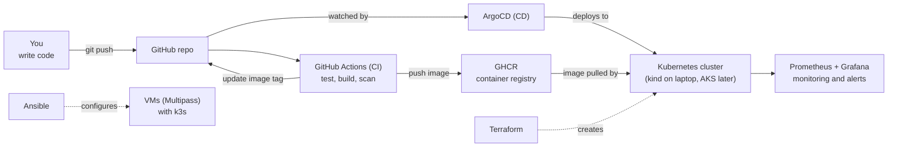

# DevOps Project: Learning Full DevOps From Zero (Free, Local-First)

[](https://github.com/valinfernanda/devops-project/actions/workflows/ci.yml)
[](https://github.com/valinfernanda/devops-project/actions/workflows/codeql.yml)

This project is built **one step at a time**. Every phase has its own guide in [`docs/`](docs/).
Each guide is written so you can **redo everything on your own** and understand *why* each step exists,
not just *what* to type.

## 📖 How to study this repo on your own

Everything we did is written down: concepts, every command, every click on GitHub, and every mistake
we made along the way. Suggested order:

| # | Read | Why |
|---|---|---|
| 1 | [docs/glossary.md](docs/glossary.md) | Keep it open in a second tab: every technical word, in plain English |
| 2 | [docs/git-github-basics.md](docs/git-github-basics.md) | Git, branches, pull requests, merging, from zero (+ 4 practice exercises) |
| 2b | [docs/github-handbook.md](docs/github-handbook.md) | Real outputs (fetch vs pull, conflicts, undo…), every GitHub feature, programmer + DevOps cases |
| 3 | [docs/00-setup.md](docs/00-setup.md) | Phase 0: prepare the laptop |
| 4 | [docs/01-app-docker.md](docs/01-app-docker.md) | Phase 1: the app, Docker, Compose |
| 5 | [docs/02-ci.md](docs/02-ci.md) | Phase 2: CI, security scans, branch protection, PR workflow |
| ➕ | [docs/faq.md](docs/faq.md) | Every question asked along the way (Azure or not? what is kind? who owns the DB? …) |

**How to use each guide:**
1. Read a step's 🎯 Objective and 📚 Concepts **before** looking at commands.
2. Run the commands yourself, and compare your output with the 📤 Output section.
3. Read the 🧯 Troubleshooting / "real mistake" boxes: those are things that actually went wrong for us.
4. At the end of each phase, do the **"Redo-it-yourself checklist"** without looking at the steps.
5. If a word is unclear → [glossary](docs/glossary.md). If a Git/GitHub step is unclear → [basics](docs/git-github-basics.md).

## How every guide is structured

Every step in every guide follows the same template:

| Section | What it tells you |
|---|---|
| 🎯 **Objective** | What this step must achieve, in one or two sentences |
| ❓ **Why** | Why the step is needed and what breaks if you skip it |
| 📚 **Concepts** | The theory you need to understand the step |
| 🛠️ **Tool** | Which program does the work |
| ⌨️ **Commands** | The exact commands, with every flag explained |
| 📤 **Output** | What we actually got when we ran it (real output, not invented) |
| ✅ **Verify** | How to prove the step worked |
| 🧯 **Troubleshooting** | Common errors and how to fix them |

Between processes there is a **"Where are we now?" flowchart**, so you always know what is done and what comes next.

## Big picture: what we are building



## Stack (all free)

| Area | Tool | Paid cloud equivalent |
|---|---|---|
| Workstation | WSL2 Ubuntu 22.04 | — |
| Containers | Docker | — |
| Kubernetes | kind (Kubernetes IN Docker) | AKS / EKS / GKE |
| Infrastructure as Code | Terraform | Terraform against Azure |
| Configuration management | Ansible + local VMs (Multipass) | Azure VMs |
| Kubernetes packaging | Helm | — |
| CI | GitHub Actions | Azure DevOps Pipelines |
| CD / GitOps | ArgoCD | — |
| Registry | GHCR (GitHub Container Registry) | ACR |
| Monitoring | Prometheus + Grafana + Loki | Azure Monitor |
| Real cloud (later) | Azure free trial ($200 / 30 days) | — |

## Roadmap & progress

- [x] **Phase 0: Workstation setup** → [docs/00-setup.md](docs/00-setup.md) ✅
- [x] **Phase 1: Application + Docker** → [docs/01-app-docker.md](docs/01-app-docker.md) ✅
- [x] **Phase 2: CI with GitHub Actions** → [docs/02-ci.md](docs/02-ci.md) ✅
- [ ] Phase 3: Kubernetes basics → intermediate + Helm
- [ ] Phase 4: Terraform (cluster and add-ons as code)
- [ ] Phase 5: Ansible (provision VMs + install k3s)
- [ ] Phase 6: CD / GitOps with ArgoCD
- [ ] Phase 7: Monitoring & logging
- [ ] Phase 8: Azure sprint (30-day free trial: VNet, AKS, ACR, Key Vault with Terraform)

> **Why Azure comes last:** the free trial credit ($200) expires **30 days after sign-up**.
> We build all the skills locally first, prepare the Azure Terraform code in advance, and only then
> sign up, so no day of the trial is wasted.

## Quick start (inside WSL Ubuntu)

```bash
cp .env.example .env                 # then set POSTGRES_PASSWORD
docker compose up -d --build         # db → migrate → api
curl localhost:8000/health           # {"status":"ok",...}
docker compose run --rm tests        # 12 tests, own throwaway database
```

API docs: <http://localhost:8000/docs>

## Folder structure (grows each phase)

```
devops-project/
├── README.md              ← you are here
├── compose.yaml           ← local stack: PostgreSQL + migrations + API (+ tests)
├── .env.example           ← template for local secrets (.env itself is never committed)
├── .gitignore             ← files that must never be committed (secrets, state)
├── .gitattributes         ← forces Linux line endings for scripts/configs
├── .github/
│   ├── workflows/ci.yml   ← CI: lint, scans, tests, build, push to GHCR
│   ├── workflows/codeql.yml ← SAST for Python + workflow files
│   └── dependabot.yml     ← weekly dependency update PRs
├── app/                   ← Task API (FastAPI + PostgreSQL)
│   ├── Dockerfile         ← production multi-stage image (311 MB, non-root)
│   ├── taskapi/           ← application code
│   ├── migrations/        ← Alembic database migrations
│   └── tests/             ← unit + integration tests
├── scripts/
│   ├── 00-install-tools.sh   ← installs kubectl, kind, terraform, helm, ansible, k9s
│   ├── ci-local.sh           ← runs the CI checks locally before you push
│   └── git-playground.sh     ← safe Git sandbox: replays every handbook example
└── docs/                  ← one detailed guide per phase
    ├── 00-setup.md
    ├── 01-app-docker.md
    ├── 02-ci.md
    ├── git-github-basics.md ← Git & GitHub from zero (+ exercises)
    ├── github-handbook.md ← real outputs, every GitHub feature, programmer + DevOps cases
    ├── glossary.md        ← every term, plain English
    ├── faq.md             ← questions & answers from the journey
    └── images/            ← screenshots used in the guides
```
