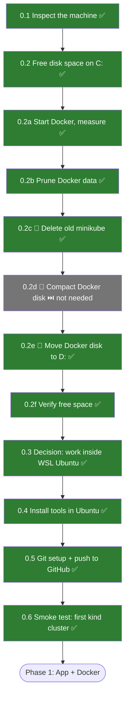
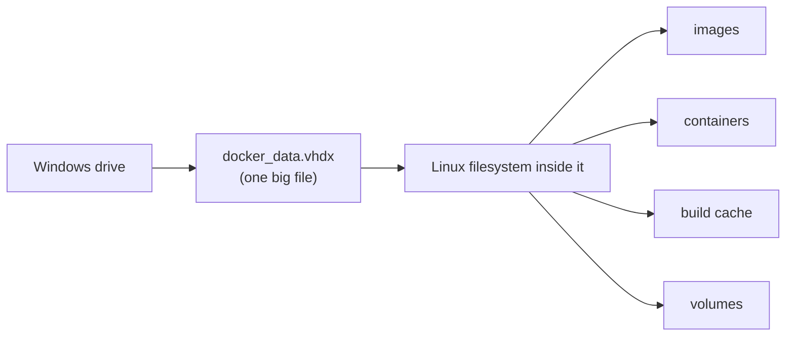
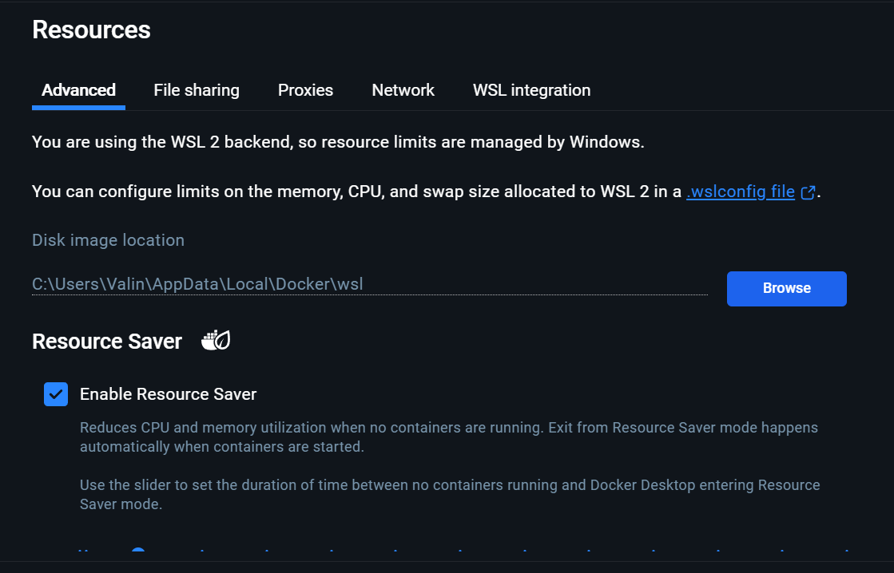
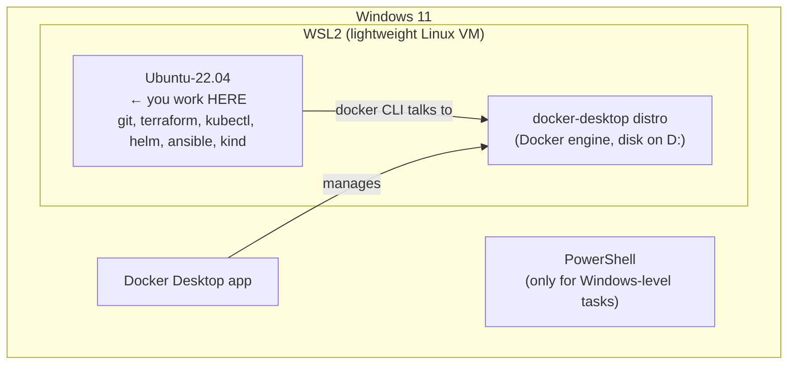
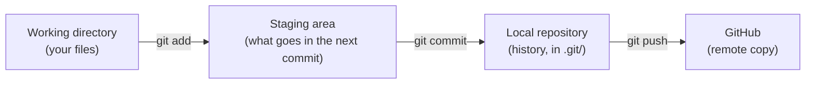
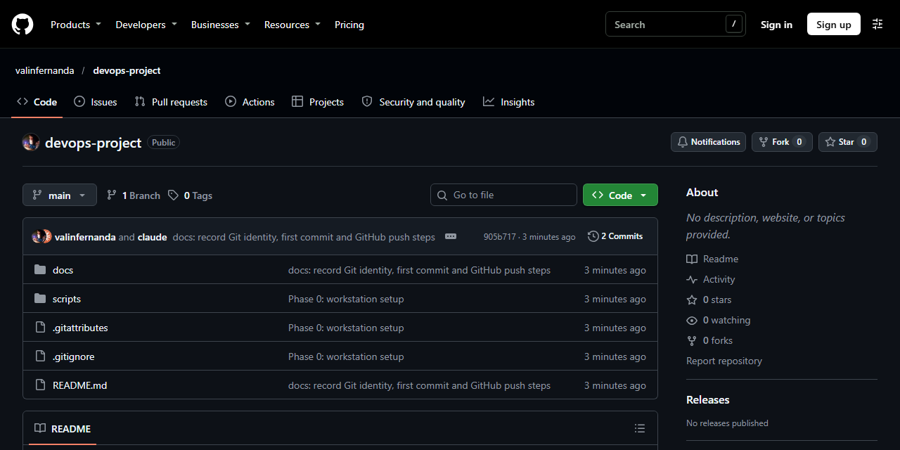
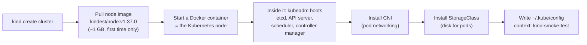
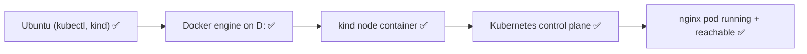

# Phase 0: Workstation Setup

> 🎯 **Phase objective:** turn this Windows laptop into a working DevOps workstation that can run
> Docker, a multi-node Kubernetes cluster, Terraform, Helm, and Ansible, with enough free disk space
> to do so reliably.

**Status:** ✅ done (20 Nov 2026)

**Legend:** ✅ done · ⏳ not started / waiting · ⚠️ problem found · ⏭️ skipped (not needed) · 👤 **you** must do this step (admin rights or a GUI click)

---

## Where are we now?



*(Green = done, yellow = waiting for you, grey = skipped, red = tried but failed. Updated after every process.)*

> 💡 **How to view these diagrams:** they are written in **Mermaid**. GitHub renders them automatically.
> In VS Code, install the extension *"Markdown Preview Mermaid Support"* and press `Ctrl+Shift+V`.

---

## Step 0.1: Inspect the machine ✅

### 🎯 Objective
Know exactly what hardware and software we are starting with **before** installing anything.

### ❓ Why
Kubernetes and monitoring are hungry for **RAM** and **disk**. Installing tools on a machine that
cannot run them wastes hours on confusing errors. Real DevOps engineers always check the target
environment first. In automation this is called *pre-flight checks*.

### 🛠️ Tool
**PowerShell**, the Windows command-line shell.

### ⌨️ Commands

```powershell
# Total RAM in GB. Get-CimInstance asks Windows (via WMI) for hardware info.
[math]::Round((Get-CimInstance Win32_ComputerSystem).TotalPhysicalMemory/1GB,1)

# Number of logical CPU threads
(Get-CimInstance Win32_ComputerSystem).NumberOfLogicalProcessors

# Used/free space on every drive (C:, D:, E: ...)
Get-PSDrive -PSProvider FileSystem

# Which DevOps tools are already installed, and which version
docker version
kubectl version --client      # --client = only show the local tool version, don't contact a cluster
minikube version --short
terraform version
helm version --short
git --version

# Which Linux distributions are installed in WSL, and whether they use WSL version 2
wsl -l -v                     # -l = list, -v = verbose (shows state + WSL version)
```

### 📤 Output (20 Nov 2026)

| Item | Result | Meaning |
|---|---|---|
| RAM | 30.8 GB | ✅ Plenty. A 3-node kind cluster + monitoring needs about 8 GB |
| CPU | 12 threads | ✅ Plenty |
| Disk C: | **1.1 GB free** | ⚠️ **Blocker.** Docker/Kubernetes need ~30 GB. See Step 0.2 |
| Disk D: | 20.1 GB free | Target for Docker's data |
| Disk E: | 14.6 GB free | Spare |
| Docker | client 28.4.0, Docker Desktop 4.47 (was **not running**) | Must be started before use |
| kubectl (Windows) | v1.34.0 | Not used. We use the Linux copy inside WSL (Step 0.4) |
| minikube | v1.38.0, one old cluster using the **Hyper-V** driver | Not needed (we use kind). Removed in 0.2c |
| Terraform (Windows) | v1.13.3 (latest is 1.17.2) | Not used. Latest installed inside WSL |
| Helm (Windows) | v4.1.4 | Not used. Installed inside WSL |
| Git | 2.49.0, `user.name` not set | Must set identity before committing (0.5c) |
| WSL | `Ubuntu-22.04` (WSL2) + `docker-desktop` | ✅ |
| Ansible, kind, k9s | **not installed** | Installed in Step 0.4 |

---

## Step 0.2: Free disk space on C: ✅

### 🎯 Objective
Get C: from **1.1 GB free** to a safe level by (1) deleting data we don't need and
(2) moving Docker's storage to drive D:.

### ❓ Why
By default Docker Desktop and WSL store everything on C:. Every Docker image and every kind
node (each ~1 GB) lands there. With 1.1 GB free:
- Docker fails with `no space left on device`.
- Kubernetes nodes start **evicting pods** (killing them) when disk is low. This condition is called *DiskPressure*.
- Windows itself becomes unstable (updates fail, apps crash).

### 📚 Concepts: where does Docker actually store data?

Docker Desktop on Windows does **not** run containers directly on Windows. It runs a small Linux
system inside **WSL2**, and all images/containers live inside a **virtual hard disk file** (`.vhdx`):



**Key fact:** a `.vhdx` file **grows automatically but never shrinks automatically**.
Deleting images *inside* Docker frees space *inside* the virtual disk, but the file on the Windows
drive stays the same size. Think of a balloon: letting air out of what's inside doesn't make the
rubber smaller.

**What was using C: (DevOps-related):**

| File | Size | What it is |
|---|---|---|
| `C:\Users\Valin\AppData\Local\Docker\wsl\disk\docker_data.vhdx` | 14.1 GB | All Docker images, containers, cache |
| `C:\Users\Valin\AppData\Local\Packages\CanonicalGroupLimited.Ubuntu22.04LTS_...\LocalState\ext4.vhdx` | 4.7 GB | The Ubuntu WSL system (stays on C:, that's fine now) |
| `C:\Users\Valin\.minikube\` | 3.6 GB | Old minikube cluster (Hyper-V VM disk + checkpoint + cached ISO) |

---

### Step 0.2a: Start Docker Desktop and measure usage ✅

#### 🎯 Objective
Find out what is *inside* Docker's virtual disk, so we delete only what is safe to delete.

#### ⌨️ Commands

```powershell
# Start Docker Desktop (same as clicking its icon)
Start-Process "C:\Program Files\Docker\Docker\Docker Desktop.exe"

# Wait until the Docker engine answers (repeat until it stops erroring)
docker info

# Disk usage summary. "RECLAIMABLE" = space you could free right now
docker system df

# Details: every image, every container (-a = include stopped ones), every volume
docker images
docker ps -a
docker volume ls
```

#### 📤 Output

```
TYPE            TOTAL     ACTIVE    SIZE      RECLAIMABLE
Images          16        6         10.33GB   7.928GB (76%)
Containers      12        1         39.12MB   39.1MB (99%)
Local Volumes   1         1         168.9MB   0B (0%)
Build Cache     174       0         8.406GB   8.406GB
```

**How to read this:**
- **Images:** 16 images, ~10 GB. 7.9 GB is reclaimable (old builds from earlier projects).
- **Containers:** 12 containers, 11 of them stopped 8–13 months ago.
- **Build Cache: 8.4 GB, 100% reclaimable.** Leftovers from `docker build`. Pure cache, always safe to delete; Docker recreates it when needed.
- **Volumes:** 1 volume (168 MB) used by a running `mariadb` container. **Volumes hold real data (a database!) so we do NOT delete them.**

---

### Step 0.2b: Prune unused Docker data ✅

#### 🎯 Objective
Delete stopped containers, unused images, and build cache. Keep anything that is running and all volumes.

#### 📚 Concepts: what "prune" means
*Prune* = "cut away the dead branches". Docker has a prune command per object type:

| Command | Deletes | Safe? |
|---|---|---|
| `docker container prune` | Stopped containers | ✅ Running ones are never touched |
| `docker image prune` | *Dangling* images (untagged leftovers) | ✅ |
| `docker image prune -a` | **All** images not used by any container | ✅ if you can rebuild/re-pull them |
| `docker builder prune -a` | All build cache | ✅ Always |
| `docker volume prune` | Unused volumes | ⚠️ **Deletes data.** Check first |
| `docker system prune -a --volumes` | Everything above at once | ⚠️ Dangerous because of volumes |

We used the individual commands so we could **skip volumes on purpose**.

#### ⌨️ Commands

```powershell
docker container prune -f     # -f = force, don't ask "are you sure?"
docker image prune -a -f      # -a = all unused images, not just dangling
docker builder prune -a -f    # -a = all build cache, not just old entries
docker system df              # measure again
```

#### 📤 Output

```
Deleted Containers: (11 container IDs)
Total reclaimed space: 39.1MB
...
Total: 10.96GB            ← build cache freed

TYPE            TOTAL     ACTIVE    SIZE      RECLAIMABLE
Images          1         1         460.5MB   50.19kB (0%)
Containers      1         1         24.58kB   0B (0%)
Local Volumes   1         1         168.9MB   0B (0%)
Build Cache     0         0         0B        0B
```

Inside Docker, usage dropped from **~19 GB to ~0.6 GB**. Only `mariadb` (running, with its volume) remained.
**But** `docker_data.vhdx` was **still 14.14 GB** and C: still had ~1.4 GB free: the balloon effect.

> ℹ️ The deleted images (`task-management-api`, `studentportal-server`, etc.) were builds from earlier
> projects. They can be rebuilt from their source code, and the `ghcr.io/...` ones can be pulled again.

---

### Step 0.2c: 👤 Delete the old minikube cluster (admin PowerShell) ✅

#### 🎯 Objective
Remove the old minikube cluster **properly** (unregister the VM from Hyper-V *and* delete its files).

#### ❓ Why must *you* run this as admin?
This minikube cluster used the **Hyper-V driver**: a real Hyper-V virtual machine.
Your normal user account is **not** in the *Hyper-V Administrators* group, so minikube can't talk to
Hyper-V without admin rights:

```
Hyper-V\Get-VM : You do not have the required permission to complete this task.
```

Just deleting the `.minikube` folder would leave a **broken VM registered in Hyper-V** pointing to
missing files. `minikube delete` removes both cleanly.

#### ⌨️ Commands (in **PowerShell → Run as administrator**)

```powershell
minikube delete --all --purge
```

| Part | Meaning |
|---|---|
| `delete` | Stop and delete a cluster (VM + its config) |
| `--all` | All profiles (clusters), not only the default one |
| `--purge` | Also delete the whole `C:\Users\Valin\.minikube` folder (cache, ISO, certificates) |

#### ✅ Verify

```powershell
Test-Path "$env:USERPROFILE\.minikube"   # printed: False
```

**Result:** C: free went from 1.4 GB → **5.3 GB**.

---

### Step 0.2d: Compact Docker's virtual disk ⏭️ (turned out not to be needed)

#### 🎯 Original objective
Shrink `docker_data.vhdx` from 14.1 GB to roughly its real content size.

#### What happened
The first attempt didn't take effect (the file stayed 14.14 GB, most likely because Docker Desktop
was running and the file was locked). We changed the order: **move first** (0.2e). It turned out
the move **only copies the blocks that actually contain data**, so the file arrived on D: at
**2.89 GB**. The move compacted it for us.

#### For future reference: how to compact manually (admin PowerShell)

```powershell
# 1. Quit Docker Desktop completely (whale icon → Quit Docker Desktop)
wsl --shutdown                                            # stop all WSL distros so the file is unlocked
Optimize-VHD -Path "D:\DockerDesktop\DockerDesktopWSL\disk\docker_data.vhdx" -Mode Full
(Get-Item "D:\DockerDesktop\DockerDesktopWSL\disk\docker_data.vhdx").Length / 1GB   # new size
```

| Part | Meaning |
|---|---|
| `wsl --shutdown` | Immediately stops every running WSL distro and the WSL2 virtual machine |
| `Optimize-VHD -Path ...` | Hyper-V command that releases unused blocks of a virtual disk back to Windows |
| `-Mode Full` | Thorough scan; reclaims the most space (slower than `Quick`) |

#### 🧯 Troubleshooting
- **"The process cannot access the file because it is being used"** → Docker Desktop is still running (or auto-started). Quit it, run `wsl --shutdown` again, retry.
- **`Optimize-VHD` not recognized** → you are not in an *admin* PowerShell, or Hyper-V tools are missing.

---

### Step 0.2e: 👤 Move Docker's disk to D: (Docker Desktop GUI) ✅

#### 🎯 Objective
Make Docker store all images/containers on **D:** instead of C:.

#### ❓ Why
Kubernetes work adds several GB of images over time (each kind node image alone is ~1 GB).
D: keeps that away from C:, which Windows needs to stay healthy.

#### Steps
1. Open Docker Desktop → ⚙️ **Settings** (top right).
2. Go to **Resources → Advanced**.
3. **Disk image location** → **Browse** → select the empty folder `D:\DockerDesktop` → **Select Folder**.
4. Click **Apply & restart** (bottom-right corner of the Settings window). Docker copies the disk file.

**Before** (path still on C:, nothing moved yet):



> ⚠️ **Common mistake (we hit it!):** choosing a folder in *Browse* only changes the text field.
> **Nothing moves until you click "Apply & restart".** Docker requires the target folder to be **empty**.

#### ✅ Verify

```powershell
# The old file on C: should be gone
Test-Path "$env:LOCALAPPDATA\Docker\wsl\disk\docker_data.vhdx"          # → False

# The new files on D:
Get-ChildItem D:\DockerDesktop -Recurse -File

# Docker Desktop's own settings file records the new location
Get-Content "$env:APPDATA\Docker\settings-store.json"
```

#### 📤 Output

```
old vhdx on C exists: False

  GB FullName
  -- --------
2.89 D:\DockerDesktop\DockerDesktopWSL\disk\docker_data.vhdx    ← images, containers, volumes
0.14 D:\DockerDesktop\DockerDesktopWSL\main\ext4.vhdx           ← Docker's tiny internal Linux

"CustomWslDistroDir": "D:\\DockerDesktop\\DockerDesktopWSL"     ← in settings-store.json
```

---

### Step 0.2f: Verify the end result ✅

#### 🎯 Objective
Prove each cleanup step worked by checking the result, not by assuming it did.
**Every change is followed by a verification.** That's a core DevOps habit.

#### 📤 Final result

| Check | Before Phase 0 | After | |
|---|---|---|---|
| C: free | 1.1 GB | **~29 GB** | ✅ |
| D: free | 20.1 GB | ~16–18 GB (Docker now lives here) | ✅ |
| Docker disk file | 14.14 GB on C: | 2.89 GB on D: | ✅ |
| Old minikube | 3.6 GB on C: | gone | ✅ |
| `mariadb` volume (database data) | 168.9 MB | still there | ✅ data safe |
| `mariadb` **container** | running | ⚠️ gone after the move (see below) | |

#### ⚠️ Note: the `mariadb` container disappeared during the move
After the disk move, `docker ps -a` showed **0 containers**, but the `mariadb:lts` **image** and its
**volume** (the actual database files) are intact. In Docker, a container is disposable; the volume
is what holds the data. That's exactly why we never prune volumes blindly.

If you ever need that old database again, recreate a container on top of the same volume:

```powershell
docker run -d --name mariadb --restart always `
  -v 5d5180ee977771eb71edacc813d809e5788bb428fb564941b6e6c45c801d0eef:/var/lib/mysql `
  -p 3306:3306 mariadb:lts
```

Because the volume already contains an initialized database, MariaDB uses the existing data and
existing passwords. If you don't need it: leave it. **Don't run `docker volume prune`** unless you
are sure, because the volume now counts as "unused" and would be deleted.

#### What we learned (a real story from this step)
1. The first verification showed **"I clicked it" ≠ "it happened"**: the disk wasn't moved, because
   *Apply & restart* hadn't been clicked. Files and settings are the source of truth.
2. Order matters: compacting a locked file fails silently; moving first solved both problems.

---

## Step 0.3: Decision: work inside WSL Ubuntu, not Windows ✅

### 🎯 Objective
Choose **one** consistent place where all DevOps commands are run.

### ❓ Why Linux (WSL Ubuntu) instead of Windows PowerShell?
1. **Servers and CI pipelines are almost always Linux.** The commands you learn here are the same ones you'll use on real servers and in GitHub Actions.
2. **Ansible cannot run on Windows** as a control node. Linux is mandatory.
3. Official docs and tutorials for Kubernetes, Terraform, Helm, and Ansible use Linux shell (bash) syntax.
4. Docker Desktop's **WSL integration** makes the `docker` command available inside Ubuntu, talking to the same Docker engine.

### 📚 Concepts: how the pieces connect



### ⌨️ How to enter Ubuntu

```powershell
wsl -d Ubuntu-22.04     # -d = which distribution to start
```

Inside Ubuntu, go to the project (your Windows files are under `/mnt/c/...`):

```bash
cd /mnt/c/Users/Valin/Downloads/devops-project
```

### ✅ Verified
Inside Ubuntu, `docker version` shows **client 28.4.0 / server 28.4.0**: Ubuntu reaches Docker Desktop's engine.

---

## Step 0.4: Install the DevOps toolbox inside Ubuntu ✅

### 🎯 Objective
Install kubectl, kind, Terraform, Helm, Ansible, and k9s inside Ubuntu, **using a script** instead of typing commands by hand.

### ❓ Why a script instead of typing commands?
This is your first taste of the core DevOps idea: **automate, don't click.**
- **Repeatable:** new laptop? Run one command and get the identical setup.
- **Documented:** the script *is* the documentation of what was installed and how.
- **Reviewable:** it lives in Git, so every change to it has history.
- **Idempotent:** running it twice is safe; it just re-installs the same pinned versions.

### 📚 Concepts: what each tool is for

| Tool | What it does | Analogy | Used in phases |
|---|---|---|---|
| **kubectl** | Sends commands to any Kubernetes cluster's API | The remote control | 3–8 |
| **kind** | Creates clusters where each node is a Docker container | A Kubernetes "simulator" that's actually real Kubernetes | 3–7 |
| **Terraform** | Creates/updates/destroys infrastructure from `.tf` files | A blueprint the builder follows exactly | 4, 8 |
| **Helm** | Installs whole apps into Kubernetes from "charts" | `apt install`, but for Kubernetes | 3, 6, 7 |
| **Ansible** | Logs into servers via SSH and configures them | A checklist that executes itself | 5 |
| **k9s** | Interactive terminal dashboard for a cluster | Task Manager for Kubernetes | 3–8 |

### 🛠️ Tool
The script [`scripts/00-install-tools.sh`](../scripts/00-install-tools.sh) (bash). Read it: every block is commented.

### 📚 Concepts used inside the script

| Technique | Where | Why it matters |
|---|---|---|
| `set -euo pipefail` | top | Script **stops at the first error** instead of continuing in a broken state |
| **Pinned versions** (`KUBECTL_VERSION="v1.37.2"`) | top | Reproducible: same versions next month, not "whatever is latest" |
| **Checksum verification** (`sha256sum --check`) | kubectl, kind | Proves the downloaded file is exactly what the publisher released (not corrupted, not tampered with) |
| **Signed apt repository** (`signed-by=...gpg`) | Terraform | apt refuses packages not signed by HashiCorp's key |
| **PPA** (`ppa:ansible/ansible`) | Ansible | Ubuntu's built-in Ansible is old; the official PPA has current versions |
| `mktemp -d` + `trap ... EXIT` | top | Downloads go to a temp folder that is **always** cleaned up, even on failure |
| `install -m 0755` | binaries | Copies a file and makes it executable in one step |

We also added [`.gitattributes`](../.gitattributes): it forces **Linux line endings (LF)** for `.sh`,
`.yaml`, and `.tf` files. Windows editors use CRLF, and bash fails on CRLF with the cryptic error
`$'\r': command not found`.

### ⌨️ Command

Inside Ubuntu, from the project folder:

```bash
sudo bash scripts/00-install-tools.sh
```

- `sudo` = run as **root** (administrator). Needed because tools are installed system-wide into `/usr/local/bin` and apt packages.
- `bash scripts/...` = run the script with bash (no need to make it executable first).

> ℹ️ Claude ran it from Windows with `wsl -d Ubuntu-22.04 -u root -- bash scripts/00-install-tools.sh`
> (`-u root` = start the shell as root, same effect as sudo without typing your password).

### 📤 Output (shortened)

```
==> 1/7 Base packages (curl, gpg, unzip, ...)
==> 2/7 kubectl v1.37.2 (Kubernetes command-line client)
/tmp/tmp.Z7vgKPWzmC/kubectl: OK                ← checksum verified
==> 3/7 kind v0.33.0 (Kubernetes IN Docker)
kind-linux-amd64: OK                           ← checksum verified
==> 4/7 Terraform (from HashiCorp's official apt repository)
==> 5/7 Helm 4 (Kubernetes package manager, official install script)
==> 6/7 Ansible (from the official Ansible PPA)
==> 7/7 k9s (terminal UI for Kubernetes)
==> Installed versions
kubectl  : Client Version: v1.37.2
kind     : kind v0.33.0 go1.26.7 linux/amd64
terraform: Terraform v1.17.2
helm     : v4.3.2+g8346aaa
ansible  : ansible [core 2.17.14]
k9s      : Version              v0.51.0

All tools installed.
```

### ✅ Verify (any time)

```bash
kubectl version --client
kind version
terraform version
helm version --short
ansible --version
k9s version --short
```

### 🧯 Troubleshooting
- **`$'\r': command not found`** → the script got Windows line endings. Fix: `sed -i 's/\r$//' scripts/00-install-tools.sh`.
- **`sha256sum: WARNING: 1 computed checksum did NOT match`** → download was corrupted. Just run the script again.
- **`sudo: a password is required`** → that's normal; type your **Ubuntu** user's password (not your Windows one).

---

## Step 0.5: Git setup (partly ✅)

### 🎯 Objective
Put the project under version control, so every file (Dockerfiles, Terraform, Kubernetes YAML,
Ansible playbooks) has history, and so CI can run on it later.

### 0.5a Initialize the repository ✅

```bash
git init -b main      # create a new repo; -b main = name the first branch "main"
```

### 0.5b Create `.gitignore` and `.gitattributes` ✅

[`.gitignore`](../.gitignore) lists files Git must **never** track:

| Pattern | Why it's excluded |
|---|---|
| `*.tfstate`, `*.tfstate.*` | Terraform state. Can contain passwords and secrets in plain text |
| `*.tfvars` | Terraform variable files, often hold secrets |
| `.terraform/` | Downloaded provider plugins (large, re-downloadable) |
| `kubeconfig*`, `*.pem`, `*.key`, `.env` | Credentials and keys |
| `*.retry` | Ansible leftover files |

> 🔐 **Golden rule of DevOps: secrets never go into Git.**

[`.gitattributes`](../.gitattributes) forces LF line endings for scripts and config files (see Step 0.4).

### 0.5c Set your Git name ✅

Check result before: **email was set, `user.name` was empty**, in *both* Windows Git and Ubuntu Git.
Set to your GitHub username **`valinfernanda`** in both places.

> 📚 **Important concept:** Windows and WSL Ubuntu are two separate systems, so they have **two
> separate Git configs** (`C:\Users\Valin\.gitconfig` and `/home/valin/.gitconfig`). Since you'll
> commit from Ubuntu, set it there (and in Windows too, if you ever commit from VS Code on Windows).

Inside **Ubuntu**:

```bash
git config --global user.name "Your Name"
git config --global user.name        # verify: prints your name
```

In **PowerShell** (optional, for Windows Git):

```powershell
git config --global user.name "Your Name"
```

`--global` = applies to every repo for this user (stored in `~/.gitconfig`).

We also set `git config --global init.defaultBranch main` in Ubuntu, so every future `git init` uses `main`.

### 0.5d First commit ✅

#### 🎯 Objective
Save a snapshot of Phase 0 into Git history.

#### 📚 Concepts: the three areas of Git



#### ⌨️ Commands

```bash
git add -A          # stage everything: new, changed, and deleted files
git status --short  # check what will be committed (A = added)
git commit -m "Phase 0: workstation setup"
git log --oneline   # see history
```

#### 📤 Output

```
A  .gitattributes
A  .gitignore
A  README.md
A  docs/00-setup.md
A  docs/images/00-docker-disk-location-before.png
A  scripts/00-install-tools.sh
940160d Phase 0: workstation setup
author: valinfernanda
```

> ℹ️ You may see `warning: LF will be replaced by CRLF` for `.md` files. That's Windows Git's
> `core.autocrlf=true` converting line endings **in your working folder only**; the repository
> stores LF. It's harmless for Markdown, and `.gitattributes` protects `.sh`/`.yaml`/`.tf` files.

### 0.5e 👤 Create the GitHub repository and push ✅

#### 🎯 Objective
Put the repo on GitHub (`github.com/valinfernanda/devops-project`). Phase 2 (CI with GitHub Actions)
needs it there.

#### ❓ Why public?
- **GitHub Actions minutes are free and unlimited for public repos** (private repos have a monthly limit).
- It becomes **portfolio** you can show recruiters.
- It's safe *because* `.gitignore` keeps secrets out. Never commit secrets to a public repo.

#### Steps
1. Open <https://github.com/new>.
2. **Repository name:** `devops-project` · **Public** · leave *Add a README*, *.gitignore*, *license* **unchecked** (our repo already has them; adding them on GitHub creates a conflicting first commit).
3. Click **Create repository**.
4. Then connect and push:

```bash
git remote add origin https://github.com/valinfernanda/devops-project.git   # "origin" = conventional name for the main remote
git push -u origin main    # -u = remember origin/main as the default upstream, so later just "git push"
```

The first push opens a **browser sign-in** (Git Credential Manager) if you aren't signed in yet.
On this laptop, credentials were already saved from earlier projects, so no prompt appeared.

#### ✅ Verify

```bash
git status -sb            # "## main...origin/main" = local main tracks GitHub's main, nothing unpushed
git ls-remote origin main # the commit GitHub has; must equal your local `git log -1`
```

#### 📤 Output

```
## main...origin/main
905b717d0822dda30e9af59f1cbf1aee577c00b5    refs/heads/main
```

The repo is live at **<https://github.com/valinfernanda/devops-project>**:



> 💡 Open [`docs/00-setup.md` on GitHub](https://github.com/valinfernanda/devops-project/blob/main/docs/00-setup.md):
> the Mermaid flowcharts render as real diagrams there, no extension needed.

---

## Step 0.6: Smoke test: first kind cluster ✅

### 🎯 Objective
Prove the whole chain works end-to-end: **Ubuntu → kind → Docker (on D:) → Kubernetes → a running pod**.
Then delete it. This is a throwaway test cluster, not the real one (that one comes in Phase 3/4,
built with a config file and Terraform).

### ❓ Why a "smoke test"?
The name comes from hardware: power a new device on and check that no smoke comes out.
In DevOps it means a **quick, shallow test that the basics work** before investing time in details.

### 📚 Concepts: what `kind create cluster` does



- **Node image:** a Docker image containing a full Kubernetes node (systemd, containerd, kubelet).
- **Control plane:** the "brain" of Kubernetes: `etcd` (database), `kube-apiserver` (front door), `kube-scheduler` (decides where pods run), `kube-controller-manager` (keeps reality = desired state).
- **CNI (Container Network Interface):** gives every pod an IP address so pods can talk to each other.
- **kubeconfig / context:** the file `~/.kube/config` tells kubectl *which* cluster to talk to and *how* to log in. A *context* is a named "cluster + user" pair.

### ⌨️ Commands (inside Ubuntu) and 📤 real output

**1. Create the cluster** (`--name` = cluster name; default is `kind`)

```bash
kind create cluster --name smoke-test
```
```
Creating cluster "smoke-test" ...
 ✓ Ensuring node image (kindest/node:v1.37.0) 🖼️
 ✓ Preparing nodes 📦
 ✓ Writing configuration 📜
 ✓ Starting control-plane 🕹️
 ✓ Installing CNI 🔌
 ✓ Installing StorageClass 💾
Set kubectl context to "kind-smoke-test"
real	1m10.839s                      ← took 70 s (includes downloading the node image)
```

**2. Which cluster is kubectl talking to?**

```bash
kind get clusters                  # → smoke-test
kubectl config current-context     # → kind-smoke-test
```

**3. Look at the node**

```bash
kubectl get nodes -o wide          # -o wide = extra columns (IP, OS, runtime)
```
```
NAME                       STATUS     ROLES           VERSION   INTERNAL-IP   OS-IMAGE                       CONTAINER-RUNTIME
smoke-test-control-plane   NotReady   control-plane   v1.37.0   172.18.0.2    Debian GNU/Linux 13 (trixie)   containerd://2.3.4
```
`NotReady` 6 seconds after creation is **normal**: the node becomes `Ready` once the CNI (networking) finishes starting.

**4. Proof that the "node" is just a Docker container**

```bash
docker ps --filter name=smoke-test
```
```
NAMES                      IMAGE                  STATUS
smoke-test-control-plane   kindest/node:v1.37.0   Up 18 seconds
```

**5. The control-plane components run as pods**

```bash
kubectl get pods -n kube-system    # -n = namespace; kube-system holds Kubernetes' own components
```
```
etcd-smoke-test-control-plane                      0/1     Running
kube-apiserver-smoke-test-control-plane            0/1     Running
kube-controller-manager-smoke-test-control-plane   1/1     Running
kube-scheduler-smoke-test-control-plane            1/1     Running
```

**6. Run a real workload: an nginx web server pod**

```bash
kubectl run hello --image=nginx:alpine --restart=Never   # --restart=Never = plain Pod, no Deployment
kubectl wait --for=condition=Ready pod/hello --timeout=180s
kubectl get pod hello -o wide
```
```
pod/hello created
pod/hello condition met
NAME    READY   STATUS    IP           NODE
hello   1/1     Running   10.244.0.3   smoke-test-control-plane
```
The pod got its own IP (`10.244.0.3`) from the CNI, and the scheduler placed it on the only node.

**7. Talk to the web server from inside the pod**

```bash
kubectl exec hello -- wget -qO- http://localhost
```
```
<title>Welcome to nginx!</title>
```
`kubectl exec` runs a command *inside* a running container (like SSH, but through the Kubernetes API).

**8. Clean up**

```bash
kind delete cluster --name smoke-test
kind get clusters                    # → No kind clusters found.
```

### ✅ What this proved



---

## ✅ Phase 0 summary

**What you have now**
- C: back to ~29 GB free; Docker lives on D:.
- A Linux workstation (WSL Ubuntu) with kubectl 1.37.2, kind 0.33.0, Terraform 1.17.2, Helm 4.3.2, Ansible core 2.17.14, k9s 0.51.0.
- A Git repo with safety rails (`.gitignore`, `.gitattributes`) and a reproducible install script, published at <https://github.com/valinfernanda/devops-project>.
- Proof that you can create a Kubernetes cluster, run a pod, and delete it all in ~2 minutes.

**Concepts you met**
pre-flight checks · virtual disks (vhdx) · prune vs. volumes · admin rights / Hyper-V · WSL2 ·
idempotent scripts · version pinning · checksums · signed repositories · smoke tests ·
Kubernetes control plane · CNI · kubeconfig context · pods

**Redo-it-yourself checklist** (on a fresh machine)
1. Check RAM/disk (`Get-PSDrive`, `Get-CimInstance`).
2. Install Docker Desktop, set *Disk image location* to a drive with space, **Apply & restart**.
3. `wsl --install -d Ubuntu-22.04`, then enable it in Docker Desktop → *Resources → WSL integration*.
4. Inside Ubuntu: `sudo bash scripts/00-install-tools.sh`.
5. `git config --global user.name/user.email`.
6. Smoke test: `kind create cluster` → `kubectl get nodes` → `kind delete cluster`.

**Next → Phase 1: Application + Docker.** We write a small API with a database, containerize it with
a multi-stage Dockerfile, and run it with Docker Compose.
