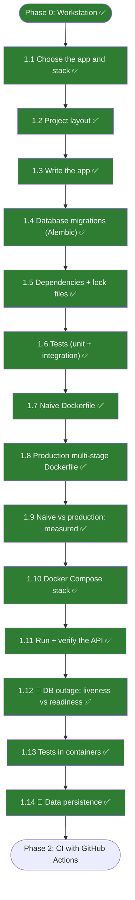
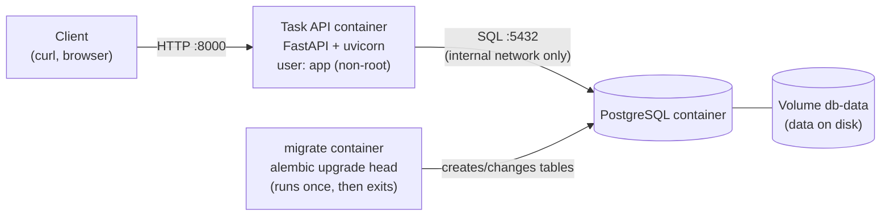
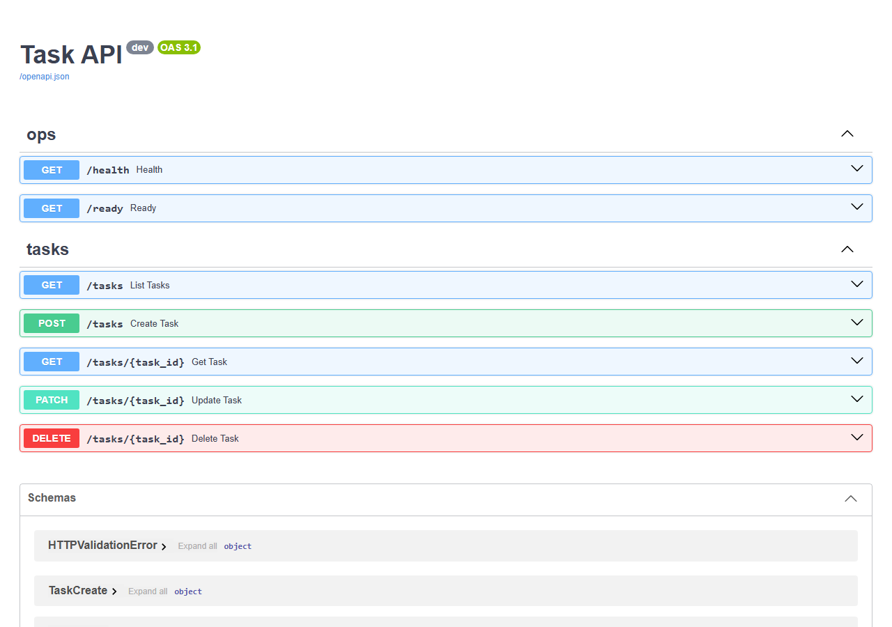
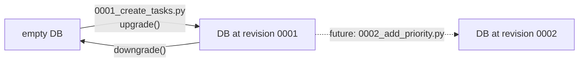
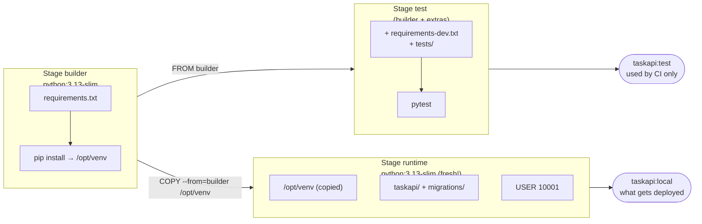
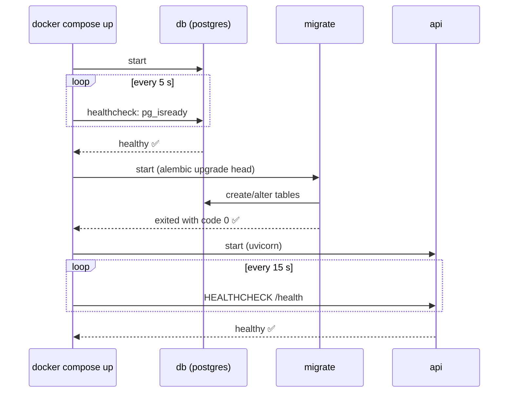
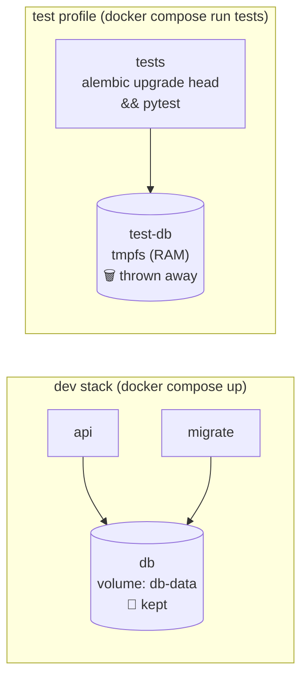

# Phase 1: Application + Docker

> 🎯 **Phase objective:** build the application that every later phase will test, deploy, and monitor,
> and package it as a **small, secure, production-ready container image**, running together with its
> database through **Docker Compose**.

**Status:** ✅ done (20 Nov 2026)

**Legend:** ✅ done · ⏳ waiting · ⚠️ problem found · 👤 you must do this · 🧪 experiment

---

## 🧭 Programmer or DevOps? How to read this phase

Steps 1.1–1.6 are mostly **programmer work**: building the app itself. We had to build it ourselves, because
a DevOps engineer needs a realistic app to containerize, test and deploy. **The DevOps core of this phase
starts at Step 1.7 (the Dockerfile).** Before that, a few sections are still things DevOps must know well,
because they are the app's **contract with the platform**. In a team, DevOps is often the one who *asks* for them.

| Step | Owner | What a DevOps engineer takes from it |
|---|---|---|
| 1.1 Choose the app and the stack | 💻 Programmer | ⭐ **Must read: "Concept: the 12-factor app"**. Config in env vars, stateless, logs to stdout: DevOps relies on all of it (K8s ConfigMaps/Secrets, scaling, log collection) |
| 1.2 Project layout | 💻 Programmer | Just know where things are |
| 1.3 Write the application | 💻 Programmer | ⭐ **Must read: the endpoints table + "Concept: liveness vs readiness"**. `/health` and `/ready` become Kubernetes probes in Phase 3. DevOps defines this requirement |
| 1.4 Database migrations (Alembic) | 🤝 Shared | Programmers **write** migrations. DevOps decides **when and how they run** (Compose `migrate` service now, a K8s Job / ArgoCD hook later). ⭐ Read *"Why not let the app create tables at startup?"* |
| 1.5 Dependencies and lock files | 🤝 Shared | ⭐ Lock files = reproducible builds. Dependabot and Trivy (Phase 2) read these files |
| 1.6 Tests | 💻 Programmer writes them | DevOps **runs** them automatically (Step 1.13 here, CI in Phase 2). Skim the unit vs integration concept |
| **1.7 Naive Dockerfile** | 🛠️ **DevOps** ← *starts here* | Image layers, why a naive image is bad |
| 1.8 Production multi-stage Dockerfile | 🛠️ DevOps | Multi-stage, non-root, pinned base image, HEALTHCHECK, `.dockerignore` |
| 1.9 Naive vs production, measured | 🛠️ DevOps | Measure size, layers, user: prove the improvement |
| 1.10 Docker Compose | 🛠️ DevOps | Whole stack in one file, startup order with healthchecks, volumes, `.env` secrets |
| 1.11 Run and verify the API | 🛠️ DevOps | Smoke test after deploying + **"Logs: one stream, written to stdout"** |
| 1.12 🧪 Database outage | 🛠️ DevOps | Proves liveness vs readiness for real. This is how you'd debug an incident |
| 1.13 Tests in containers | 🛠️ DevOps | Isolated test database, the real bug where tests wiped dev data |
| 1.14 🧪 Data persistence | 🛠️ DevOps | Named volumes: what survives `down`, what doesn't |

**Fast DevOps reading path:** 1.1 (12-factor concept only) → 1.3 (endpoints + liveness/readiness only) →
1.4 (the "why" box) → 1.5 → **1.7 to 1.14 in full**.

Who owns what in general (DB schema, Dockerfile, pipelines…): see [FAQ Q10](faq.md).

---

## Where are we now?



---

## Step 1.1: Choose the app and the stack ✅

### 🎯 Objective
Pick an application that is **simple enough** not to distract from DevOps, but **realistic enough**
to exercise everything later phases need: a database, configuration, health checks, logs, and tests.

### ❓ Why not just deploy "hello world"?
A hello-world container has no database, no config, no state, and can't really fail. Every hard DevOps
problem (startup order, migrations, secrets, readiness, persistence, rollback) comes from those things.

### The decision

| Choice | Picked | Why |
|---|---|---|
| App | **Task API**: a REST API to create/list/update/delete tasks | Tiny business logic, real database usage |
| Language / framework | **Python 3.13 + FastAPI** | Readable, popular, automatic API docs, easy testing |
| Database | **PostgreSQL 17** | The most common open-source production database; Azure has a managed version (Phase 8) |
| DB access | **SQLAlchemy 2** (ORM) + **psycopg 3** (driver) | Industry standard in Python |
| Schema changes | **Alembic** migrations | Versioned database changes (Step 1.4) |
| Config | **Environment variables** (pydantic-settings) | Same image runs everywhere (12-factor) |

### 📚 Concept: the 12-factor app
A famous checklist for building apps that run well in containers and the cloud
([12factor.net](https://12factor.net)). The four factors we apply right now:

| Factor | Rule | Where in our app |
|---|---|---|
| III. Config | Config lives in **environment variables**, not in code | `taskapi/config.py` reads `APP_*` variables |
| IV. Backing services | The database is an attached resource, swappable by URL | `APP_DATABASE_URL` |
| VI. Processes | The app is **stateless**; state lives in the database | Nothing stored on the container's disk |
| XI. Logs | Write logs to **stdout**; the platform collects them | `logging` → stdout → `docker logs` |

### Architecture



---

## Step 1.2: Project layout ✅

### 🎯 Objective
Organize files so that each tool finds what it needs, and so the Docker image only contains what runs.

```
devops-project/
├── compose.yaml              ← runs the whole stack locally (Step 1.10)
├── .env.example              ← template for local secrets (copy to .env, never commit .env)
└── app/                      ← everything that becomes the container image
    ├── Dockerfile            ← production image, multi-stage (Step 1.8)
    ├── Dockerfile.naive      ← the "bad example" we compare against (Step 1.7)
    ├── .dockerignore         ← files never sent to Docker
    ├── requirements.in       ← runtime deps we WANT (human-edited)
    ├── requirements.txt      ← exact locked versions (generated)
    ├── requirements-dev.in   ← test deps we want
    ├── requirements-dev.txt  ← test deps, locked (generated)
    ├── pytest.ini            ← test configuration
    ├── alembic.ini           ← migration tool configuration
    ├── migrations/           ← database change history
    │   ├── env.py
    │   └── versions/0001_create_tasks.py
    ├── taskapi/              ← the application code (a Python package)
    │   ├── config.py         ← settings from environment variables
    │   ├── db.py             ← database connection
    │   ├── models.py         ← tables (ORM)
    │   ├── schemas.py        ← request/response validation
    │   └── main.py           ← HTTP endpoints
    └── tests/
        ├── test_unit.py         ← no database needed
        └── test_integration.py  ← needs a real PostgreSQL
```

---

## Step 1.3: Write the application ✅

### 🎯 Objective
A working REST API with business endpoints **plus operational endpoints** that Docker, Kubernetes,
and monitoring will rely on.

### The endpoints

| Method | Path | Purpose | Status codes |
|---|---|---|---|
| GET | `/health` | **Liveness**: is the process alive? | 200 |
| GET | `/ready` | **Readiness**: can it serve traffic? (checks the DB) | 200 / 503 |
| GET | `/tasks` | List all tasks | 200 |
| POST | `/tasks` | Create a task `{"title": "..."}` | 201 / 422 |
| GET | `/tasks/search?q=...` | Case-insensitive title search *(added in Phase 2, PR #2)* | 200 / 422 |
| GET | `/tasks/{id}` | Get one task | 200 / 404 |
| PATCH | `/tasks/{id}` | Update `title` and/or `done` | 200 / 404 / 422 |
| DELETE | `/tasks/{id}` | Delete a task | 204 / 404 |
| GET | `/docs` | Interactive API docs (auto-generated by FastAPI) | 200 |



### 📚 Concept: liveness vs readiness (very important for Kubernetes)

| | `/health` (liveness) | `/ready` (readiness) |
|---|---|---|
| Question | "Is the process stuck or dead?" | "Should I send it traffic right now?" |
| Checks the database? | **No, never** | **Yes** |
| If it fails, Kubernetes... | **restarts** the container | **stops sending traffic** (no restart) |

**Why liveness must NOT check the database:** if the DB goes down and liveness checked it, Kubernetes
would restart *every* app container in a loop. That doesn't fix the database, and it adds chaos.
Readiness is the right tool: "pause traffic until the DB is back". We prove this in Step 1.12.

### Walkthrough of the code (read the files: every block is commented)

| File | What to notice |
|---|---|
| [`config.py`](../app/taskapi/config.py) | `env_prefix="APP_"`: field `database_url` is read from `APP_DATABASE_URL`. Defaults exist only for convenience; containers always override them. |
| [`db.py`](../app/taskapi/db.py) | `create_engine()` doesn't connect until first use. `pool_pre_ping=True` survives DB restarts. `get_session()` gives each request its own session and always closes it. |
| [`models.py`](../app/taskapi/models.py) | The `tasks` table as a Python class. `server_default=func.now()`: the **database** sets the timestamp. |
| [`schemas.py`](../app/taskapi/schemas.py) | `Field(min_length=1, max_length=200)`: invalid input is rejected with **422** before touching the DB. |
| [`main.py`](../app/taskapi/main.py) | Logs go to stdout. `SessionDep` = dependency injection: FastAPI hands a DB session to each endpoint. |

---

## Step 1.4: Database migrations with Alembic ✅

### 🎯 Objective
Create and change database tables through **versioned migration files**, applied by a separate step
**before** the app starts.

### ❓ Why not let the app create tables at startup?
Many tutorials call `Base.metadata.create_all()` when the app starts. That breaks in real life:
- It can **create** tables but can't **change** them (add a column, rename, add an index).
- With 3 replicas starting at once, all 3 try to change the schema at the same moment.
- There is no history of what changed when, and no way to roll back.

Migrations solve this: each schema change is a numbered file in Git, applied **once**, in order.



Alembic records the current revision in a small table (`alembic_version`), so it knows what's left to apply.

### Files

| File | Role |
|---|---|
| [`alembic.ini`](../app/alembic.ini) | Where migrations live. **No DB password here.** |
| [`migrations/env.py`](../app/migrations/env.py) | Reads `APP_DATABASE_URL` and the table definitions from our app |
| [`migrations/versions/0001_create_tasks.py`](../app/migrations/versions/0001_create_tasks.py) | `upgrade()` creates the table, `downgrade()` drops it |

### ⌨️ Commands

```bash
alembic upgrade head     # apply all pending migrations ("head" = newest)
alembic current          # show the DB's current revision
alembic downgrade -1     # undo the last migration
```

In our stack these run inside the `migrate` container (Step 1.10). In Kubernetes they will run as a
**Job** / ArgoCD **PreSync hook** (Phase 6). Same idea, different runner.

### 🧯 Real error we hit: `No module named 'taskapi'`

```
    from taskapi import models
ModuleNotFoundError: No module named 'taskapi'
service "migrate" didn't complete successfully: exit 1
```

**Cause:** the `alembic` command is a "console script"; Python doesn't automatically add the current
folder (`/app`) to its import path for those, so `env.py` can't find our package.
**Fix:** one line in `alembic.ini`:

```ini
prepend_sys_path = .
```

**Lesson:** `depends_on: condition: service_completed_successfully` (Step 1.10) did its job: the API
**was never started** on top of a database without tables.

---

## Step 1.5: Dependencies and lock files ✅

### 🎯 Objective
Install **exactly the same library versions** every time: on your laptop, in CI, and in production.

### 📚 Concept: "what I want" vs "what I got"

| File | Written by | Content | Example |
|---|---|---|---|
| `requirements.in` | **you** | top-level libraries you need | `fastapi` |
| `requirements.txt` | **pip-compile** (generated) | *every* library, including dependencies of dependencies, with exact versions | `fastapi==0.165.0`, `starlette==1.10.0`, `anyio==4.16.0`, … |

Without a lock file, `pip install fastapi` installs *whatever is newest today*. A rebuild next month can
pull in a breaking change and fail for no visible reason. That's the classic "it worked yesterday".

Dev tools are split out: `requirements-dev.in` starts with `-c requirements.txt` ("use the same locked
versions"), then adds `pytest` and `httpx2`. **Test tools never go into the production image.**

### 🛠️ Tool
`pip-compile` from **pip-tools**, run **inside a container**, so you don't need Python installed
on your machine at all, and the lock is resolved for the same Python version as the image (3.13).

### ⌨️ Command (inside Ubuntu, in `app/`)

```bash
docker run --rm -v "$PWD:/work" -w /work python:3.13-slim sh -c "
  pip install -q pip-tools &&
  pip-compile -q --strip-extras --no-header --output-file requirements.txt     requirements.in &&
  pip-compile -q --strip-extras --no-header --output-file requirements-dev.txt requirements-dev.in"
```

| Part | Meaning |
|---|---|
| `--rm` | delete the container when done |
| `-v "$PWD:/work"` | **mount** the current folder into the container at `/work`, so generated files land on your disk |
| `-w /work` | working directory inside the container |
| `--strip-extras` | write `psycopg` + `psycopg-binary` instead of `psycopg[binary]` (more portable lock) |
| `--no-header` | skip the auto-generated comment header |

### 📤 Output (`requirements.txt`, 27 pinned packages from 6 requested)

```
alembic==1.20.1        fastapi==0.165.0       psycopg==3.3.9          sqlalchemy==2.1.9
pydantic==2.14.4       pydantic-settings==2.16.3   starlette==1.10.0   uvicorn==0.54.0
... (+ 19 transitive dependencies)
```

**To upgrade a library later:** edit the `.in` file (or just re-run), regenerate, rebuild, run tests,
commit both files. In Phase 2 a bot (Dependabot/Renovate) will propose these upgrades automatically.

---

## Step 1.6: Tests ✅

### 🎯 Objective
Automatically prove the app works, at two levels, so CI (Phase 2) can block broken code.

### 📚 Concept: unit vs integration tests

| | Unit tests | Integration tests |
|---|---|---|
| File | [`tests/test_unit.py`](../app/tests/test_unit.py) | [`tests/test_integration.py`](../app/tests/test_integration.py) |
| Needs a database? | **No** | **Yes**, a real PostgreSQL |
| Speed | milliseconds | seconds |
| Catches | logic and validation bugs | wrong SQL, missing migrations, wiring problems |
| Count | 5 | 3 |

The pyramid idea: **many cheap unit tests, fewer expensive integration tests.** CI runs units first (fail fast).

### Techniques worth noticing

| Technique | Where | What it teaches |
|---|---|---|
| `monkeypatch.setattr(main, "check_database", lambda: False)` | unit | **Mocking**: fake a DB outage without a DB, to test `/ready` returns 503 |
| `@pytest.fixture(autouse=True)` + `TRUNCATE tasks` | integration | Every test starts from an empty table, so tests don't influence each other |
| `pytestmark = pytest.mark.integration` | integration | Run subsets: `pytest -m "not integration"` runs only unit tests |

### 🧯 Real error we hit: tests couldn't import the app

```
ImportError while importing test module '/app/tests/test_unit.py'.
E   ModuleNotFoundError: No module named 'taskapi'
```

Same root cause as Alembic. **Fix** in [`pytest.ini`](../app/pytest.ini): `pythonpath = .`

**Lesson:** the running API worked fine, and only the *tests* exposed the problem. That's exactly why CI
runs tests on every change instead of trusting "it runs on my machine".

---

## Step 1.7: The naive Dockerfile ✅

### 🎯 Objective
Write the Dockerfile most beginners write, so we can **measure** its problems instead of just being told.

### [`app/Dockerfile.naive`](../app/Dockerfile.naive)

```dockerfile
FROM python:3.13
WORKDIR /app
COPY . .
RUN pip install -r requirements.txt -r requirements-dev.txt
CMD uvicorn taskapi.main:app --host 0.0.0.0 --port 8000
```

### 📚 Concept: images are built in layers
Each instruction (`FROM`, `COPY`, `RUN`, …) creates a **layer**. Docker **caches** layers and reuses
them as long as nothing *before* them changed. Once one layer changes, **every layer after it is rebuilt**.

### What's wrong with it

| # | Problem | Consequence |
|---|---|---|
| 1 | `FROM python:3.13`, the full Debian image with compilers | Huge image, many more packages that could have security holes |
| 2 | `COPY . .` **before** `pip install` | Any code change invalidates the cache → **all dependencies reinstall** on every build |
| 3 | Installs **dev dependencies** (pytest…) and copies **tests** | Test tools shipped to production: bigger, more attack surface |
| 4 | No `USER` → runs as **root** | If the app is hacked, the attacker is root inside the container |
| 5 | **Shell form** `CMD uvicorn ...` | Runs as `/bin/sh -c "uvicorn ..."`: `sh` is PID 1 and doesn't forward `SIGTERM`, so `docker stop` waits 10 s and then kills the app hard (no graceful shutdown) |
| 6 | No `HEALTHCHECK` | Docker can't tell a hung app from a healthy one |

---

## Step 1.8: The production multi-stage Dockerfile ✅

### 🎯 Objective
Fix every problem above: small, cache-friendly, no build/test tools, non-root, graceful shutdown, health check.

### 📚 Concept: multi-stage builds
One Dockerfile, several `FROM` sections ("stages"). Later stages **copy only selected files** from
earlier ones. Everything else (compilers, caches, test tools) is left behind.



### [`app/Dockerfile`](../app/Dockerfile): instruction by instruction

| Instruction | Why |
|---|---|
| `ARG PYTHON_VERSION=3.13` | One place to change the Python version for all stages |
| `FROM python:${PYTHON_VERSION}-slim AS builder` | **slim** = Debian without compilers/docs (~176 MB vs ~1 GB). `AS builder` names the stage |
| `ENV PIP_NO_CACHE_DIR=1 ...` | Don't keep pip's download cache inside the image |
| `RUN python -m venv /opt/venv` | Put all packages in **one folder** that's easy to copy to the next stage |
| `COPY requirements.txt ...` **then** `RUN pip install` | **Cache trick:** this layer only rebuilds when `requirements.txt` changes, not when code changes |
| `FROM builder AS test` | Test stage = builder + dev deps + tests. Built only when asked (`--target test`) |
| `FROM python:...-slim AS runtime` | **Fresh** slim base: nothing from the builder comes along unless explicitly copied |
| `ENV PYTHONUNBUFFERED=1` | Logs appear immediately in `docker logs` |
| `RUN groupadd ... useradd --uid 10001 ... app` | Dedicated **unprivileged user**. Fixed UID lets Kubernetes enforce `runAsNonRoot` (Phase 3) |
| `COPY --from=builder /opt/venv /opt/venv` | Only the installed packages travel to the final image |
| `COPY taskapi ./taskapi` etc. | Only runtime files. **Owned by root** → the app user can read but **not modify** its code |
| `USER 10001` | Everything after this, and the running container, is non-root |
| `HEALTHCHECK ... CMD ["python", "-c", "...urlopen('/health')..."]` | Docker marks the container `healthy`/`unhealthy`. Uses Python's stdlib because slim has no `curl` |
| `CMD ["uvicorn", ...]` | **Exec form**: uvicorn is PID 1, receives `SIGTERM`, shuts down gracefully |

### [`app/.dockerignore`](../app/.dockerignore)
The **build context** is the folder you send to Docker (`.`). `.dockerignore` excludes caches, local
virtualenvs, **`.env` secrets**, and the Dockerfiles themselves, so they can never end up inside an image.

---

## Step 1.9: Naive vs production, measured ✅

### ⌨️ Commands (inside Ubuntu, in `app/`)

```bash
docker build -f Dockerfile.naive -t taskapi:naive .     # -f = which Dockerfile, -t = name:tag
docker build -t taskapi:local .                          # default Dockerfile, default (last) stage
docker images | grep taskapi                             # sizes

echo "# cache test" >> taskapi/main.py                   # simulate a 1-line code change
docker build -f Dockerfile.naive -t taskapi:naive .      # rebuild both, measure time
docker build -t taskapi:local .

docker run --rm --entrypoint "" taskapi:local sh -c "id -un"   # who runs inside?
docker history -q taskapi:local | wc -l                        # number of layers
docker inspect --format "{{json .Config.Cmd}}" taskapi:local   # how it starts
```

### 📤 Results

| Measurement | Naive | Production | |
|---|---|---|---|
| **Image size** | **1.81 GB** | **311 MB** | **5.8× smaller** |
| First build | 129 s | 56 s | |
| **Rebuild after a 1-line code change** | **56 s** (pip reinstalls everything) | **6 s** (dependency layers `CACHED`) | **~9× faster** |
| Runs as | `root` | `app` | |
| `pytest` inside? | yes (`/usr/local/bin/pytest`) | not installed | |
| `tests/` inside? | yes | not present | |
| `gcc` compiler inside? | yes (`/usr/bin/gcc`) | not installed | |
| CMD | `["/bin/sh","-c","uvicorn ..."]` (shell form) | `["uvicorn", ...]` (exec form) | |
| Health check | none | every 15 s, 3 retries | |

**Why the rebuild difference matters:** in CI every push rebuilds the image. 56 s vs 6 s, multiplied by
dozens of pushes a day, is real waiting time. A smaller image also means faster pulls when Kubernetes
starts new pods, and fewer packages that can contain vulnerabilities (we'll *count* them with Trivy in Phase 2).

> The naive image is kept only for this comparison. You can delete it: `docker rmi taskapi:naive`.

---

## Step 1.10: Docker Compose: the whole stack in one file ✅

### 🎯 Objective
Start **database → migrations → API** in the correct order with one command, with secrets kept out of Git.

### 📚 Concept: what Compose gives you
- **One private network** per project: containers reach each other **by service name** (`db:5432`).
- **Startup order with conditions** (not just "start A before B", but "start B when A is *healthy*").
- **Named volumes** for data that must survive container restarts.
- **Variables from `.env`**, so one file holds local secrets and `compose.yaml` stays committable.

### Startup order



### [`compose.yaml`](../compose.yaml): key parts explained

| Part | Meaning |
|---|---|
| `name: devops-lab` | Project name → containers are called `devops-lab-api-1`, etc. |
| `x-app-env: &app-env` | A reusable YAML block (**anchor**). `*app-env` pastes it; `<<: *app-env` merges it and lets you add keys |
| `${POSTGRES_PASSWORD:?Set ... in .env}` | Required variable: Compose **refuses to start** with a clear message if it's missing |
| `${POSTGRES_USER:-taskapi}` | Optional variable with a default |
| `db` → `volumes: db-data:/var/lib/postgresql/data` | Database files live in a **named volume**, not in the container |
| `db` → no `ports:` | The DB is **not exposed** to your laptop, only to containers in the stack (least privilege) |
| `db` → `healthcheck: pg_isready` | Postgres' own readiness tool. `$$` = literal `$` (expanded inside the container) |
| `migrate` → `restart: "no"` | Runs once and exits, like a Kubernetes **Job** |
| `api` → `depends_on: migrate: condition: service_completed_successfully` | API starts **only if migrations succeeded** |
| `api` → `ports: "8000:8000"` | `host:container`. Your laptop's port 8000 forwards to the container |
| `restart: unless-stopped` | Restart after crashes or Docker restarts, unless you stopped it yourself |
| `test-db` → `tmpfs` | Test database stored **in RAM**: fast and wiped automatically |
| `tests` / `test-db` → `profiles: ["test"]` | **Not** started by `up`; only when you run them explicitly |

### 🔍 The tricky rows, explained in depth

The table above is dense. This section unpacks the rows that are hardest to understand the first time.

> 📝 `compose.yaml` is **YAML**, not a programming language: no `import`, no `if`, no logic. It is a settings file
> with four rules: `key: value`; indentation = "belongs to the line above"; `-` = an item in a list; `#` = comment.

#### Order: the file is NOT read top to bottom

Compose does **not** start services in the order they are written. The order comes only from `depends_on`:

| Service | `depends_on` | Starts when |
|---|---|---|
| `db` | none | immediately |
| `migrate` | `db: service_healthy` | `db` is **healthy** |
| `api` | `db: service_healthy` + `migrate: service_completed_successfully` | `db` is healthy **and** `migrate` exited with code 0 |

You could write `api` first and `db` last: the result is identical. Remove every `depends_on` and all three start
**at the same time**, and `migrate`/`api` crash because the database isn't ready yet.

#### `x-app-env: &app-env`: write once, reuse twice

Both `migrate` and `api` need the same database connection settings. Built up step by step:

1. **Plain version.** Each service gets an `environment:` block: variables handed to the container at start,
   which the app inside reads.
   ```yaml
   api:
     environment:
       APP_DATABASE_URL: postgresql+psycopg://taskapi:secret@db:5432/taskapi
       APP_LOG_LEVEL: info
   ```
2. **The problem.** `migrate` needs exactly the same lines. Copy-pasting means two places to update, and forgetting
   one is a bug.
3. **The fix: a YAML anchor.** Write the block once at the top and give it a name; reuse it by name.
   ```yaml
   x-app-env: &app-env          # & = give this block the name "app-env"
     APP_DATABASE_URL: ...
     APP_LOG_LEVEL: info

   services:
     migrate:
       environment: *app-env    # * = paste the block named "app-env" here
     api:
       environment:
         <<: *app-env           # <<: = merge the block in...
         APP_VERSION: dev       # ...and add one more key
   ```
   The `x-` prefix tells Compose "this is not a service, ignore it". It is only a place to keep the block.
4. **No password in the file.** `compose.yaml` is in Git, so the password is replaced by `${POSTGRES_PASSWORD}`
   and the real value lives in `.env` (see the next part).

**Who reads `APP_DATABASE_URL`?** The Python app, in a different file:
[`app/taskapi/config.py`](../app/taskapi/config.py). There, `Settings(BaseSettings)` with `env_prefix="APP_"`
maps `APP_DATABASE_URL` → `database_url`, `APP_LOG_LEVEL` → `log_level`, `APP_VERSION` → `version`. The developer
decides the variable **names**; whoever runs the app (Compose here, Kubernetes later) supplies the **values**.

**Anatomy of the URL:**

```
postgresql+psycopg :// taskapi : secret @ db   : 5432 / taskapi
└ database + driver ┘   └ user ┘ └ pass ┘ └host┘ └port┘ └db name┘
```

`db` is the **service name**: Compose's internal DNS resolves it to the database container.

#### `${...}`: how values come from `.env`

When you run any `docker compose` command, Compose automatically reads a file named exactly `.env` in the
project folder (format: `NAME=value`, one per line), then does a **find-and-replace** of every `${NAME}` in
`compose.yaml`, **before** any container is created. No code is involved: it's built into Compose.

| Syntax | If `NAME` is missing or empty in `.env` |
|---|---|
| `${NAME}` | becomes an empty string (with a warning) |
| `${NAME:-taskapi}` | `:-` = "use the default": becomes `taskapi` |
| `${NAME:?message}` | `:?` = "complain": Compose **stops** and prints `message` |

The `-` in `:-` is **not** a minus sign: `:-` is one operator, inherited from the bash shell. Memory aid:
`:-` = fall back to a default, `:?` = "where is the value?".

Don't confuse the two "env" things:

| | Where | Role |
|---|---|---|
| `.env` | separate file next to `compose.yaml` | **source** of values for `${...}` (read by Compose) |
| `environment:` | section inside `compose.yaml` | variables **given to the container** |

```
.env                        compose.yaml                          container db
POSTGRES_USER=taskapi  →   environment:                      →   has the variable
                             POSTGRES_USER: ${POSTGRES_USER}       POSTGRES_USER=taskapi
```

See the result of the replacement yourself: `docker compose config` (⚠️ prints the password).

#### `db` → `volumes: db-data:/var/lib/postgresql/data`

Format: `<volume name> : <folder inside the container>`.

| Side | Who decides | Notes |
|---|---|---|
| Left `db-data` | **you** | any name, but it must match the `volumes:` list at the bottom of the file |
| Right `/var/lib/postgresql/data` | **the image** | where the postgres image stores its data (`PGDATA` in its Docker Hub docs) |

- The volume is **created automatically** on the first `up`. Real name: `devops-lab_db-data` (`docker volume ls`).
- It survives `down`; only `down -v` deletes it.
- ⚠️ A wrong right-hand path starts **without any error**, but Postgres keeps writing to its real folder, so the
  volume stays empty and data disappears with the container.
- Every image has its own data folder: `mysql` → `/var/lib/mysql`, `mongo` → `/data/db`, `redis` → `/data`.
  Postgres **18+** changed its path; check the docs when upgrading.

#### `db` → no `ports:`

There is no line saying "no". The `db` service simply has **no `ports:` key**; the comment in the file is only
there to say "this is on purpose". When a setting is not written, Compose uses its default, and the default for
`ports` is "no door from your laptop".

```
┌──────────────────────────── YOUR LAPTOP ────────────────────────────┐
│   browser, terminal, DBeaver...                                     │
│         │ localhost:8000 (api has ports: "8000:8000")               │
│         ▼                                                           │
│   ┌──────────── Docker network: devops-lab_default ──────────────┐  │
│   │   api ──── db:5432 ───► db ◄──── migrate                     │  │
│   └──────────────────────────────────────────────────────────────┘  │
└─────────────────────────────────────────────────────────────────────┘
```

| From | Address | Works? |
|---|---|---|
| `api`, `migrate` (same Docker network) | `db:5432` | ✅ |
| your laptop | `localhost:5432` | ❌ no door |

- **Exposed** = given a door from your laptop via `ports:`. **Stack** = all services of this compose file.
- **Least privilege** = give every party only the access it really needs. Only `api` and `migrate` need the
  database; users go through the API. Fewer open doors = less to attack. Production databases follow the same rule.
- Prove it: `nc -zv localhost 5432` fails, `nc -zv localhost 8000` succeeds (while the stack runs).
- Need to look inside the DB? Without opening a port: `docker compose exec db psql -U taskapi -d taskapi`
  (`\dt` lists tables, `\q` quits). If you really need a port in development, use `"127.0.0.1:5432:5432"` so only
  your own machine can reach it.

#### `db` → `healthcheck` and `$$`

**Why a healthcheck?** A container that is *running* is not necessarily *ready*: Postgres needs a few seconds to
initialise. The healthcheck is a command Docker runs **inside the container, over and over**, to ask "ready yet?".

```yaml
healthcheck:
  test: ["CMD-SHELL", "pg_isready -U $${POSTGRES_USER} -d $${POSTGRES_DB}"]
  interval: 5s     # run the check every 5 seconds
  timeout: 3s      # a check that takes longer than 3 s counts as failed
  retries: 10      # 10 failures IN A ROW → status "unhealthy"
```

| Part | Meaning |
|---|---|
| `CMD-SHELL` | run the command through a shell (`sh`), so `${...}` inside it can be filled in |
| `pg_isready` | Postgres' own tool: exit code 0 = accepting connections, anything else = not yet |
| `-U` / `-d` | user and database to check |

Status goes `starting` → `healthy` (or `unhealthy`). See it in the `STATUS` column of `docker compose ps`.

**`$$` = a literal `$`.** Two different programs understand `${...}`, and the number of `$` decides which one
fills it in:

| You write | Who fills it in | With which value |
|---|---|---|
| `${POSTGRES_USER}` | **Compose**, on your laptop, when reading the file | from `.env` |
| `$${POSTGRES_USER}` | Compose **skips it** (only turns `$$` into `$`); the **shell inside the container** fills it in later | the container's own variable (from its `environment:`) |

```
compose.yaml:          pg_isready -U $${POSTGRES_USER}
   Compose: "$$ is not for me" → turns $$ into $, leaves the name alone
container receives:    pg_isready -U ${POSTGRES_USER}
   shell inside the container fills it in from the container's variables
actually runs:         pg_isready -U taskapi
```

Why bother? If `.env` has no `POSTGRES_USER` line, the container still gets `taskapi` (from the default in
`environment:`), but a single `$` would make Compose insert an **empty** string → `pg_isready -U ` → wrong check.
With `$$`, the check always uses the user Postgres was really created with.

Then the jobs are split: the **shell** fills in the variables and starts the command, **`pg_isready`** does the
actual check, and **Docker** records healthy / not healthy from the exit code.

Prove it: `docker inspect devops-lab-db-1 --format '{{json .Config.Healthcheck.Test}}'` shows the command stored in
the container still with a single `$` and the name **not yet** replaced.

> ⚠️ Don't confuse `$$` with `$1`: in a shell, `$1` means "the first argument of a script", something else entirely.

#### `migrate` → `restart: "no"`

Two kinds of containers live in this stack:

| Kind | Examples | Behaviour |
|---|---|---|
| long-running service | `db`, `api` | a server: waits for requests forever, never "finishes" |
| one-off task | `migrate` | does one job (`alembic upgrade head` = create/update the tables), then **exits** |

`restart:` decides what Docker does when a container stops:

| Value | Behaviour |
|---|---|
| `"no"` | never restart: right for a one-off task |
| `always` | always restart, even after you stopped it yourself (once Docker restarts) |
| `on-failure` | restart only if it exited with an error |
| `unless-stopped` | restart after crashes or Docker restarts, unless **you** stopped it: right for `db` and `api` |

With `unless-stopped`, `migrate` would finish, Docker would restart it, it would finish again... forever. And `api`
waits for `service_completed_successfully`, which needs `migrate` to really finish.

- The quotes matter: in YAML a bare `no` is the boolean `false`. Compose expects the text `"no"`.
- `docker compose ps -a` shows `migrate` as `Exited (0)`: that's **success**, not a crash.

**Like a Kubernetes Job.** Phase 3 runs the same command as a real Job:
[`k8s/manifests/30-migrate-job.yaml`](../k8s/manifests/30-migrate-job.yaml).

| Compose `migrate` | Kubernetes Job |
|---|---|
| normal service + `restart: "no"` | `kind: Job`: a resource made for "run once until it succeeds" |
| `restart: "no"` | `restartPolicy: Never` |
| `depends_on: db: service_healthy` | `initContainers: wait-for-db` looping on `pg_isready` |
| fails once = failed | `backoffLimit: 4` = retried up to 4 times first |
| `api` waits for `service_completed_successfully` | Helm runs the Job as a hook before the app is deployed |

#### `test-db` → `tmpfs`

`tmpfs` (**temporary file system**) = the folder is stored in **RAM** instead of on disk. So yes: the test
database is "in memory".

| | `db` | `test-db` |
|---|---|---|
| data folder | `/var/lib/postgresql/data` | the same folder |
| stored in | volume (disk) | tmpfs (RAM) |
| speed | normal | faster |
| container removed | data **kept** | data **gone** |

Postgres itself is unchanged: it still thinks it writes files to disk; only the folder underneath is in RAM. That
fits tests perfectly: fast, every run starts from an empty database, and nothing is left behind. Don't use it for
large data, because it consumes RAM.

Prove it (while `test-db` runs): `docker compose exec test-db df -h /var/lib/postgresql/data` shows `tmpfs` in the
`Filesystem` column; the same command on `db` does not.

### Secrets: `.env` vs `.env.example`

| File | In Git? | Content |
|---|---|---|
| [`.env.example`](../.env.example) | ✅ yes | variable **names** + placeholder values: documentation |
| `.env` | ❌ **never** (`.gitignore`) | your real local values |

### ⌨️ Commands (inside Ubuntu, in the project root)

```bash
cp .env.example .env                                   # once
sed -i "s/^POSTGRES_PASSWORD=.*/POSTGRES_PASSWORD=$(openssl rand -hex 16)/" .env   # random password
git check-ignore -q .env && echo "ignored by git: OK"  # verify it will never be committed
docker compose config --quiet && echo valid            # validate the YAML + variables
docker compose up -d --build                           # -d = background, --build = (re)build images
docker compose ps -a                                   # -a = include exited containers (migrate)
```

### 📤 Output

```
.env created with a random password
.env is ignored by git: OK
compose.yaml is valid
 Container devops-lab-db-1       Healthy
 Container devops-lab-migrate-1  Exited
 Container devops-lab-api-1      Started

SERVICE   STATUS                     PORTS
api       Up (health: starting)      0.0.0.0:8000->8000/tcp
db        Up 26 seconds (healthy)    5432/tcp
migrate   Exited (0)
```

`migrate` **Exited (0)** is the success state: exit code 0 = "finished without errors".

### 🔍 Each command explained, line by line

> These are **Linux shell (bash)** commands. Run them in the Ubuntu terminal, **not** in Windows PowerShell:
> `sed`, `$( ... )` and `&&` do not work in Windows PowerShell 5.1.

Two shell building blocks appear in several lines, so learn them first:

| Syntax | Meaning | Example |
|---|---|---|
| `A && B` | Run `B` **only if `A` succeeded** (exit code 0) | `config --quiet && echo valid` prints `valid` only when the file is OK |
| `$( ... )` | **Command substitution**: run the command inside first, then paste its output here | `$(openssl rand -hex 16)` becomes a random 32-character string |
| `# ...` | Comment: ignored by the shell | `# once` |

#### 1. `cp .env.example .env`: create your secrets file

| Part | Meaning |
|---|---|
| `cp` | **copy** a file |
| `.env.example` | source: the template that **is** in Git |
| `.env` | destination: your private copy that is **not** in Git |

`# once` = do this a single time. ⚠️ Running it again **overwrites** your `.env` with the template, and your
password is lost. If the database volume already exists, the stack then fails to log in (see the tip under step 5).

#### 2. `sed -i "s/^POSTGRES_PASSWORD=.*/POSTGRES_PASSWORD=$(openssl rand -hex 16)/" .env`: set a random password

Read it from the inside out:

**a) `$(openssl rand -hex 16)` runs first.**
`openssl rand -hex 16` generates 16 random bytes and prints them as 32 hex characters
(`0-9` and `a-f`), different every time. `$( ... )` pastes that result into the command.

**b) `sed` then does a find-and-replace inside `.env`.**

| Part | Meaning |
|---|---|
| `sed` | **s**tream **ed**itor: edits text from the command line, like "Find & Replace" |
| `-i` | **in-place**: change the file itself (without it, `sed` only prints the result) |
| `"s/FIND/REPLACE/"` | the `s` (substitute) command: `s` + `/` + what to find + `/` + replacement + `/` |
| `.env` | the file to edit |

**c) The FIND part is a pattern (regular expression): `^POSTGRES_PASSWORD=.*`**

| Piece | Meaning |
|---|---|
| `^` | start of the line |
| `POSTGRES_PASSWORD=` | this exact text |
| `.*` | `.` = any character, `*` = repeated any number of times → "everything until the end of the line" |

Together: *"the whole line that starts with `POSTGRES_PASSWORD=`, whatever its current value is"*.

**Result:**

```
before:  POSTGRES_PASSWORD=change-me-to-something-long
after:   POSTGRES_PASSWORD=<32 random hex characters>
```

> ⚠️ Lesson learned: a first version of this page showed a **realistic** random value here as the example. The
> CI secret scan (**gitleaks**, rule `generic-api-key`) failed the pull request: `PASSWORD=` followed by a
> long, random-looking string is exactly what a leaked secret looks like, and gitleaks can't know it was fake.
> In docs, write placeholders like `<32 random hex characters>` instead of realistic fake secrets.

Why not type a password by hand? You can, but a random one from the computer is stronger than one a human
invents, and you never need to remember it: it lives in `.env`.

#### 3. `git check-ignore -q .env && echo "ignored by git: OK"`: prove `.env` can't be committed

| Part | Meaning |
|---|---|
| `git check-ignore .env` | ask Git: "does a rule in `.gitignore` ignore this file?" Success = yes, failure = no |
| `-q` | **quiet**: print nothing, only return success or failure |
| `&& echo "ignored by git: OK"` | print the message **only if** the file is ignored |

| What you see | Meaning |
|---|---|
| `ignored by git: OK` | ✅ `.env` is in `.gitignore`, so `git add .` will never pick it up |
| **nothing at all** | ❌ danger: `.env` is **not** ignored. Add `.env` to `.gitignore` before any commit |

#### 4. `docker compose config --quiet && echo valid`: validate before starting anything

| Part | Meaning |
|---|---|
| `docker compose config` | read `compose.yaml`, fill in every `${...}` from `.env`, and check the result |
| `--quiet` | don't print the resolved file, only check it |
| `&& echo valid` | print `valid` only if there was no problem |

If something is wrong (bad YAML indentation, or `POSTGRES_PASSWORD` missing so the `:?` rule fires) you get an
**error message** instead of `valid`. Nothing has been started yet, so this is a cheap, safe check.

💡 Without `--quiet`, `docker compose config` prints the **final** file with all variables filled in. Useful to
see what Compose really uses. It shows your password in clear text, so don't paste that output anywhere.

#### 5. `docker compose up -d --build`: build and start the stack

| Part | Meaning |
|---|---|
| `up` | create and start every service **except** those with `profiles:` (`test-db`, `tests`) |
| `-d` | **detached**: run in the background and give the terminal back. Logs are not streamed to your screen |
| `--build` | **rebuild** the images from `./app` first. Needed after code changes; without it Compose reuses the old image |

What happens, in order: build image → start `db` → wait for **healthy** → run `migrate` → wait for
**exit code 0** → start `api` (see the [startup order diagram](#startup-order) above).

💡 Run it **without** `-d` once (`docker compose up --build`) to watch every container's logs live and see the
order with your own eyes. `Ctrl+C` stops everything.

💡 Postgres only reads `POSTGRES_USER` / `POSTGRES_PASSWORD` / `POSTGRES_DB` the **first time**, when the
`db-data` volume is empty. Changing the password in `.env` later does **not** change it inside the database:
`migrate` and `api` then fail with "password authentication failed". In local development the easy fix is
`docker compose down -v` (⚠️ deletes all data) and `up` again.

#### 6. `docker compose ps -a`: check the result

| Part | Meaning |
|---|---|
| `ps` | list the containers of this project and their status |
| `-a` | **all**: include containers that already **stopped** |

`-a` matters because `migrate` has already finished. Without `-a` it is not listed, and you can't tell whether it
succeeded.

| Service | Expected status | Meaning |
|---|---|---|
| `db` | `Up ... (healthy)` | running, and `pg_isready` succeeds ✅ |
| `migrate` | `Exited (0)` | finished successfully: this is **normal**, not a crash ✅ |
| `api` | `Up ... (health: starting)` → `(healthy)` | running; becomes healthy after its first `/health` checks ✅ |

If `migrate` shows `Exited (1)` (or any number other than 0), the migration **failed** and `api` will never
start. Read why with:

```bash
docker compose logs migrate
```

#### Summary

| # | Command | Purpose | How often |
|---|---|---|---|
| 1 | `cp .env.example .env` | create your private `.env` | once |
| 2 | `sed ... openssl rand ...` | put a random password in it | once |
| 3 | `git check-ignore -q .env` | prove `.env` will never be committed | once |
| 4 | `docker compose config --quiet` | validate the file and variables | every time you edit `compose.yaml` / `.env` |
| 5 | `docker compose up -d --build` | build and start the stack | every time you start working / change code |
| 6 | `docker compose ps -a` | check every container's status | after every `up` |

---

## Step 1.11: Run and verify the API ✅

### 🎯 Objective
Exercise every endpoint from outside the containers, and read the logs.

### ⌨️ Commands and 📤 real output

```bash
docker compose run --rm --no-deps migrate alembic current   # → 0001 (head)
curl -s localhost:8000/health    # → {"status":"ok","version":"dev"}
curl -s localhost:8000/ready     # → {"status":"ready"}  [HTTP 200]

curl -s -X POST localhost:8000/tasks -H "Content-Type: application/json" -d '{"title":"Learn Docker"}'
# → {"id":1,"title":"Learn Docker","done":false,"created_at":"2026-11-20T20:55:00.979678Z"}

curl -s -X PATCH localhost:8000/tasks/1 -H "Content-Type: application/json" -d '{"done":true}'
# → {"id":1,"title":"Learn Docker","done":true,...}

curl -s -X POST localhost:8000/tasks -H "Content-Type: application/json" -d '{"title":""}'
# → {"detail":[{"type":"string_too_short","loc":["body","title"],"msg":"String should have at least 1 character",...  [HTTP 422]

curl -s localhost:8000/tasks/999 # → {"detail":"task not found"}  [HTTP 404]
```

| curl flag | Meaning |
|---|---|
| `-s` | silent (no progress bar) |
| `-X POST` | HTTP method |
| `-H "Content-Type: application/json"` | tell the API the body is JSON |
| `-d '{...}'` | request body |
| `-w "%{http_code}"` | print the HTTP status code |

### 📚 Concept: what is a smoke test?
The block above is a **smoke test**: a short list of quick checks you run right after
`docker compose up` to answer one question: "is the stack basically working?" (The name comes from
hardware: switch it on and see if smoke comes out.) It isn't a full test suite. It just checks each
layer, from the bottom up:

| # | Check | Layer it proves |
|---|---|---|
| 1 | `alembic current` → `0001 (head)` | The database exists and its **schema** matches the code |
| 2 | `/health` → 200 | The **API process** is alive |
| 3 | `/ready` → 200 | The **API can talk to the database** |
| 4 | `POST` + `PATCH` work | The **happy path**: data really goes in and comes back out of Postgres |
| 5 | Bad input → 422, missing task → 404 | The **failure paths**: the API fails *politely* |

Beginners often skip number 5. A good API doesn't only work when everything is right. It also
fails with the **correct status code** and a **clear message** when something is wrong.

### 🔍 Each command explained

#### 1. `docker compose run --rm --no-deps migrate alembic current`

| Part | Meaning |
|---|---|
| `docker compose run` | Run **one command, once**, in a service's container. Different from `up`, which starts the service and keeps it running. |
| `--rm` | Delete the container as soon as the command finishes, so no leftover "Exited" containers pile up. |
| `--no-deps` | Don't also start the services it `depends_on` (`db`). The db is already running. |
| `migrate` | The service name from `compose.yaml`. It uses the same image as the API, which includes Alembic. |
| `alembic current` | The command to run. It **replaces** the service's default command (`alembic upgrade head`). It asks: "which migration revision is the database at?" |

📤 `0001 (head)` means:
- `0001` is the migration that has been applied to the DB (a file in `app/migrations/versions/`).
- `(head)` means that revision is the **newest** one. No migrations are waiting, so the DB schema
  matches the code.

> If you see a revision **without** `(head)`, some migrations haven't been applied yet, and the API
> may crash with "table/column does not exist". Fix: `docker compose run --rm migrate`.

#### 2. `curl -s localhost:8000/health` and `/ready`

- `/health` → `{"status":"ok","version":"dev"}`: the process is alive. It **never** touches the
  database. `"version":"dev"` is the default from [`config.py`](../app/taskapi/config.py)
  (`version: str = "dev"`). Later, CI/CD can set `APP_VERSION` to a git SHA or tag, so you can see
  *which build* is actually running.
- `/ready` → `{"status":"ready"}` with HTTP **200**: the API ran a query against Postgres and it
  worked. If the DB were down, you'd get HTTP **503** and `"database unreachable"`.

Why these are two separate endpoints is explained in
[Concept: liveness vs readiness](#-concept-liveness-vs-readiness-very-important-for-kubernetes)
(Step 1.3), and proven in Step 1.12.

#### 3. `POST /tasks`: create a task

```bash
curl -s -X POST localhost:8000/tasks -H "Content-Type: application/json" -d '{"title":"Learn Docker"}'
```
- `-X POST` means "create something new". `-H ...` tells the server the body is JSON. `-d` is the body.
- We sent **only** `title`. The server filled in the rest:
  - `id: 1`: auto-increment from Postgres
  - `done: false`: the default value
  - `created_at`: set **by the database** (`server_default=func.now()` in
    [`models.py`](../app/taskapi/models.py)). The `Z` at the end means UTC.
- The status code is **201 Created**, not 200. You can see it in the logs below. 201 is the correct
  code when something new was created.
- This proves the full round trip **API → Postgres → API**: the row really exists in the database.

#### 4. `PATCH /tasks/1`: partial update

```bash
curl -s -X PATCH localhost:8000/tasks/1 -H "Content-Type: application/json" -d '{"done":true}'
```
- **PATCH** = update **only the fields you send**. We sent `done`, so `title` stays the same.
- Compare with **PUT**, which conventionally replaces the *whole* object (you'd have to send every
  field).
- What makes this possible: in [`schemas.py`](../app/taskapi/schemas.py) every field of the update
  schema is optional (`default=None`). The code only changes the fields that were actually sent.

#### 5. Empty title → **422** (on purpose)

```bash
curl -s -X POST localhost:8000/tasks -H "Content-Type: application/json" -d '{"title":""}'
```
We **deliberately send bad data** to prove validation works.
- The rule lives in [`schemas.py`](../app/taskapi/schemas.py): `Field(min_length=1, max_length=200)`.
- **Pydantic** (which FastAPI uses) rejects the request **before** your endpoint code runs and
  before anything touches the database.
- **422 Unprocessable Entity** = "your JSON is valid, but its content breaks the rules".
  (Broken JSON syntax would also be a 422 in FastAPI, with a different `type`.)
- `"loc":["body","title"]` says **where** the problem is: in the request body, field `title`.
  `"type":"string_too_short"` says **what** is wrong. This makes the API easy to debug for whoever
  calls it.

#### 6. Missing task → **404**

```bash
curl -s localhost:8000/tasks/999
```
- No task has id 999. The code checks for this and raises `HTTPException(status_code=404, detail="task not found")`
  ([`main.py`](../app/taskapi/main.py)).
- Without that check, the API might return `null` with a 200 (confusing: "success, but nothing?")
  or crash with a 500 (looks like *our* bug, not the caller's mistake).

### 📚 Status codes used in this step

| Code | Name | Meaning | Whose fault? |
|---|---|---|---|
| 200 | OK | Request worked | – |
| 201 | Created | Request worked **and** created something new | – |
| 404 | Not Found | The thing you asked for doesn't exist | Caller (4xx) |
| 422 | Unprocessable Entity | Input breaks the validation rules | Caller (4xx) |
| 503 | Service Unavailable | Server is up but can't serve right now (DB down) | Server (5xx) |

Rule of thumb: **4xx = the client sent something wrong**, **5xx = the server has a problem**.
Monitoring (Phase 7) usually alerts on 5xx, not 4xx.

> 💡 **Windows/PowerShell note:** these commands are written for bash (Ubuntu/WSL or Git Bash). In
> PowerShell, `curl` may be an alias for `Invoke-WebRequest`, and the quotes inside the JSON often
> get mangled. If you must use PowerShell, call `curl.exe` and escape the inner quotes:
> `curl.exe -s -X POST localhost:8000/tasks -H "Content-Type: application/json" -d '{\"title\":\"Learn Docker\"}'`

### Logs: one stream, written to stdout

```bash
docker compose logs api --no-log-prefix --tail 8
```
```
2026-11-20 20:55:01,031 INFO taskapi task created id=2
INFO:     172.19.0.1:45010 - "POST /tasks HTTP/1.1" 201 Created
2026-11-20 20:55:01,064 INFO taskapi task updated id=1
INFO:     172.19.0.1:45026 - "PATCH /tasks/1 HTTP/1.1" 200 OK
INFO:     172.19.0.1:45030 - "POST /tasks HTTP/1.1" 422 Unprocessable Content
INFO:     172.19.0.1:45044 - "GET /tasks/999 HTTP/1.1" 404 Not Found
INFO:     127.0.0.1:36032 - "GET /health HTTP/1.1" 200 OK      ← Docker's HEALTHCHECK calling us
```

After ~15 s: `api  Up 27 seconds (healthy)`. The HEALTHCHECK passed.

Open **<http://localhost:8000/docs>** in your browser to try every endpoint interactively.

---

## Step 1.12: 🧪 Experiment: database outage (liveness vs readiness) ✅

### 🎯 Objective
**See** the difference between `/health` and `/ready` from Step 1.3, instead of taking it on faith.

### ⌨️ Commands and 📤 output

```bash
docker compose stop db
curl -s -w "  [HTTP %{http_code}]" localhost:8000/health
curl -s -w "  [HTTP %{http_code}]" localhost:8000/ready
docker compose start db
curl -s -w "  [HTTP %{http_code}]" localhost:8000/ready
```
```
/health → {"status":"ok","version":"dev"}  [HTTP 200]                              ← process is fine: don't restart it
/ready  → {"status":"not ready","reason":"database unreachable"}  [HTTP 503]       ← but don't send it traffic
/ready after db start → {"status":"ready"}  [HTTP 200]                             ← recovered by itself, no restart
```

**What Kubernetes will do with this (Phase 3):** during the outage it removes the pod from the Service
(no traffic → users get a fast error from the load balancer instead of a slow timeout), keeps the pod
running, and adds it back automatically when `/ready` returns 200. Thanks to `pool_pre_ping=True`
the app reconnected without a restart.

---

## Step 1.13: Tests in containers ✅

### 🎯 Objective
Run the full test suite in the **same image and Python version** CI will use, without installing Python locally.

### ⌨️ Commands

```bash
docker compose run --rm tests                                  # unit + integration (own test DB)
docker run --rm taskapi:test pytest -m "not integration" -q    # unit only, no DB at all
docker compose rm -sf test-db                                  # remove ONLY the test DB afterwards
```

### ⚠️ Real bug we found and fixed: tests wiped the dev data

The first version pointed the tests at the **same `db`** the API uses. The integration tests'
`TRUNCATE tasks` **deleted our dev tasks.** In a real company, this is how people delete data in
shared databases.

**Fix:** a separate **`test-db`** service, used only by tests:



**Rule: tests never touch a database that holds data you care about.**

### ⚠️ Second gotcha: `--profile test down` stops everything
`docker compose --profile test down` removed the **entire** project (api and db too), not just the test
containers. Use `docker compose rm -sf test-db` to remove only the test DB (`-s` stop, `-f` no prompt).

### ⚠️ Third: a deprecation warning
```
StarletteDeprecationWarning: Using `httpx` with `starlette.testclient` is deprecated; install `httpx2` instead.
```
Fixed by replacing `httpx` with `httpx2` in `requirements-dev.in` and regenerating the lock.
**Treat warnings as future errors**: fixing them now is cheap.

### 📤 Final output

```
tests/test_integration.py::test_ready_with_real_database PASSED          [ 12%]
tests/test_integration.py::test_task_lifecycle PASSED                    [ 25%]
tests/test_integration.py::test_missing_task_returns_404 PASSED          [ 37%]
tests/test_unit.py::test_health_is_ok_without_database PASSED            [ 50%]
tests/test_unit.py::test_ready_returns_503_when_database_is_down PASSED  [ 62%]
tests/test_unit.py::test_ready_returns_200_when_database_is_up PASSED    [ 75%]
tests/test_unit.py::test_create_task_rejects_empty_title PASSED          [ 87%]
tests/test_unit.py::test_create_task_rejects_too_long_title PASSED       [100%]
============================== 8 passed in 1.91s ===============================

# unit only:
5 passed, 3 deselected in 1.65s

dev tasks before tests: 3   →   dev tasks after tests: 3   ✅ untouched
```

---

## Step 1.14: 🧪 Experiment: does data survive? ✅

### 🎯 Objective
Understand the difference between a **container** (disposable) and a **volume** (persistent).

### ⌨️ Commands and 📤 output

```bash
curl -s -X POST localhost:8000/tasks -H "Content-Type: application/json" -d '{"title":"I should survive a restart"}'
docker compose down              # removes containers and network, NOT volumes
docker volume ls | grep db-data  # → devops-lab_db-data   (still there)
docker compose up -d
curl -s localhost:8000/tasks     # → [... {"id":3,"title":"I should survive a restart",...}]
```

| Command | Containers | Network | Volume (data) |
|---|---|---|---|
| `docker compose stop` | stopped (kept) | kept | kept |
| `docker compose down` | **removed** | **removed** | **kept** ✅ |
| `docker compose down -v` | removed | removed | **DELETED** ⚠️ |

This is the same lesson as the `mariadb` volume in Phase 0: **containers are cattle, volumes are the data.**

---

## ✅ Phase 1 summary

**What you have now**
- A Task API with business endpoints, liveness/readiness probes, env-based config, stdout logs.
- Versioned DB migrations (Alembic) run as a one-off step before the app starts.
- Locked dependencies (27 runtime packages pinned), dev tools kept separate.
- 8 automated tests (5 unit, 3 integration) running in containers with their own throwaway DB.
- A production image: **311 MB, non-root, no build/test tools, graceful shutdown, health check**.
- A Compose stack with correct startup order and secrets in an ignored `.env`.

**Concepts you met**
12-factor app · liveness vs readiness · ORM · migrations · lock files · unit vs integration tests ·
mocking · image layers & build cache · multi-stage builds · non-root containers · PID 1 & signals ·
build context & `.dockerignore` · Compose networks, healthchecks, `depends_on` conditions, profiles,
volumes, `.env` interpolation · test isolation

**Real problems we debugged**
1. `No module named 'taskapi'` in Alembic → `prepend_sys_path = .`
2. Same error in pytest → `pythonpath = .`
3. Tests deleting dev data → separate `test-db` on tmpfs
4. `--profile test down` stopping everything → `rm -sf test-db`
5. Deprecation warning → `httpx` → `httpx2`

**Redo-it-yourself checklist**
1. `cp .env.example .env` and set a password.
2. `docker compose up -d --build` → `docker compose ps -a` (migrate `Exited (0)`, api `healthy`).
3. `curl localhost:8000/health`, `/ready`, create/list a task, open `/docs`.
4. `docker compose run --rm tests` → 8 passed; then `docker compose rm -sf test-db`.
5. Stop the DB, watch `/ready` turn 503 while `/health` stays 200; start it again.
6. `docker compose down` → `up -d` → your tasks are still there.

**Daily commands cheat sheet**

| Task | Command |
|---|---|
| Start / rebuild | `docker compose up -d --build` |
| Status | `docker compose ps -a` |
| Follow API logs | `docker compose logs -f api` |
| Shell inside API container | `docker compose exec api sh` |
| Run tests | `docker compose run --rm tests` |
| Stop (keep data) | `docker compose down` |
| Reset everything incl. data | `docker compose down -v` |

**Next → Phase 2: CI with GitHub Actions.** Every push and pull request will automatically lint the code,
run these tests, build the image, scan it for vulnerabilities, and push it to GHCR, with branch
protection so nothing broken can be merged.
