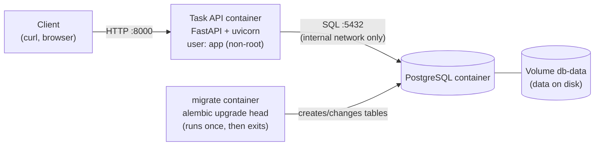
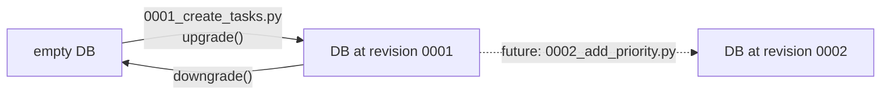
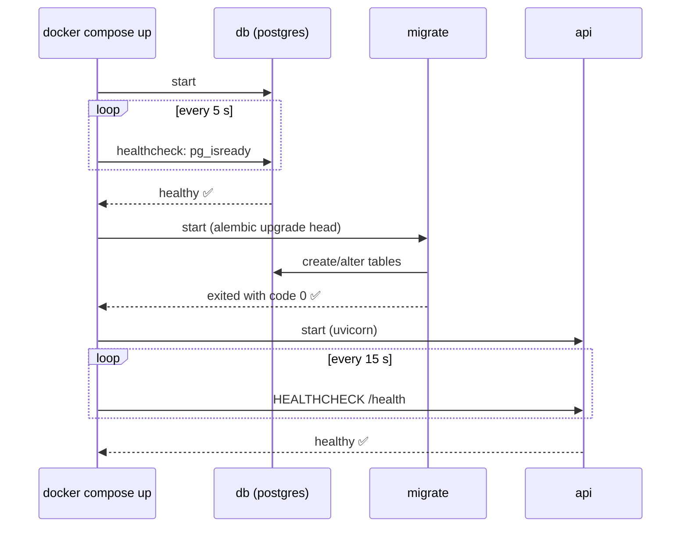
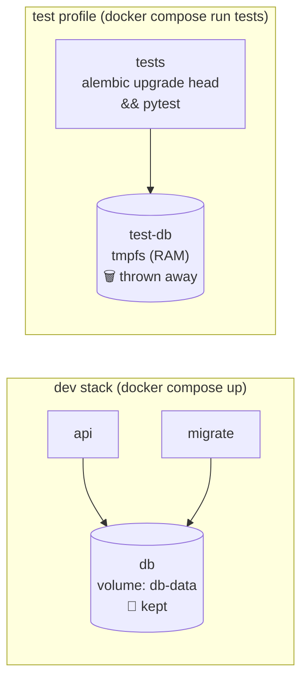

# Phase 1: Application + Docker

> 🎯 **Phase objective:** build the application that every later phase will test, deploy, and monitor,
> and package it as a **small, secure, production-ready container image**, running together with its
> database through **Docker Compose**.

**Status:** ✅ done (20 Nov 2026)

**Legend:** ✅ done · ⏳ waiting · ⚠️ problem found · 👤 you must do this · 🧪 experiment

---

## Where are we now?


---

## Step 1.1: Choose the app and the stack ✅

### 🎯 Objective
Pick an application that is **simple enough** not to distract from DevOps, but **realistic enough**
to exercise everything later phases need: a database, configuration, health checks, logs, and tests.

### ❓ Why not just deploy "hello world"?
A hello-world container has no database, no config, no state, and can't really fail. Every hard DevOps
problem (startup order, migrations, secrets, readiness, persistence, rollback) comes from those things.

### The decision

| Choice | Picked | Why |
|---|---|---|
| App | **Task API**: a REST API to create/list/update/delete tasks | Tiny business logic, real database usage |
| Language / framework | **Python 3.13 + FastAPI** | Readable, popular, automatic API docs, easy testing |
| Database | **PostgreSQL 17** | The most common open-source production database; Azure has a managed version (Phase 8) |
| DB access | **SQLAlchemy 2** (ORM) + **psycopg 3** (driver) | Industry standard in Python |
| Schema changes | **Alembic** migrations | Versioned database changes (Step 1.4) |
| Config | **Environment variables** (pydantic-settings) | Same image runs everywhere (12-factor) |

### 📚 Concept: the 12-factor app
A famous checklist for building apps that run well in containers and the cloud
([12factor.net](https://12factor.net)). The four factors we apply right now:

| Factor | Rule | Where in our app |
|---|---|---|
| III. Config | Config lives in **environment variables**, not in code | `taskapi/config.py` reads `APP_*` variables |
| IV. Backing services | The database is an attached resource, swappable by URL | `APP_DATABASE_URL` |
| VI. Processes | The app is **stateless**; state lives in the database | Nothing stored on the container's disk |
| XI. Logs | Write logs to **stdout**; the platform collects them | `logging` → stdout → `docker logs` |

### Architecture



---

## Step 1.2: Project layout ✅

### 🎯 Objective
Organize files so that each tool finds what it needs, and so the Docker image only contains what runs.

```
devops-project/
├── compose.yaml              ← runs the whole stack locally (Step 1.10)
├── .env.example              ← template for local secrets (copy to .env, never commit .env)
└── app/                      ← everything that becomes the container image
    ├── Dockerfile            ← production image, multi-stage (Step 1.8)
    ├── Dockerfile.naive      ← the "bad example" we compare against (Step 1.7)
    ├── .dockerignore         ← files never sent to Docker
    ├── requirements.in       ← runtime deps we WANT (human-edited)
    ├── requirements.txt      ← exact locked versions (generated)
    ├── requirements-dev.in   ← test deps we want
    ├── requirements-dev.txt  ← test deps, locked (generated)
    ├── pytest.ini            ← test configuration
    ├── alembic.ini           ← migration tool configuration
    ├── migrations/           ← database change history
    │   ├── env.py
    │   └── versions/0001_create_tasks.py
    ├── taskapi/              ← the application code (a Python package)
    │   ├── config.py         ← settings from environment variables
    │   ├── db.py             ← database connection
    │   ├── models.py         ← tables (ORM)
    │   ├── schemas.py        ← request/response validation
    │   └── main.py           ← HTTP endpoints
    └── tests/
        ├── test_unit.py         ← no database needed
        └── test_integration.py  ← needs a real PostgreSQL
```

---

## Step 1.3: Write the application ✅

### 🎯 Objective
A working REST API with business endpoints **plus operational endpoints** that Docker, Kubernetes,
and monitoring will rely on.

### The endpoints

| Method | Path | Purpose | Status codes |
|---|---|---|---|
| GET | `/health` | **Liveness**: is the process alive? | 200 |
| GET | `/ready` | **Readiness**: can it serve traffic? (checks the DB) | 200 / 503 |
| GET | `/tasks` | List all tasks | 200 |
| POST | `/tasks` | Create a task `{"title": "..."}` | 201 / 422 |
| GET | `/tasks/{id}` | Get one task | 200 / 404 |
| PATCH | `/tasks/{id}` | Update `title` and/or `done` | 200 / 404 / 422 |
| DELETE | `/tasks/{id}` | Delete a task | 204 / 404 |
| GET | `/docs` | Interactive API docs (auto-generated by FastAPI) | 200 |


### 📚 Concept: liveness vs readiness (very important for Kubernetes)

| | `/health` (liveness) | `/ready` (readiness) |
|---|---|---|
| Question | "Is the process stuck or dead?" | "Should I send it traffic right now?" |
| Checks the database? | **No, never** | **Yes** |
| If it fails, Kubernetes... | **restarts** the container | **stops sending traffic** (no restart) |

**Why liveness must NOT check the database:** if the DB goes down and liveness checked it, Kubernetes
would restart *every* app container in a loop. That doesn't fix the database, and it adds chaos.
Readiness is the right tool: "pause traffic until the DB is back". We prove this in Step 1.12.

### Walkthrough of the code (read the files: every block is commented)

| File | What to notice |
|---|---|
| [`config.py`](../app/taskapi/config.py) | `env_prefix="APP_"`: field `database_url` is read from `APP_DATABASE_URL`. Defaults exist only for convenience; containers always override them. |
| [`db.py`](../app/taskapi/db.py) | `create_engine()` doesn't connect until first use. `pool_pre_ping=True` survives DB restarts. `get_session()` gives each request its own session and always closes it. |
| [`models.py`](../app/taskapi/models.py) | The `tasks` table as a Python class. `server_default=func.now()`: the **database** sets the timestamp. |
| [`schemas.py`](../app/taskapi/schemas.py) | `Field(min_length=1, max_length=200)`: invalid input is rejected with **422** before touching the DB. |
| [`main.py`](../app/taskapi/main.py) | Logs go to stdout. `SessionDep` = dependency injection: FastAPI hands a DB session to each endpoint. |

---

## Step 1.4: Database migrations with Alembic ✅

### 🎯 Objective
Create and change database tables through **versioned migration files**, applied by a separate step
**before** the app starts.

### ❓ Why not let the app create tables at startup?
Many tutorials call `Base.metadata.create_all()` when the app starts. That breaks in real life:
- It can **create** tables but can't **change** them (add a column, rename, add an index).
- With 3 replicas starting at once, all 3 try to change the schema at the same moment.
- There is no history of what changed when, and no way to roll back.

Migrations solve this: each schema change is a numbered file in Git, applied **once**, in order.



Alembic records the current revision in a small table (`alembic_version`), so it knows what's left to apply.

### Files

| File | Role |
|---|---|
| [`alembic.ini`](../app/alembic.ini) | Where migrations live. **No DB password here.** |
| [`migrations/env.py`](../app/migrations/env.py) | Reads `APP_DATABASE_URL` and the table definitions from our app |
| [`migrations/versions/0001_create_tasks.py`](../app/migrations/versions/0001_create_tasks.py) | `upgrade()` creates the table, `downgrade()` drops it |

### ⌨️ Commands

```bash
alembic upgrade head     # apply all pending migrations ("head" = newest)
alembic current          # show the DB's current revision
alembic downgrade -1     # undo the last migration
```

In our stack these run inside the `migrate` container (Step 1.10). In Kubernetes they will run as a
**Job** / ArgoCD **PreSync hook** (Phase 6). Same idea, different runner.

### 🧯 Real error we hit: `No module named 'taskapi'`

```
    from taskapi import models
ModuleNotFoundError: No module named 'taskapi'
service "migrate" didn't complete successfully: exit 1
```

**Cause:** the `alembic` command is a "console script"; Python doesn't automatically add the current
folder (`/app`) to its import path for those, so `env.py` can't find our package.
**Fix:** one line in `alembic.ini`:

```ini
prepend_sys_path = .
```

**Lesson:** `depends_on: condition: service_completed_successfully` (Step 1.10) did its job: the API
**was never started** on top of a database without tables.

---

## Step 1.5: Dependencies and lock files ✅

### 🎯 Objective
Install **exactly the same library versions** every time: on your laptop, in CI, and in production.

### 📚 Concept: "what I want" vs "what I got"

| File | Written by | Content | Example |
|---|---|---|---|
| `requirements.in` | **you** | top-level libraries you need | `fastapi` |
| `requirements.txt` | **pip-compile** (generated) | *every* library, including dependencies of dependencies, with exact versions | `fastapi==0.165.0`, `starlette==1.10.0`, `anyio==4.16.0`, … |

Without a lock file, `pip install fastapi` installs *whatever is newest today*. A rebuild next month can
pull in a breaking change and fail for no visible reason. That's the classic "it worked yesterday".

Dev tools are split out: `requirements-dev.in` starts with `-c requirements.txt` ("use the same locked
versions"), then adds `pytest` and `httpx2`. **Test tools never go into the production image.**

### 🛠️ Tool
`pip-compile` from **pip-tools**, run **inside a container**, so you don't need Python installed
on your machine at all, and the lock is resolved for the same Python version as the image (3.13).

### ⌨️ Command (inside Ubuntu, in `app/`)

```bash
docker run --rm -v "$PWD:/work" -w /work python:3.13-slim sh -c "
  pip install -q pip-tools &&
  pip-compile -q --strip-extras --no-header --output-file requirements.txt     requirements.in &&
  pip-compile -q --strip-extras --no-header --output-file requirements-dev.txt requirements-dev.in"
```

| Part | Meaning |
|---|---|
| `--rm` | delete the container when done |
| `-v "$PWD:/work"` | **mount** the current folder into the container at `/work`, so generated files land on your disk |
| `-w /work` | working directory inside the container |
| `--strip-extras` | write `psycopg` + `psycopg-binary` instead of `psycopg[binary]` (more portable lock) |
| `--no-header` | skip the auto-generated comment header |

### 📤 Output (`requirements.txt`, 27 pinned packages from 6 requested)

```
alembic==1.20.1        fastapi==0.165.0       psycopg==3.3.9          sqlalchemy==2.1.9
pydantic==2.14.4       pydantic-settings==2.16.3   starlette==1.10.0   uvicorn==0.54.0
... (+ 19 transitive dependencies)
```

**To upgrade a library later:** edit the `.in` file (or just re-run), regenerate, rebuild, run tests,
commit both files. In Phase 2 a bot (Dependabot/Renovate) will propose these upgrades automatically.

---

## Step 1.6: Tests ✅

### 🎯 Objective
Automatically prove the app works, at two levels, so CI (Phase 2) can block broken code.

### 📚 Concept: unit vs integration tests

| | Unit tests | Integration tests |
|---|---|---|
| File | [`tests/test_unit.py`](../app/tests/test_unit.py) | [`tests/test_integration.py`](../app/tests/test_integration.py) |
| Needs a database? | **No** | **Yes**, a real PostgreSQL |
| Speed | milliseconds | seconds |
| Catches | logic and validation bugs | wrong SQL, missing migrations, wiring problems |
| Count | 5 | 3 |

The pyramid idea: **many cheap unit tests, fewer expensive integration tests.** CI runs units first (fail fast).

### Techniques worth noticing

| Technique | Where | What it teaches |
|---|---|---|
| `monkeypatch.setattr(main, "check_database", lambda: False)` | unit | **Mocking**: fake a DB outage without a DB, to test `/ready` returns 503 |
| `@pytest.fixture(autouse=True)` + `TRUNCATE tasks` | integration | Every test starts from an empty table, so tests don't influence each other |
| `pytestmark = pytest.mark.integration` | integration | Run subsets: `pytest -m "not integration"` runs only unit tests |

### 🧯 Real error we hit: tests couldn't import the app

```
ImportError while importing test module '/app/tests/test_unit.py'.
E   ModuleNotFoundError: No module named 'taskapi'
```

Same root cause as Alembic. **Fix** in [`pytest.ini`](../app/pytest.ini): `pythonpath = .`

**Lesson:** the running API worked fine, and only the *tests* exposed the problem. That's exactly why CI
runs tests on every change instead of trusting "it runs on my machine".

---

## Step 1.7: The naive Dockerfile ✅

### 🎯 Objective
Write the Dockerfile most beginners write, so we can **measure** its problems instead of just being told.

### [`app/Dockerfile.naive`](../app/Dockerfile.naive)

```dockerfile
FROM python:3.13
WORKDIR /app
COPY . .
RUN pip install -r requirements.txt -r requirements-dev.txt
CMD uvicorn taskapi.main:app --host 0.0.0.0 --port 8000
```

### 📚 Concept: images are built in layers
Each instruction (`FROM`, `COPY`, `RUN`, …) creates a **layer**. Docker **caches** layers and reuses
them as long as nothing *before* them changed. Once one layer changes, **every layer after it is rebuilt**.

### What's wrong with it

| # | Problem | Consequence |
|---|---|---|
| 1 | `FROM python:3.13`, the full Debian image with compilers | Huge image, many more packages that could have security holes |
| 2 | `COPY . .` **before** `pip install` | Any code change invalidates the cache → **all dependencies reinstall** on every build |
| 3 | Installs **dev dependencies** (pytest…) and copies **tests** | Test tools shipped to production: bigger, more attack surface |
| 4 | No `USER` → runs as **root** | If the app is hacked, the attacker is root inside the container |
| 5 | **Shell form** `CMD uvicorn ...` | Runs as `/bin/sh -c "uvicorn ..."`: `sh` is PID 1 and doesn't forward `SIGTERM`, so `docker stop` waits 10 s and then kills the app hard (no graceful shutdown) |
| 6 | No `HEALTHCHECK` | Docker can't tell a hung app from a healthy one |

---

## Step 1.8: The production multi-stage Dockerfile ✅

### 🎯 Objective
Fix every problem above: small, cache-friendly, no build/test tools, non-root, graceful shutdown, health check.

### 📚 Concept: multi-stage builds
One Dockerfile, several `FROM` sections ("stages"). Later stages **copy only selected files** from
earlier ones. Everything else (compilers, caches, test tools) is left behind.


### [`app/Dockerfile`](../app/Dockerfile): instruction by instruction

| Instruction | Why |
|---|---|
| `ARG PYTHON_VERSION=3.13` | One place to change the Python version for all stages |
| `FROM python:${PYTHON_VERSION}-slim AS builder` | **slim** = Debian without compilers/docs (~176 MB vs ~1 GB). `AS builder` names the stage |
| `ENV PIP_NO_CACHE_DIR=1 ...` | Don't keep pip's download cache inside the image |
| `RUN python -m venv /opt/venv` | Put all packages in **one folder** that's easy to copy to the next stage |
| `COPY requirements.txt ...` **then** `RUN pip install` | **Cache trick:** this layer only rebuilds when `requirements.txt` changes, not when code changes |
| `FROM builder AS test` | Test stage = builder + dev deps + tests. Built only when asked (`--target test`) |
| `FROM python:...-slim AS runtime` | **Fresh** slim base: nothing from the builder comes along unless explicitly copied |
| `ENV PYTHONUNBUFFERED=1` | Logs appear immediately in `docker logs` |
| `RUN groupadd ... useradd --uid 10001 ... app` | Dedicated **unprivileged user**. Fixed UID lets Kubernetes enforce `runAsNonRoot` (Phase 3) |
| `COPY --from=builder /opt/venv /opt/venv` | Only the installed packages travel to the final image |
| `COPY taskapi ./taskapi` etc. | Only runtime files. **Owned by root** → the app user can read but **not modify** its code |
| `USER 10001` | Everything after this, and the running container, is non-root |
| `HEALTHCHECK ... CMD ["python", "-c", "...urlopen('/health')..."]` | Docker marks the container `healthy`/`unhealthy`. Uses Python's stdlib because slim has no `curl` |
| `CMD ["uvicorn", ...]` | **Exec form**: uvicorn is PID 1, receives `SIGTERM`, shuts down gracefully |

### [`app/.dockerignore`](../app/.dockerignore)
The **build context** is the folder you send to Docker (`.`). `.dockerignore` excludes caches, local
virtualenvs, **`.env` secrets**, and the Dockerfiles themselves, so they can never end up inside an image.

---

## Step 1.9: Naive vs production, measured ✅

### ⌨️ Commands (inside Ubuntu, in `app/`)

```bash
docker build -f Dockerfile.naive -t taskapi:naive .     # -f = which Dockerfile, -t = name:tag
docker build -t taskapi:local .                          # default Dockerfile, default (last) stage
docker images | grep taskapi                             # sizes

echo "# cache test" >> taskapi/main.py                   # simulate a 1-line code change
docker build -f Dockerfile.naive -t taskapi:naive .      # rebuild both, measure time
docker build -t taskapi:local .

docker run --rm --entrypoint "" taskapi:local sh -c "id -un"   # who runs inside?
docker history -q taskapi:local | wc -l                        # number of layers
docker inspect --format "{{json .Config.Cmd}}" taskapi:local   # how it starts
```

### 📤 Results

| Measurement | Naive | Production | |
|---|---|---|---|
| **Image size** | **1.81 GB** | **311 MB** | **5.8× smaller** |
| First build | 129 s | 56 s | |
| **Rebuild after a 1-line code change** | **56 s** (pip reinstalls everything) | **6 s** (dependency layers `CACHED`) | **~9× faster** |
| Runs as | `root` | `app` | |
| `pytest` inside? | yes (`/usr/local/bin/pytest`) | not installed | |
| `tests/` inside? | yes | not present | |
| `gcc` compiler inside? | yes (`/usr/bin/gcc`) | not installed | |
| CMD | `["/bin/sh","-c","uvicorn ..."]` (shell form) | `["uvicorn", ...]` (exec form) | |
| Health check | none | every 15 s, 3 retries | |

**Why the rebuild difference matters:** in CI every push rebuilds the image. 56 s vs 6 s, multiplied by
dozens of pushes a day, is real waiting time. A smaller image also means faster pulls when Kubernetes
starts new pods, and fewer packages that can contain vulnerabilities (we'll *count* them with Trivy in Phase 2).

> The naive image is kept only for this comparison. You can delete it: `docker rmi taskapi:naive`.

---

## Step 1.10: Docker Compose: the whole stack in one file ✅

### 🎯 Objective
Start **database → migrations → API** in the correct order with one command, with secrets kept out of Git.

### 📚 Concept: what Compose gives you
- **One private network** per project: containers reach each other **by service name** (`db:5432`).
- **Startup order with conditions** (not just "start A before B", but "start B when A is *healthy*").
- **Named volumes** for data that must survive container restarts.
- **Variables from `.env`**, so one file holds local secrets and `compose.yaml` stays committable.

### Startup order



### [`compose.yaml`](../compose.yaml): key parts explained

| Part | Meaning |
|---|---|
| `name: devops-lab` | Project name → containers are called `devops-lab-api-1`, etc. |
| `x-app-env: &app-env` | A reusable YAML block (**anchor**). `*app-env` pastes it; `<<: *app-env` merges it and lets you add keys |
| `${POSTGRES_PASSWORD:?Set ... in .env}` | Required variable: Compose **refuses to start** with a clear message if it's missing |
| `${POSTGRES_USER:-taskapi}` | Optional variable with a default |
| `db` → `volumes: db-data:/var/lib/postgresql/data` | Database files live in a **named volume**, not in the container |
| `db` → no `ports:` | The DB is **not exposed** to your laptop, only to containers in the stack (least privilege) |
| `db` → `healthcheck: pg_isready` | Postgres' own readiness tool. `$$` = literal `$` (expanded inside the container) |
| `migrate` → `restart: "no"` | Runs once and exits, like a Kubernetes **Job** |
| `api` → `depends_on: migrate: condition: service_completed_successfully` | API starts **only if migrations succeeded** |
| `api` → `ports: "8000:8000"` | `host:container`. Your laptop's port 8000 forwards to the container |
| `restart: unless-stopped` | Restart after crashes or Docker restarts, unless you stopped it yourself |
| `test-db` → `tmpfs` | Test database stored **in RAM**: fast and wiped automatically |
| `tests` / `test-db` → `profiles: ["test"]` | **Not** started by `up`; only when you run them explicitly |

### Secrets: `.env` vs `.env.example`

| File | In Git? | Content |
|---|---|---|
| [`.env.example`](../.env.example) | ✅ yes | variable **names** + placeholder values: documentation |
| `.env` | ❌ **never** (`.gitignore`) | your real local values |

### ⌨️ Commands (inside Ubuntu, in the project root)

```bash
cp .env.example .env                                   # once
sed -i "s/^POSTGRES_PASSWORD=.*/POSTGRES_PASSWORD=$(openssl rand -hex 16)/" .env   # random password
git check-ignore -q .env && echo "ignored by git: OK"  # verify it will never be committed
docker compose config --quiet && echo valid            # validate the YAML + variables
docker compose up -d --build                           # -d = background, --build = (re)build images
docker compose ps -a                                   # -a = include exited containers (migrate)
```

### 📤 Output

```
.env created with a random password
.env is ignored by git: OK
compose.yaml is valid
 Container devops-lab-db-1       Healthy
 Container devops-lab-migrate-1  Exited
 Container devops-lab-api-1      Started

SERVICE   STATUS                     PORTS
api       Up (health: starting)      0.0.0.0:8000->8000/tcp
db        Up 26 seconds (healthy)    5432/tcp
migrate   Exited (0)
```

`migrate` **Exited (0)** is the success state: exit code 0 = "finished without errors".

---

## Step 1.11: Run and verify the API ✅

### 🎯 Objective
Exercise every endpoint from outside the containers, and read the logs.

### ⌨️ Commands and 📤 real output

```bash
docker compose run --rm --no-deps migrate alembic current   # → 0001 (head)
curl -s localhost:8000/health    # → {"status":"ok","version":"dev"}
curl -s localhost:8000/ready     # → {"status":"ready"}  [HTTP 200]

curl -s -X POST localhost:8000/tasks -H "Content-Type: application/json" -d '{"title":"Learn Docker"}'
# → {"id":1,"title":"Learn Docker","done":false,"created_at":"2026-11-20T20:55:00.979678Z"}

curl -s -X PATCH localhost:8000/tasks/1 -H "Content-Type: application/json" -d '{"done":true}'
# → {"id":1,"title":"Learn Docker","done":true,...}

curl -s -X POST localhost:8000/tasks -H "Content-Type: application/json" -d '{"title":""}'
# → {"detail":[{"type":"string_too_short","loc":["body","title"],"msg":"String should have at least 1 character",...  [HTTP 422]

curl -s localhost:8000/tasks/999 # → {"detail":"task not found"}  [HTTP 404]
```

| curl flag | Meaning |
|---|---|
| `-s` | silent (no progress bar) |
| `-X POST` | HTTP method |
| `-H "Content-Type: application/json"` | tell the API the body is JSON |
| `-d '{...}'` | request body |
| `-w "%{http_code}"` | print the HTTP status code |

### Logs: one stream, written to stdout

```bash
docker compose logs api --no-log-prefix --tail 8
```
```
2026-11-20 20:55:01,031 INFO taskapi task created id=2
INFO:     172.19.0.1:45010 - "POST /tasks HTTP/1.1" 201 Created
2026-11-20 20:55:01,064 INFO taskapi task updated id=1
INFO:     172.19.0.1:45026 - "PATCH /tasks/1 HTTP/1.1" 200 OK
INFO:     172.19.0.1:45030 - "POST /tasks HTTP/1.1" 422 Unprocessable Content
INFO:     172.19.0.1:45044 - "GET /tasks/999 HTTP/1.1" 404 Not Found
INFO:     127.0.0.1:36032 - "GET /health HTTP/1.1" 200 OK      ← Docker's HEALTHCHECK calling us
```

After ~15 s: `api  Up 27 seconds (healthy)`. The HEALTHCHECK passed.

Open **<http://localhost:8000/docs>** in your browser to try every endpoint interactively.

---

## Step 1.12: 🧪 Experiment: database outage (liveness vs readiness) ✅

### 🎯 Objective
**See** the difference between `/health` and `/ready` from Step 1.3, instead of taking it on faith.

### ⌨️ Commands and 📤 output

```bash
docker compose stop db
curl -s -w "  [HTTP %{http_code}]" localhost:8000/health
curl -s -w "  [HTTP %{http_code}]" localhost:8000/ready
docker compose start db
curl -s -w "  [HTTP %{http_code}]" localhost:8000/ready
```
```
/health → {"status":"ok","version":"dev"}  [HTTP 200]                              ← process is fine: don't restart it
/ready  → {"status":"not ready","reason":"database unreachable"}  [HTTP 503]       ← but don't send it traffic
/ready after db start → {"status":"ready"}  [HTTP 200]                             ← recovered by itself, no restart
```

**What Kubernetes will do with this (Phase 3):** during the outage it removes the pod from the Service
(no traffic → users get a fast error from the load balancer instead of a slow timeout), keeps the pod
running, and adds it back automatically when `/ready` returns 200. Thanks to `pool_pre_ping=True`
the app reconnected without a restart.

---

## Step 1.13: Tests in containers ✅

### 🎯 Objective
Run the full test suite in the **same image and Python version** CI will use, without installing Python locally.

### ⌨️ Commands

```bash
docker compose run --rm tests                                  # unit + integration (own test DB)
docker run --rm taskapi:test pytest -m "not integration" -q    # unit only, no DB at all
docker compose rm -sf test-db                                  # remove ONLY the test DB afterwards
```

### ⚠️ Real bug we found and fixed: tests wiped the dev data

The first version pointed the tests at the **same `db`** the API uses. The integration tests'
`TRUNCATE tasks` **deleted our dev tasks.** In a real company, this is how people delete data in
shared databases.

**Fix:** a separate **`test-db`** service, used only by tests:



**Rule: tests never touch a database that holds data you care about.**

### ⚠️ Second gotcha: `--profile test down` stops everything
`docker compose --profile test down` removed the **entire** project (api and db too), not just the test
containers. Use `docker compose rm -sf test-db` to remove only the test DB (`-s` stop, `-f` no prompt).

### ⚠️ Third: a deprecation warning
```
StarletteDeprecationWarning: Using `httpx` with `starlette.testclient` is deprecated; install `httpx2` instead.
```
Fixed by replacing `httpx` with `httpx2` in `requirements-dev.in` and regenerating the lock.
**Treat warnings as future errors**: fixing them now is cheap.

### 📤 Final output

```
tests/test_integration.py::test_ready_with_real_database PASSED          [ 12%]
tests/test_integration.py::test_task_lifecycle PASSED                    [ 25%]
tests/test_integration.py::test_missing_task_returns_404 PASSED          [ 37%]
tests/test_unit.py::test_health_is_ok_without_database PASSED            [ 50%]
tests/test_unit.py::test_ready_returns_503_when_database_is_down PASSED  [ 62%]
tests/test_unit.py::test_ready_returns_200_when_database_is_up PASSED    [ 75%]
tests/test_unit.py::test_create_task_rejects_empty_title PASSED          [ 87%]
tests/test_unit.py::test_create_task_rejects_too_long_title PASSED       [100%]
============================== 8 passed in 1.91s ===============================

# unit only:
5 passed, 3 deselected in 1.65s

dev tasks before tests: 3   →   dev tasks after tests: 3   ✅ untouched
```

---

## Step 1.14: 🧪 Experiment: does data survive? ✅

### 🎯 Objective
Understand the difference between a **container** (disposable) and a **volume** (persistent).

### ⌨️ Commands and 📤 output

```bash
curl -s -X POST localhost:8000/tasks -H "Content-Type: application/json" -d '{"title":"I should survive a restart"}'
docker compose down              # removes containers and network, NOT volumes
docker volume ls | grep db-data  # → devops-lab_db-data   (still there)
docker compose up -d
curl -s localhost:8000/tasks     # → [... {"id":3,"title":"I should survive a restart",...}]
```

| Command | Containers | Network | Volume (data) |
|---|---|---|---|
| `docker compose stop` | stopped (kept) | kept | kept |
| `docker compose down` | **removed** | **removed** | **kept** ✅ |
| `docker compose down -v` | removed | removed | **DELETED** ⚠️ |

This is the same lesson as the `mariadb` volume in Phase 0: **containers are cattle, volumes are the data.**

---

## ✅ Phase 1 summary

**What you have now**
- A Task API with business endpoints, liveness/readiness probes, env-based config, stdout logs.
- Versioned DB migrations (Alembic) run as a one-off step before the app starts.
- Locked dependencies (27 runtime packages pinned), dev tools kept separate.
- 8 automated tests (5 unit, 3 integration) running in containers with their own throwaway DB.
- A production image: **311 MB, non-root, no build/test tools, graceful shutdown, health check**.
- A Compose stack with correct startup order and secrets in an ignored `.env`.

**Concepts you met**
12-factor app · liveness vs readiness · ORM · migrations · lock files · unit vs integration tests ·
mocking · image layers & build cache · multi-stage builds · non-root containers · PID 1 & signals ·
build context & `.dockerignore` · Compose networks, healthchecks, `depends_on` conditions, profiles,
volumes, `.env` interpolation · test isolation

**Real problems we debugged**
1. `No module named 'taskapi'` in Alembic → `prepend_sys_path = .`
2. Same error in pytest → `pythonpath = .`
3. Tests deleting dev data → separate `test-db` on tmpfs
4. `--profile test down` stopping everything → `rm -sf test-db`
5. Deprecation warning → `httpx` → `httpx2`

**Redo-it-yourself checklist**
1. `cp .env.example .env` and set a password.
2. `docker compose up -d --build` → `docker compose ps -a` (migrate `Exited (0)`, api `healthy`).
3. `curl localhost:8000/health`, `/ready`, create/list a task, open `/docs`.
4. `docker compose run --rm tests` → 8 passed; then `docker compose rm -sf test-db`.
5. Stop the DB, watch `/ready` turn 503 while `/health` stays 200; start it again.
6. `docker compose down` → `up -d` → your tasks are still there.

**Daily commands cheat sheet**

| Task | Command |
|---|---|
| Start / rebuild | `docker compose up -d --build` |
| Status | `docker compose ps -a` |
| Follow API logs | `docker compose logs -f api` |
| Shell inside API container | `docker compose exec api sh` |
| Run tests | `docker compose run --rm tests` |
| Stop (keep data) | `docker compose down` |
| Reset everything incl. data | `docker compose down -v` |

**Next → Phase 2: CI with GitHub Actions.** Every push and pull request will automatically lint the code,
run these tests, build the image, scan it for vulnerabilities, and push it to GHCR, with branch
protection so nothing broken can be merged.
