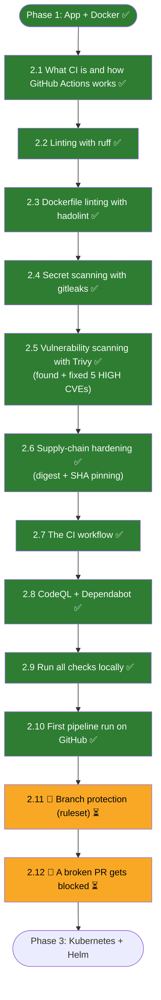
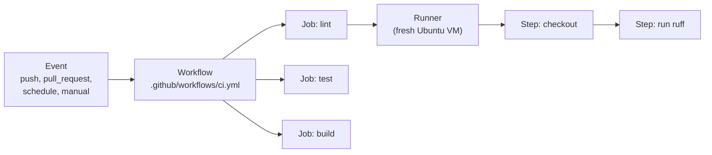
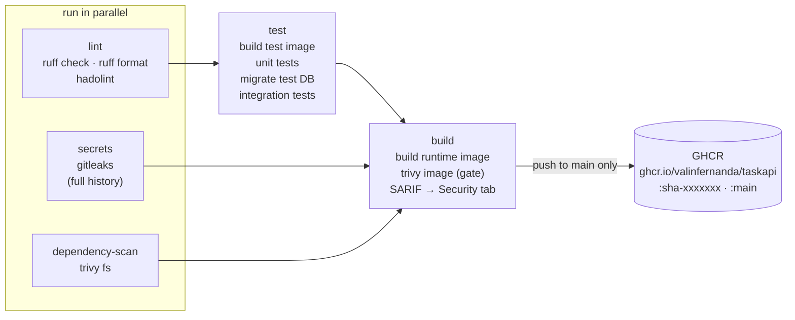
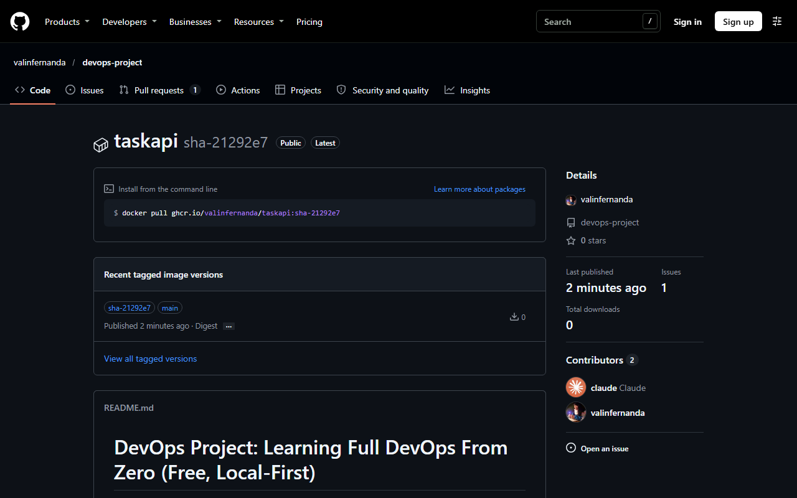
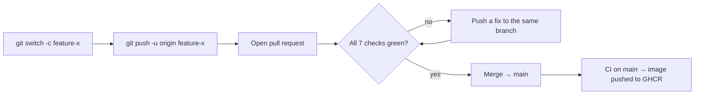

# Phase 2: Continuous Integration with GitHub Actions

> 🎯 **Phase objective:** every push and every pull request is automatically **linted, tested, scanned
> for secrets and vulnerabilities, built, and (on `main`) published** as a container image, and
> broken code **cannot be merged**.

**Status:** ⏳ in progress

**Legend:** ✅ done · ⏳ waiting · ⚠️ problem found · 👤 you must do this · 🧪 experiment

---

## Where are we now?



---

## Step 2.1: What CI is, and how GitHub Actions works ✅

### 🎯 Objective
Understand the vocabulary before writing a pipeline.

### 📚 Concept: Continuous Integration
**CI = every change is automatically built and tested the moment it's pushed**, so problems are found
in minutes by a machine, not days later by a user. It replaces "it works on my laptop" with
"it passed the same checks as everyone else's code".

### 📚 Concept: GitHub Actions vocabulary



| Term | Meaning | In our project |
|---|---|---|
| **Workflow** | A YAML file in `.github/workflows/` | `ci.yml`, `codeql.yml` |
| **Event / trigger** (`on:`) | What starts it | every PR, every push to `main`, manual button, weekly schedule |
| **Job** | A group of steps on **one fresh VM**. Jobs run **in parallel** unless linked with `needs:` | `lint`, `secrets`, `dependency-scan`, `test`, `build` |
| **Runner** | The VM GitHub lends you (free for public repos) | `ubuntu-24.04` |
| **Step** | One command (`run:`) or one reusable **action** (`uses:`) | `uses: actions/checkout@…`, `run: pytest` |
| **Action** | A reusable building block published on GitHub | `actions/checkout`, `docker/build-push-action` |
| **Service container** | A container running beside a job (e.g. a database) | PostgreSQL for integration tests |
| **`GITHUB_TOKEN`** | An automatic, short-lived token for the repo, created per run | used to push images to GHCR |

Every job starts on a **brand-new machine**: nothing from your laptop, nothing from the previous run.
That's what makes CI trustworthy: if it passes there, it doesn't depend on something hidden on your machine.

---

## Step 2.2: Python linting and formatting with ruff ✅

### 🎯 Objective
Catch bugs and style problems automatically, in seconds, before any test runs.

### 📚 Concept: linter vs formatter

| | Linter (`ruff check`) | Formatter (`ruff format`) |
|---|---|---|
| Finds | unused imports, undefined names, likely bugs, **security smells** (`S` rules = bandit) | inconsistent spacing, line breaks, quotes |
| Changes code? | reports (some auto-fixable with `--fix`) | rewrites layout, never behavior |
| Why it matters | real bugs | no more "style" discussions in code review; diffs show only real changes |

**ruff** replaces flake8 + isort + black + parts of bandit, and is very fast. Config: [`app/ruff.toml`](../app/ruff.toml)
(rule groups `E W F I B UP S SIM`; `S101 assert` allowed in tests because that's how pytest works).

ruff is pinned in [`requirements-dev.in`](../app/requirements-dev.in) → locked in `requirements-dev.txt`,
so your laptop and CI always use **the same ruff version** (`0.17.6`).

### ⌨️ Commands (inside Ubuntu, project root)

```bash
docker build -q --target test -t taskapi:test app        # ruff lives in the test image
docker run --rm taskapi:test ruff check .                 # lint
docker run --rm taskapi:test ruff format --check .        # would anything be reformatted?
docker run --rm -v "$PWD/app:/app" taskapi:test ruff format .   # apply formatting to your files
```

### 📤 Output

```
### ruff check
All checks passed!
### ruff format --check
unformatted: File would be reformatted
  --> taskapi/models.py:17:50
-     created_at: Mapped[datetime] = mapped_column(
-         DateTime(timezone=True), server_default=func.now()
-     )
+     created_at: Mapped[datetime] = mapped_column(DateTime(timezone=True), server_default=func.now())
1 file would be reformatted, 9 files already formatted
```

After `ruff format .` → `10 files already formatted`.

> 🧯 We first tried the `ghcr.io/astral-sh/ruff:0.17.6` image and got `error from registry: denied`
> (that tag isn't published there). Locking ruff as a dev dependency turned out better anyway: one version, one source of truth.

---

## Step 2.3: Dockerfile linting with hadolint ✅

### 🎯 Objective
Catch Dockerfile mistakes (the ones from Phase 1's naive Dockerfile) automatically.

### ⌨️ Commands and 📤 output

```bash
docker run --rm -i hadolint/hadolint:v2.15.1 < app/Dockerfile          # → no findings
docker run --rm -i hadolint/hadolint:v2.15.1 < app/Dockerfile.naive    # the bad example
```
```
-:10 DL3042 warning: Avoid use of cache directory with pip. Use `pip install --no-cache-dir <package>`
-:12 DL3025 warning: Use arguments JSON notation for CMD and ENTRYPOINT arguments
```

`-i` + `< file` = feed the Dockerfile through **stdin**, so no volume mount is needed.
Each rule has a page, e.g. *DL3025* = the shell-form `CMD` problem (no graceful shutdown) we discussed in Phase 1.

---

## Step 2.4: Secret scanning with gitleaks ✅

### 🎯 Objective
Fail the pipeline if a password, API key, or token was ever committed, in **any** commit.

### ❓ Why scan the whole history?
Deleting a secret in a later commit doesn't remove it: `git log -p` still shows it, and so does
everyone's clone. A leaked secret must be **revoked/rotated**, not just deleted. That's why CI
checks out with `fetch-depth: 0` (full history) and runs `gitleaks git`.

### ⌨️ Commands and 📤 output

```bash
docker run --rm -v "$PWD:/repo" zricethezav/gitleaks:v8.30.1 git /repo --no-banner           # Git history
docker run --rm -v "$PWD:/repo" zricethezav/gitleaks:v8.30.1 dir /repo --no-banner --redact  # files on disk
```
```
5 commits scanned.
no leaks found                                   ← Git history is clean ✅

leaks found: 1                                   ← working directory scan
RuleID:      generic-api-key
File:        /repo/.env                          ← our real local DB password
Line:        7
Secret:      REDACTED                            ← --redact: never print secrets in logs
```

This proves two things: gitleaks **does** detect secrets, and `.gitignore` is doing its job. `.env`
is on disk but was never committed, so the history scan (what CI runs) is clean.

> 🧯 Pulling the gitleaks image from inside Ubuntu once failed with `error getting credentials`
> (Docker Desktop's credential helper bridge). Pulling it from PowerShell (`docker pull …`) worked,
> and both share the same Docker engine, so the image was then available in Ubuntu too.

---

## Step 2.5: Vulnerability scanning with Trivy: found and fixed 5 HIGH CVEs ✅

### 🎯 Objective
Block images that contain **known, fixable, serious** vulnerabilities (CVEs).

### 📚 Concepts

| Term | Meaning |
|---|---|
| **CVE** | A public ID for a known vulnerability, e.g. `CVE-2025-47273` |
| **Severity** | LOW / MEDIUM / HIGH / CRITICAL (how bad if exploited) |
| **Fixed version** | The version where the maintainers fixed it. No fixed version = nothing you can upgrade to yet |
| `--ignore-unfixed` | Only fail on vulnerabilities **you can actually fix**. Others are tracked but don't block |
| `--exit-code 1` | Make Trivy **fail** (non-zero exit) when it finds something, so CI turns red |

Trivy scans two things:
- **`trivy fs`**: our dependency files (`requirements*.txt`)
- **`trivy image`**: the finished image: Debian OS packages **and** every Python package inside it

### ⌨️ Commands

```bash
TRIVY="docker run --rm -v trivy-cache:/root/.cache/ -v /var/run/docker.sock:/var/run/docker.sock aquasec/trivy:0.76.2"
$TRIVY -v "$PWD:/src" fs --scanners vuln --severity HIGH,CRITICAL /src/app
$TRIVY image --scanners vuln taskapi:local                                            # everything
$TRIVY image --scanners vuln --severity HIGH,CRITICAL --ignore-unfixed --exit-code 1 taskapi:local   # the gate
```

| Part | Meaning |
|---|---|
| `-v trivy-cache:/root/.cache/` | keep Trivy's vulnerability database in a volume (downloaded once, not every run) |
| `-v /var/run/docker.sock:...` | let Trivy (in a container) read images from your Docker engine |

### 📤 Output: first scan ❌

```
requirements.txt │ pip │ 0                        ← our declared dependencies: clean

taskapi:local (debian 13.7)
Total: 234 (UNKNOWN: 9, LOW: 67, MEDIUM: 110, HIGH: 48, CRITICAL: 0)

HIGH + fixable only:
msgpack     CVE-2026-114613, GHSA-6v7p-g79w-8964   1.1.2  → fixed in 1.2.3
setuptools  CVE-2025-47273                          70.3.0 → fixed in 78.1.1
urllib3     CVE-2026-97687, CVE-2026-97689          2.7.0  → fixed in 2.8.0
zlib1g      (Debian package)                               → fixed version available
```

### 🔎 Investigation: where do msgpack/urllib3 come from? We never installed them!

```bash
docker run --rm --entrypoint "" taskapi:local sh -c 'find / -name "msgpack*" -o -name "urllib3*" | grep -v __pycache__'
```
```
/opt/venv/lib/python3.13/site-packages/pip/_vendor/msgpack
/opt/venv/lib/python3.13/site-packages/pip/_vendor/urllib3
/usr/local/lib/python3.13/site-packages/pip/_vendor/msgpack
/usr/local/lib/python3.13/site-packages/pip/_vendor/urllib3
```

They're **inside pip itself** ("vendored" = pip ships its own copies). Two copies of pip were in the
runtime image: one in our venv, one from the base image. **The running app never uses pip.**

### ✅ The fix (in [`app/Dockerfile`](../app/Dockerfile))

| Change | Effect |
|---|---|
| `python -m venv --without-pip /opt/venv` | our venv has **no pip at all** |
| `/usr/local/bin/pip --python /opt/venv/bin/python install …` | install **into** the venv using the base image's pip (only in builder/test stages) |
| runtime: `python -m pip uninstall -y pip` | remove the base image's pip from the final image |
| runtime: `apt-get update && apt-get upgrade -y … && rm -rf /var/lib/apt/lists/*` | install Debian security fixes (zlib1g) released after the base image was built; clean apt lists **in the same layer** so they don't bloat the image |

### 📤 Output: after the fix ✅

```
pip in runtime image? /opt/venv/bin/python: No module named pip
Total: 232 (UNKNOWN: 9, LOW: 67, MEDIUM: 109, HIGH: 47, CRITICAL: 0)
HIGH,CRITICAL fixable:  debian │ 0          exit code: 0       ← gate passes
image size: 311 MB → 295 MB
```

### ❓ But there are still 47 HIGH! Is that OK?
They're all in Debian packages **with no fix released yet**. Nobody can upgrade to a version that doesn't
exist. The policy "**block fixable HIGH/CRITICAL, track the rest**" is the common industry compromise:
- They still show up in the **Security tab** (SARIF upload, Step 2.7), so they're tracked.
- The weekly Dependabot base-image update pulls in fixes as Debian releases them.
- To shrink this number further: *distroless* or *Chainguard/Wolfi* base images ship far fewer packages (a Phase 8 topic).

> ℹ️ Removing pip in a later layer means the base image's layer still physically contains pip's bytes.
> Scanners look at the final filesystem, where pip no longer exists. Only a different base image removes the bytes too.

---

## Step 2.6: Supply-chain hardening: pin everything ✅

### 🎯 Objective
Make sure the pipeline runs **exactly** the code you reviewed, not whatever a tag points to today.

### 📚 Concept: tags can move, digests and SHAs can't

| Reference | Example | Can it change silently? |
|---|---|---|
| Image **tag** | `python:3.13-slim` | **Yes**: re-pointed to a new image every few weeks |
| Image **digest** | `python:3.13-slim@sha256:e48f…ed90` | **No**: the hash *is* the content |
| Action **tag** | `actions/checkout@v7` | **Yes**: the owner (or an attacker who hijacked the repo) can move it |
| Action **commit SHA** | `actions/checkout@3d3c42e5…` | **No** |

**Real-world example:** in March 2025 the popular action `tj-actions/changed-files` was compromised and
its version tags were re-pointed to malicious code that dumped CI secrets into logs. Workflows pinned to
a commit SHA were not affected.

### What we pinned

| What | Where | How it gets updated |
|---|---|---|
| Base image by digest | `app/Dockerfile` (both `FROM` lines) | Dependabot `docker` → PR |
| Every action by full SHA (+ `# v7.0.1` comment for humans) | `.github/workflows/*.yml` | Dependabot `github-actions` → PR |
| Python packages | `requirements*.txt` (pip-compile lock) | Dependabot `pip` → PR |
| Tool images (hadolint, gitleaks, Trivy) by version | `ci.yml` + `scripts/ci-local.sh` | by hand (Dependabot can't see them) |

We also kept the **pip-compile header** in the lock files (removed `--no-header`), because Dependabot
uses it to recognize them as pip-compile files and update `.in` + `.txt` correctly.

---

## Step 2.7: The CI workflow ✅

### 🎯 Objective
Wire all checks into one pipeline with the right order, parallelism, and permissions.

### The pipeline: [`.github/workflows/ci.yml`](../.github/workflows/ci.yml)



### Design decisions, explained

| Decision | Why |
|---|---|
| `on: pull_request` + `push: branches: [main]` | Check every proposed change **and** the result after merging |
| `permissions: contents: read` at the top | **Least privilege**: jobs get a read-only token. Only `build` adds `packages: write` + `security-events: write` |
| `concurrency: cancel-in-progress` | Push twice quickly → the first, now-outdated run is cancelled (saves minutes) |
| `test` has `needs: lint` | **Fail fast**: no point spending minutes testing code that doesn't even lint |
| `secrets` and `dependency-scan` run in parallel with `lint` | Independent checks → shorter total time |
| Tests run **inside the `test` image** built from our Dockerfile | Same Python, same packages as locally (Phase 1) |
| `services: postgres` with `--health-cmd pg_isready` | A real DB per run; the job waits until it's healthy |
| `--network host` on `docker run` | The test container reaches the service DB at `localhost:5432` |
| `cache-from/to: type=gha` | Docker layer cache stored in GitHub's cache → later builds reuse layers |
| Build with `load: true`, **scan**, **then** `docker push` | The **exact image that was scanned** is the one published. Nothing unscanned can be pushed |
| Push only on `push` to `main` | PR images are built and scanned but never published |
| Tags `sha-<7 chars>` + `main` | `sha-…` = immutable, traceable to a commit (Kubernetes will deploy these). `main` = moving "latest from main" |
| `GITHUB_TOKEN` for GHCR | Automatic per-run token; no password to store or leak |
| SARIF upload `if: always()` | Even when the gate fails, findings land in **Security → Code scanning** |
| Job summary via `env: TAGS: …` | Never paste `${{ }}` values into `run:` scripts. Branch names are attacker-controlled → **script injection**. Pass them through environment variables |

We validated the workflows with **actionlint** (a linter for GitHub Actions files) before pushing:

```bash
docker run --rm -v "$PWD:/repo" -w /repo rhysd/actionlint:latest -color=false   # → exit 0, no findings
```

---

## Step 2.8: CodeQL (SAST) and Dependabot ✅

### CodeQL: [`.github/workflows/codeql.yml`](../.github/workflows/codeql.yml)
**SAST** = Static Application Security Testing: analyzes source code **without running it**, looking for
patterns like SQL injection or path traversal. Our matrix analyzes two "languages":
- `python`: our app
- `actions`: **our workflow files** (it catches script injection like the one we avoided in 2.7)

Runs on PRs, on pushes to `main`, and **weekly** (new rules can find issues in old code). Free for public repos.

### Dependabot: [`.github/dependabot.yml`](../.github/dependabot.yml)
Opens PRs weekly for `pip`, `docker` (base image digest), and `github-actions` (SHA pins).
Updates are **grouped** (one PR for all Python packages, one for all actions) to reduce noise.
Every Dependabot PR runs the full CI before you merge it: **automatic updates, never untested.**

---

## Step 2.9: Run every check locally ✅

### 🎯 Objective
Find failures **before** pushing: same tools, same versions, one command.

[`scripts/ci-local.sh`](../scripts/ci-local.sh) runs the 8 checks of the pipeline in order and stops at the first failure:

```bash
bash scripts/ci-local.sh
```

### 📤 Output (total: 50 s, with Docker's cache warm)

```
==> 1/8 Build test image
==> 2/8 ruff check + ruff format --check
All checks passed!
==> 3/8 hadolint
no findings
==> 4/8 gitleaks (git history)
no leaks found
==> 5/8 Trivy dependency scan
│ requirements.txt │ pip  │        0        │
==> 6/8 Unit + integration tests (own throwaway database)
============================== 8 passed in 2.37s ===============================
==> 7/8 Build runtime image
built taskapi:ci
==> 8/8 Trivy image scan (fixable HIGH/CRITICAL)
│ taskapi:ci (debian 13.7) │ debian │ 0 │
All CI checks passed locally.
```

**Habit to build:** run this before every `git push`. CI is the safety net, not the first place you find out.

### 🧯 Real debugging story: "the build is stuck!"
The first run sat at step 1 (`docker build -q`) for over 10 minutes. `-q` (quiet) hides progress, so
it *looked* frozen. Rerunning with **`--progress=plain`** showed the truth immediately:

```
#10 [builder 4/4] RUN /usr/local/bin/pip --python /opt/venv/bin/python install -r /tmp/requirements.txt
#10 DONE 149.1s
```

Changing `requirements.txt` (we added the pip-compile header) invalidated the cached dependency layer, and
the network was slow that day. **Lesson:** when something looks hung, make it verbose before guessing.

---

## Step 2.10: The first pipeline run on GitHub ✅

### 🎯 Objective
Push to `main` and confirm every job passes on GitHub's machines, and that the image is published.

### ⌨️ Commands

```bash
git add -A && git commit -m "Phase 2: CI pipeline with GitHub Actions"
git push        # the push event on main triggers ci.yml and codeql.yml
```

Watch it at **Actions** tab → <https://github.com/valinfernanda/devops-project/actions>

### 📤 Output: CI run #1 ✅ (3 min 8 s)


| Job | Result | Duration |
|---|---|---|
| Lint (ruff + hadolint) | ✅ | 8 s |
| Secret scan (gitleaks) | ✅ | 13 s |
| Dependency scan (Trivy fs) | ✅ | 14 s |
| Tests (unit + integration) | ✅ | 65 s |
| Build, scan & publish image | ✅ | 105 s |
| CodeQL: Analyze (python) / Analyze (actions) | ✅ / ✅ | |

The graph shows exactly the design from Step 2.7: three jobs in parallel → tests → build.

### 📤 The published image



```bash
docker pull ghcr.io/valinfernanda/taskapi:sha-21292e7      # works without logging in: the package is Public
```

Checked from the registry API: `{"name":"valinfernanda/taskapi","tags":["main","sha-21292e7"]}`.
`sha-21292e7` = the first 7 characters of the commit it was built from, so every image is traceable to its exact source code.

### 🤖 Bonus: Dependabot's first PR appeared within minutes

**PR #1: "build(deps): Bump python from 3.13 to 3.15 in /app"**: it changed both `FROM` lines to `python:3.15-slim@sha256:65a6…`,
and **all 9 checks passed** on the PR.

**Should you merge it? Not like this.** A real engineering judgment call:
- Python 3.15 was released only weeks ago (October 2026); most teams wait for a `.1`/`.2` release.
- Our lock files were resolved **for Python 3.13** (see their header), and the lint job uses 3.13.
  A proper upgrade = regenerate locks under 3.15 + update `setup-python` + ruff `target-version`, together, in one deliberate PR.
- "CI is green" only proves what the tests cover. Green CI is necessary, **not sufficient**.

👤 **What to do:** on PR #1, write the comment `@dependabot ignore this minor version` and close it.
Dependabot will then only propose **digest updates within 3.13** (security patches), not new minor versions.

---

## Step 2.11: 👤 Branch protection with a ruleset ⏳

### 🎯 Objective
Make the checks **mandatory**: nobody (including you) can merge into `main` unless every check is green.

### ❓ Why does this matter so much?
Without it, CI is just *advice*: you see a red ❌ and can still merge. With it, CI becomes a **gate**.
This is what makes ArgoCD's automatic sync (Phase 6) safe: only code that passed everything can reach `main`.

### Steps (GitHub web UI)
1. Open <https://github.com/valinfernanda/devops-project/settings/rules> → **New ruleset** → **New branch ruleset**.
2. **Ruleset name:** `protect-main` · **Enforcement status:** `Active`.
3. **Bypass list:** leave **empty** (the rules apply to you too; that's the point).
4. **Target branches** → **Add target** → **Include default branch**.
5. Under **Rules**, enable:
   - ✅ **Restrict deletions**
   - ✅ **Block force pushes**
   - ✅ **Require a pull request before merging** → *Required approvals*: **0** (you work alone and can't approve your own PR)
   - ✅ **Require status checks to pass** → ✅ *Require branches to be up to date before merging* → **Add checks**, and add these 7:
     `Lint (ruff + hadolint)`, `Secret scan (gitleaks)`, `Dependency scan (Trivy fs)`,
     `Tests (unit + integration)`, `Build, scan & publish image`, `Analyze (python)`, `Analyze (actions)`
6. Click **Create**.

### What changes for us
From now on, **no direct pushes to `main`**. Every change goes: branch → push → pull request → CI green → merge.



---

## Step 2.12: 🧪 Experiment: a broken PR gets blocked ⏳
*(Runs after Step 2.11: we'll open a PR with a deliberate bug, watch CI turn red and the Merge button lock, then fix it.)*
