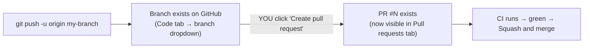
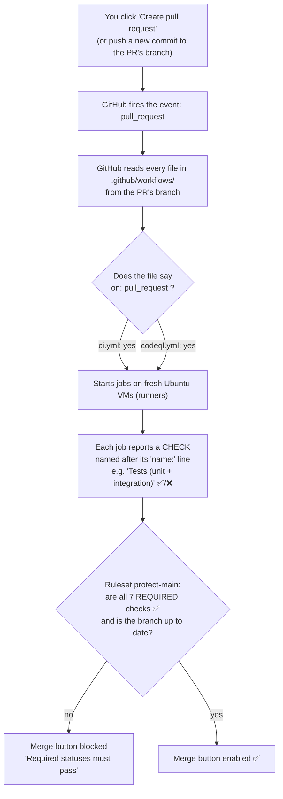

# Questions & Answers from the Journey

The questions asked while building this project, and the answers, kept here so nothing lives only in a chat.
Newest at the bottom. Terms: see the [glossary](glossary.md).

---

## Q1. Do I need Azure (or any paid cloud) to learn DevOps?

**No.** Kubernetes, Terraform, Ansible, Helm, CI/CD and monitoring can all be learned **free, on a laptop**.
AKS/EKS/GKE are "just Kubernetes"; once you master Kubernetes locally, moving to a cloud mostly means
learning how that cloud *creates* the cluster and its networking.

| Need | Free local replacement | Paid cloud equivalent |
|---|---|---|
| Kubernetes | **kind** (or minikube, k3d) | AKS / EKS / GKE |
| Infrastructure as Code | Terraform with `kind`, `kubernetes`, `helm`, `docker` providers; **LocalStack** for AWS-like APIs | Terraform → Azure |
| VMs for Ansible | **Multipass** (uses Hyper-V) | Azure VMs |
| Container registry | **GHCR** | ACR |
| CI/CD | **GitHub Actions** + **ArgoCD** | Azure DevOps |
| Monitoring | **Prometheus + Grafana + Loki** | Azure Monitor |

Free real-cloud options for later: **Oracle Cloud Always Free** (ARM VMs up to ~4 cores/24 GB, VCN,
load balancer), and an **Azure free trial** (see Q3).

---

## Q2. Is "cloud" only ~10% of DevOps?

**No, that was too small.** The *Kubernetes/CI/IaC skills* you practice locally transfer almost
entirely (~80–90%) to the cloud. But in **DevOps/Cloud Engineer jobs**, cloud-specific work is often
**30–50%** of the role.

| Learnable locally, transfers to cloud | Cloud-specific (needs a real cloud) |
|---|---|
| Linux, shell, Git | **Networking**: VNet/VPC, subnets, NSG/security groups, load balancers, DNS, private endpoints, peering |
| Docker / containers | **IAM / identity**: roles, service principals, managed identities, least privilege |
| Kubernetes, Helm | **Managed services**: Azure SQL/RDS, Blob/S3, Key Vault, queues |
| Terraform (thinking, state, modules) | **Cost management**: budgets, alerts, right-sizing |
| Ansible, CI/CD, monitoring | **Security & governance**: policies, audit logs, subscription structure |

**Strategy:** build the foundation locally (Phases 0–7), then do cloud seriously in Phase 8.
Read **AZ-900 → AZ-104** material on Microsoft Learn (free) in parallel.

---

## Q3. Azure free trial: when should I sign up?

**Not now; right before Phase 8.** Official terms (checked Nov 2026):
- **$200 credit, usable only within the first 30 days** after sign-up; unused credit expires.
- Needs a phone number + credit/debit card (non-prepaid) for verification; card isn't charged except a temporary authorization hold.
- There's a spending limit; when the 30 days end or the credit runs out, it stops unless **you** upgrade to pay-as-you-go.
- **One free account per eligible customer**; 12-month free services only for new customers who never had an Azure account.
- Free-trial vCPU quota is limited: enough for a small AKS (1–2 nodes).

If you sign up today, the 30 days expire while you're still doing local phases. So: finish Phases 0–7,
**prepare the Azure Terraform code in advance**, then sign up and run a focused **30-day sprint**
(VNet, AKS, ACR, Key Vault, budget alert), and `terraform destroy` at the end.
You fill in the sign-up form yourself (card and phone details).

---

## Q4. How does the "local system" fit together?

Your laptop becomes a mini data center:

```
┌──────────────────────── LAPTOP (Windows 11) ─────────────────────────┐
│  VS Code / browser  ←── code, open Grafana / ArgoCD / the app        │
│  ┌───────────────── WSL2 Ubuntu (Linux) ─────────────────────────┐   │
│  │  you work here: git, terraform, kubectl, helm, ansible        │   │
│  └───────────────────────────────┬───────────────────────────────┘   │
│  ┌───────────────── Docker Desktop (disk on D:) ─────────────────┐   │
│  │  kind cluster = 3 containers acting as nodes                  │   │
│  │  [control-plane] [worker 1: app, argo] [worker 2: db, grafana]│   │
│  └───────────────────────────────────────────────────────────────┘   │
│  ┌───────── Hyper-V / Multipass (Phase 5 only) ──────────────────┐   │
│  │  VM-1 Ubuntu   VM-2 Ubuntu   VM-3 Ubuntu  ← "real servers"    │   │
│  └───────────────────────────────────────────────────────────────┘   │
└──────────────────────────────────────────────────────────────────────┘
        ▲ ArgoCD pulls config + images          │ git push
        │                                       ▼
   GitHub repo → GitHub Actions (CI) → GHCR (images)       (internet, free)
```

**Final flow (after Phase 7):** you push code → CI tests, builds, scans, pushes the image to GHCR and
updates the image tag in Git → ArgoCD sees the change and deploys to kind → Prometheus/Grafana watch it
→ you open `http://localhost`. Daily use: `kind create cluster` / `terraform apply` to start,
`kind delete cluster` / `terraform destroy` to clean up. Everything is code, so a broken cluster is rebuilt in minutes.

---

## Q5. Which free VM tool for Ansible practice?

**Multipass** (by Canonical, free). On Windows 11 Pro it uses **Hyper-V**, which coexists with WSL2 and Docker.

| Tool | Verdict | Why |
|---|---|---|
| **Multipass** | ✅ chosen | one command per Ubuntu VM, supports **cloud-init** (same as cloud VMs), light |
| Hyper-V Manager | backup | built in, but manual GUI + OS install |
| VirtualBox + Vagrant | ❌ | conflicts / slow alongside WSL2 + Docker |
| VMware Workstation Pro | ❌ | free for personal use, but heavy for this |

```bash
multipass launch 22.04 --name node1 --cpus 2 --memory 2G --disk 10G --cloud-init cloud-init.yaml
multipass list           # VMs + IPs
multipass shell node1    # log in
multipass stop --all / delete --all / purge
```

3 VMs × 2 GB = 6 GB RAM (fine with 31 GB). Storage will be redirected to D:. Installed in Phase 5.

---

## Q6. What is kind?

**kind = Kubernetes IN Docker.** Each Kubernetes **node** runs as a **Docker container** (instead of a VM),
with the real Kubernetes components inside. `kubectl` can't tell the difference: the same YAML and Helm
charts work on AKS.

```yaml
# kind-config.yaml
kind: Cluster
apiVersion: kind.x-k8s.io/v1alpha4
nodes:
  - role: control-plane
    extraPortMappings: [{ containerPort: 80, hostPort: 80 }]
  - role: worker
  - role: worker
```

| Tool | How | Note |
|---|---|---|
| **kind** ✅ | node = Docker container | easy multi-node, "vanilla" Kubernetes, Terraform provider, used in CI |
| minikube | usually 1 node (VM or container) | single-node focus, many minikube-specific add-ons |
| k3d | like kind, but runs k3s | we'll learn k3s directly on VMs in Phase 5 |
| AKS/EKS/GKE | node = cloud VM | production, paid |

Limits: not for production; `LoadBalancer` services get no IP by default (we use Ingress + port mapping);
data is gone when the cluster is deleted; node images are ~1 GB (one reason Docker moved to D:).

---

## Q7. Will ArgoCD sync automatically or manually?

**Both, in that order** (Phase 6):
1. **Manual first**, to learn: push → app shows **OutOfSync** → read the diff → click **Sync**.
2. **Then automatic**, with two switches:
   ```yaml
   syncPolicy:
     automated:
       prune: true      # deleted from Git → deleted from the cluster
       selfHeal: true   # changed by hand in the cluster → reverted to match Git
   ```
3. A **drift experiment**: `kubectl scale` by hand, watch `selfHeal` undo it.
4. **dev** = auto-sync on every merge; **prod** = also auto-sync, but changes only enter prod's folder via a
   **PR you approve**. In real GitOps the human gate is the **PR merge**, not the Sync button.

Locally, GitHub can't send webhooks to your laptop, so ArgoCD **polls Git every ~3 minutes**.

---

## Q8. With auto-sync, what tests protect production?

Whatever is merged goes live, so the checks run **before** the merge, in layers:

| Layer | Checks | Phase |
|---|---|---|
| ① PR / CI | lint · unit tests · integration tests (real DB) · gitleaks · dependency scan · CodeQL · hadolint · image scan · K8s manifest checks (`helm lint`, `kubeconform`, `kube-linter`) · Terraform checks · ansible-lint · **test deploy to a throwaway kind cluster in CI + smoke tests** | 2, 3, 4, 5, 6 |
| ② Deploy | readiness/liveness probes · rolling update with `maxUnavailable: 0` (a bad version gets stuck, old pods keep serving) · resource limits · ArgoCD PreSync (migrations) and PostSync (smoke test) hooks | 3, 6 |
| ③ After deploy | alerts on errors/latency/restarts · synthetic checks (blackbox-exporter) · rollback = `git revert` · *(stretch)* Argo Rollouts canary with automatic rollback | 7 |

Two principles: **shift left** (catch problems as early as possible) and **fail fast** (cheap checks first).
**Branch protection** (Phase 2, done) is what makes this a gate instead of advice.

---

## Q9. Will we use Helm?

**Yes, from Phase 3**, in two ways:
1. **Packaging our own app**: templates + `values-dev.yaml` / `values-prod.yaml`, so one chart serves every environment.
   We write **plain YAML first** (to learn each Kubernetes object), then convert it, and use `helm template` to see what Helm generates.
2. **Installing other software**: ingress-nginx (3), ArgoCD (6), kube-prometheus-stack + Loki (7), Sealed/External Secrets + cert-manager (8).

Helm connects to everything: CI validates the chart (`helm lint`, schema checks, test install),
Terraform's `helm` provider installs platform pieces (4), ArgoCD renders the chart per environment (6).
We'll also compare Helm with **Kustomize** in Phase 3.

---

## Q10. Are the database and the API built by DevOps or by developers?

**Mostly developers.** In a real company you wouldn't write the Task API; it was written here because
DevOps needs a realistic workload.

| Area | Usually owned by |
|---|---|
| Business logic, endpoints, validation, DB schema + migration files, tests | 👩‍💻 Developers |
| The database **server** (provisioning, sizing, backups, HA, network access, upgrades) | 🛠️ DevOps / Platform (sometimes a DBA) |
| Secrets and config delivery (Key Vault, K8s Secrets) | 🛠️ DevOps |
| *When/how* migrations run (Job, PreSync hook) | 🛠️ DevOps (devs write them) |
| Pipelines, deployment, monitoring, alerts | 🛠️ DevOps / SRE |
| Dockerfile, compose, `/health` + `/ready`, log format, metrics | 🤝 **Shared**: DevOps sets the requirements and reviews |

As a DevOps engineer you should **read** the app well enough to know its contract (port 8000, `APP_*` env
vars, `/health`, `/ready`, needs PostgreSQL, `alembic upgrade head`), containerize it well, and debug it.
You don't need to write FastAPI from scratch. In startups the lines blur ("you build it, you run it").

---

## Q11. I followed the steps but didn't really understand them. What now?

That's normal; following along and understanding are different things. Everything is written down so you can
re-learn it at your own pace:
1. Start with [git-github-basics.md](git-github-basics.md) and the [glossary](glossary.md).
2. Re-read each phase guide, **running every command yourself** and comparing outputs.
3. Do each phase's **"Redo-it-yourself checklist"** and the exercises in the Git guide.
4. Ask about anything unclear; the answer gets added to the docs (like this file).

---

## Q12. Claude says it added a new section, but I don't see it on GitHub. Why?

Because the change is on a **branch**, not on `main` yet. GitHub shows `main` by default.
Real case: Steps 2.13/2.14 were pushed to `docs/pr-workflow`, but **no PR had been created**, so `main` didn't have them.

| Where you look | Shows the new section? |
|---|---|
| GitHub repo page (default = `main`) | ❌ until the PR is merged |
| GitHub with the branch selected | ✅ |
| Your laptop folder | ✅ only if your folder is switched to that branch (`git branch --show-current`) |

**How to see a branch on GitHub:** on the repo's **Code** tab, click the branch dropdown (it says `main`,
top-left above the file list) → pick the branch. Or open a URL with the branch name in it:
`https://github.com/<you>/<repo>/blob/<branch>/docs/02-ci.md`

**How to get it into `main`:** create the PR (the link printed by `git push`, or `/pull/new/<branch>`),
wait for green, **Squash and merge**. See [02-ci.md Step 2.13](02-ci.md#step-213-working-with-pull-requests-day-to-day-)
and [git-github-basics.md §4–6](git-github-basics.md).

**Check from the terminal** whether `main` on GitHub already has something:

```bash
curl -s https://raw.githubusercontent.com/<you>/<repo>/main/docs/02-ci.md | grep "^## Step 2.13"
```
No output = not on `main` yet.

---

## Q13. I opened the "Pull requests" tab and my branch isn't there. Why?

Because **pushing a branch does NOT create a pull request.** The *Pull requests* tab only lists PRs that
someone has **created**. A pushed branch with no PR is just a branch: it's on GitHub, but it isn't in that list.
Real case: `docs/github-handbook` was pushed, but the list showed only Dependabot's PR #1.



| What you did | Branch on GitHub? | In *Pull requests* tab? |
|---|---|---|
| `git push -u origin my-branch` | ✅ | ❌ |
| Opened `/pull/new/my-branch` (the compare page) | ✅ | ❌ still a preview, no `#number` |
| Clicked the green **Create pull request** button | ✅ | ✅ gets a `#number` |

**How to create it** (any of these):
1. Open `https://github.com/<you>/<repo>/pull/new/<branch>` → fill the title → click **Create pull request**.
2. Or: repo page → yellow banner *"my-branch had recent pushes"* → **Compare & pull request** → **Create pull request**.
3. Or: *Pull requests* tab → **New pull request** → set **base: `main`**, **compare: `my-branch`** → **Create pull request**.

**Check from the terminal:**

```bash
git ls-remote --heads origin my-branch     # prints a line → the branch IS on GitHub
curl -s "https://api.github.com/repos/<you>/<repo>/pulls?head=<you>:my-branch" | grep '"number"'
                                            # prints nothing → no PR yet
```

### ⚠️ The opposite trap: pushing to a branch whose PR is ALREADY merged

Real case (PR #5): the PR was squash-merged and its branch deleted. A few minutes later one more commit (FAQ Q14)
was pushed to the same branch name. What happened:

1. `git push` silently **re-created** the deleted branch on GitHub, with the new commit on it.
2. The merged PR #5 does **not** pick up the new commit: a merged PR is closed forever, and the squash commit on
   `main` contains only what was in the PR at merge time.
3. So Q14 sat on a forgotten branch, not on `main`. The hint was in the push output: `Create a pull request for
   'docs/github-handbook'`. If a PR were still open, GitHub wouldn't suggest creating one.

**Fix:** start a fresh branch from the updated `main` and copy just that commit over:

```bash
git switch main && git pull --ff-only          # main now includes the squash of PR #5
git switch -c docs/faq-q14                     # new branch, new name
git cherry-pick 67dbb82                        # copy the stranded commit (hash from `git log docs/github-handbook`)
git push -u origin docs/faq-q14                # → create a NEW PR (#6)
```

**Rule:** after a PR is merged, never push to its branch again. Every new change gets a **new branch from the
updated `main`**. (Reusing the old branch also causes fake conflicts, because squash merging gives `main` a new
commit that Git doesn't see as the same as the branch's commits.) Then delete the leftover branch on GitHub:
*Code* tab → branch dropdown → **View all branches** → 🗑️ next to it.

---

## Q14. When I open a PR, CI runs a bunch of checks automatically. Where is that set up, and how do I change it?

**Short answer:** two separate pieces work together. Neither one is "magic"; you can open both.

| Piece | Where it lives | What it decides | Who changes it |
|---|---|---|---|
| **① Workflow files** | In the repo: `.github/workflows/ci.yml`, `codeql.yml` | **WHAT** runs and **WHEN** (which jobs, which commands, on which events) | Anyone, via a PR (it's code) |
| **② Ruleset** `protect-main` | GitHub **Settings → Rules → Rulesets** (not in the repo) | **WHICH** of those checks must be ✅ before the Merge button works | Repo admin (you), by clicking |

Without ①, nothing runs. Without ②, checks still run, but a red ❌ is only *advice*: you could still click Merge.

### How it flows when you open a PR



### Piece ①: the workflow file (what runs, and when)

The top of `.github/workflows/ci.yml`, with comments added:

```yaml
name: CI                     # the workflow's name (shown in the Actions tab)

on:                          # WHEN: the events that start this workflow
  pull_request:              #  → every PR opened / every new commit pushed to a PR   ← this is why CI runs on your PR
  push:
    branches: [main]         #  → every push to main (= every merge); this run also publishes the image
  workflow_dispatch:         #  → a manual "Run workflow" button in the Actions tab

jobs:                        # WHAT: each job = one check on the PR
  lint:                      # job id (used in 'needs:')
    name: Lint (ruff + hadolint)   # ← THIS text is the check name you see on the PR and in the ruleset
    runs-on: ubuntu-24.04          # a fresh virtual machine from GitHub, deleted afterwards
    steps:
      - uses: actions/checkout@<sha>               # download the PR's code onto the VM
      - run: ruff check --output-format=github .   # the actual command; exit code ≠ 0 → check ❌
  test:
    name: Tests (unit + integration)
    needs: lint              # order: only starts after lint is green
    ...
```

**The one rule that decides ✅ or ❌:** every `run:` line is a shell command. Exit code `0` = pass; any other exit
code = the step fails → the job fails → that check is ❌ on the PR. Tools like ruff, pytest, gitleaks and Trivy are
"checks" simply because they exit with an error when they find a problem.

Our current checks and where each one comes from:

| Check name on the PR | File → job id | What it checks | Phase 2 step |
|---|---|---|---|
| `Lint (ruff + hadolint)` | ci.yml → `lint` | Python style/bugs, Dockerfile best practices | 2.2, 2.3 |
| `Secret scan (gitleaks)` | ci.yml → `secrets` | Passwords/keys in any commit, whole history | 2.4 |
| `Dependency scan (Trivy fs)` | ci.yml → `dependency-scan` | Known CVEs in `requirements*.txt` | 2.5 |
| `Tests (unit + integration)` | ci.yml → `test` | 12 pytest tests against a real PostgreSQL | 2.7 |
| `Build, scan & publish image` | ci.yml → `build` | Image builds; Trivy finds no fixable HIGH/CRITICAL; pushes to GHCR **only on main** | 2.5, 2.7 |
| `Analyze (python)` | codeql.yml → `analyze` (matrix) | SAST: SQL injection etc. in app code | 2.8 |
| `Analyze (actions)` | codeql.yml → `analyze` (matrix) | Insecure workflow files | 2.8 |

> Dependabot (`.github/dependabot.yml`) is **not** a check. It's a robot that *opens* PRs (like #1), and those PRs
> then go through the same checks.

### Piece ②: the ruleset (which checks are required)

Click path: repo → **Settings** → left sidebar *Code and automation* → **Rules → Rulesets** → `protect-main` →
**Require status checks to pass** → the list of 7 names. Full setup: [02-ci.md Step 2.11](02-ci.md#step-211--branch-protection-with-a-ruleset-).

The ruleset only knows check **names** (plain text). It doesn't know what a check does; it just waits until a check
with exactly that name reports ✅.

### Recipe: adding a NEW check (example: lint the shell scripts with ShellCheck)

*Example only, not added to this project yet.*

1. Branch: `git switch -c ci/shellcheck`
2. Add a job to `.github/workflows/ci.yml` under `jobs:`:
   ```yaml
     shellcheck:
       name: ShellCheck (scripts)
       runs-on: ubuntu-24.04
       steps:
         - uses: actions/checkout@3d3c42e5aac5ba805825da76410c181273ba90b1 # v7.0.1
         - run: docker run --rm -v "$PWD:/mnt" -w /mnt koalaman/shellcheck:v0.10.0 scripts/*.sh
   ```
   (Optional: add `shellcheck` to `build`'s `needs:` if the image build should wait for it.)
3. Try the same command locally first (inside WSL), then commit, push, and **create the PR**.
4. The PR now shows an **8th** check, `ShellCheck (scripts)`. It runs, but it's **not required** yet: even if it's ❌,
   you could still merge.
5. Merge the PR once green.
6. Make it required: Settings → Rules → Rulesets → `protect-main` → *Require status checks* → **Add checks** →
   type `ShellCheck` → select it → **Save changes**. (A check only shows up in that search after it has run at least
   once in the last 7 days. That's why steps 3–5 come first.)
7. Verify:
   ```bash
   curl -s https://api.github.com/repos/valinfernanda/devops-project/rules/branches/main | grep -o '"context": *"[^"]*"'
   ```

### Changing or removing a check

| You want to… | Do this | Watch out |
|---|---|---|
| Change what a check does | Edit the job's `steps:` in a PR | The edit itself must pass CI to merge |
| **Rename** a check | Change `name:` **and** update the ruleset to the new name | ⚠️ If you forget the ruleset, every PR waits forever: *"Expected — Waiting for status to be reported"* |
| Remove a check | Remove it from the ruleset **first**, then delete the job | Same "waiting forever" trap if you do it the other way round |
| Run a check only when some files change | `on: pull_request: paths: ['app/**']` | ⚠️ If that check is **required** and a PR doesn't touch `app/`, it never runs → the PR is stuck. Don't put `paths:` on required checks |
| Run CI by hand | Actions tab → **CI** → **Run workflow** (thanks to `workflow_dispatch`) | — |

### See which checks ran on a commit, from the terminal

```bash
curl -s https://api.github.com/repos/valinfernanda/devops-project/commits/0e03036/check-runs \
  | grep -E '^      "(name|conclusion)"' | paste - -
```

Real output (main commit `0e03036`, duplicates removed):

```
      "name": "Analyze (actions)",            "conclusion": "success",
      "name": "Analyze (python)",             "conclusion": "success",
      "name": "Build, scan & publish image",  "conclusion": "success",
      "name": "Tests (unit + integration)",   "conclusion": "success",
      "name": "Dependency scan (Trivy fs)",   "conclusion": "success",
      "name": "Lint (ruff + hadolint)",       "conclusion": "success",
      "name": "Secret scan (gitleaks)",       "conclusion": "success",
```

And the 7 names the ruleset requires (same names, matched as text):

```bash
curl -s https://api.github.com/repos/valinfernanda/devops-project/rules/branches/main | grep -o '"context": *"[^"]*"'
```
```
"context": "Lint (ruff + hadolint)"
"context": "Secret scan (gitleaks)"
"context": "Dependency scan (Trivy fs)"
"context": "Tests (unit + integration)"
"context": "Build, scan & publish image"
"context": "Analyze (python)"
"context": "Analyze (actions)"
```

### Who does this in a real team?

Writing the workflows, choosing the tools, pinning versions and maintaining the ruleset is **DevOps / platform**
work. Programmers mostly *use* it: they open PRs, read why a check is red ([02-ci.md Step 2.14](02-ci.md#step-214-reading-ci-results-where-to-click-when-something-is-red-)),
fix it, and push again. Programmers also write **tests** (new pytest files), and the existing `test` job picks
them up automatically, so adding a test needs no workflow change.
