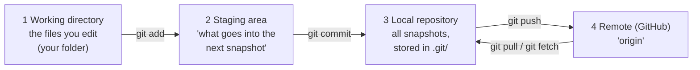
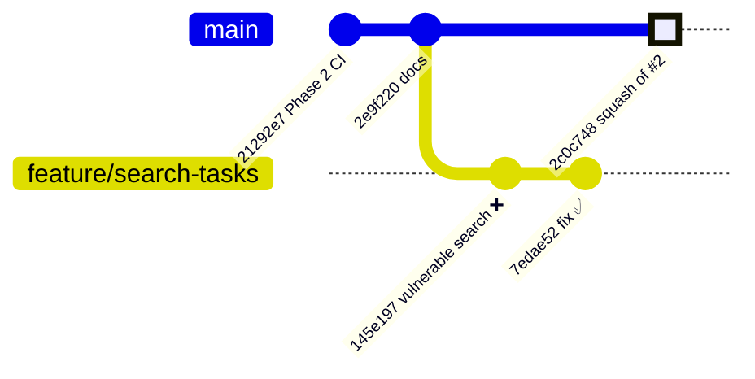
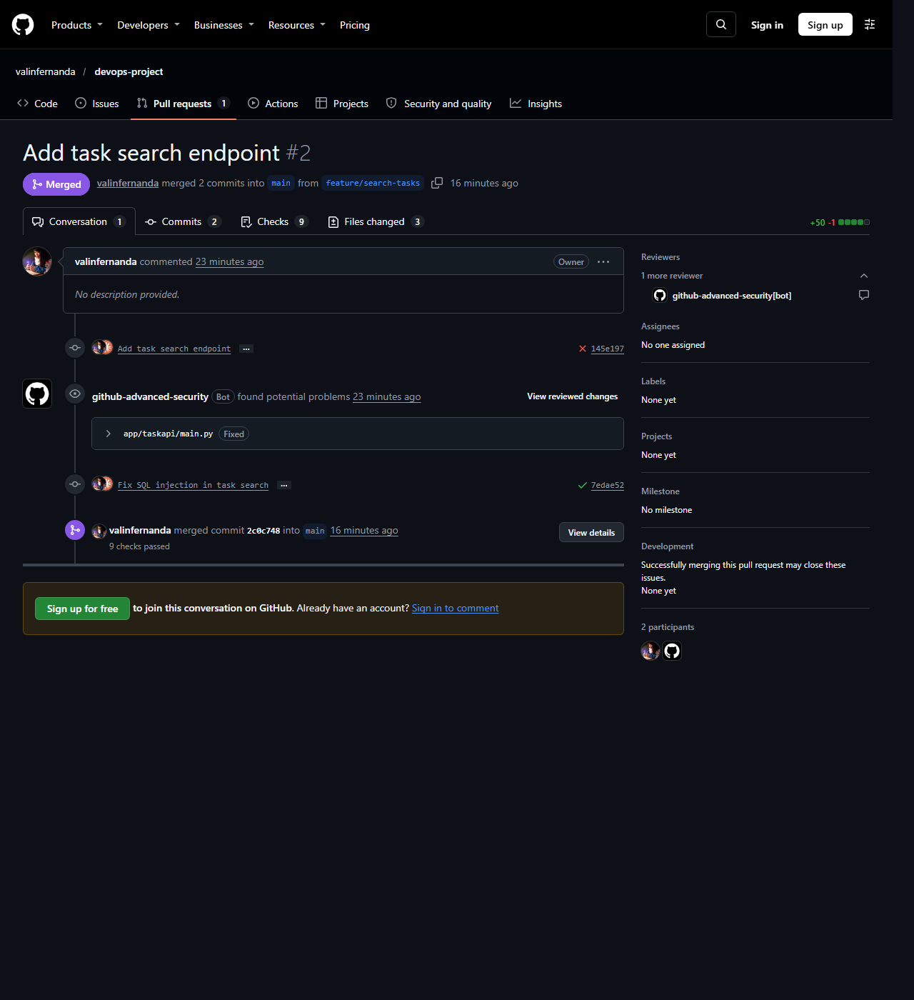

# Git & GitHub Basics: From Zero

> 🎯 **Objective:** understand what Git and GitHub actually do, so every step in this project
> (commits, branches, pushes, pull requests, merges, protected branches) makes sense, not just "type this".
>
> **Read this before Phase 2's PR steps.** Every command here is one we really used in this project.
>
> **Next:** [github-handbook.md](github-handbook.md): real outputs (fetch vs pull, conflicts, undo), every GitHub feature, programmer + DevOps cases.

---

## 1. What problem does Git solve?

Without Git, a project folder only has **one** version: the current one. You can't see what changed
yesterday, can't undo safely, and two people editing the same files overwrite each other.

**Git** = a tool that records **snapshots** of your project over time.
**GitHub** = a website that stores a copy of your Git project online, and adds collaboration
features: pull requests, CI (Actions), the container registry (GHCR), security scanning.

| | Git | GitHub |
|---|---|---|
| What | A program on your laptop | A website / service |
| Works offline? | Yes | No |
| Main job | History of your files | Sharing + collaboration + automation |
| In this project | `git commit`, `git push`… | Repo page, PRs, Actions, GHCR, rulesets |

---

## 2. The mental model: four places your code lives



1. **Working directory**: your normal folder. Editing a file changes only this.
2. **Staging area**: a "shopping basket" for the next snapshot. `git add` puts changes in it.
3. **Local repository**: the history, hidden in the `.git/` folder. `git commit` saves the basket as a snapshot.
4. **Remote**: the copy on GitHub. By convention it's named **`origin`**. `git push` uploads, `git pull` downloads.

> 💡 Why a staging area? So you can commit **some** changes and leave others for later.
> Example: you fixed a bug *and* started a new feature; commit only the bug fix.

---

## 3. Commits: snapshots with an ID

A **commit** = one snapshot of the whole project + a message + author + time + a pointer to the previous commit.

Each commit has an ID called a **hash** or **SHA**: 40 hex characters, usually shown shortened to 7:

```
2c0c748 Add task search endpoint (#2)          ← commit 2c0c748 …
2e9f220 docs: Phase 2 first CI run results...  ← … came after 2e9f220 …
21292e7 Phase 2: CI pipeline with GitHub Actions
```

The same SHA appears everywhere in this project:
- Image tag `ghcr.io/valinfernanda/taskapi:sha-2c0c748` = "built from commit 2c0c748"
- Actions pinned by SHA: `actions/checkout@3d3c42e5…` = "exactly this commit of that action"

A commit can never change: changing anything would produce a different SHA. That's why SHAs are trustworthy.

**Good commit messages** say *what* and *why*: `Fix SQL injection in task search`, not `update` or `fix stuff`.

---

## 4. Branches: parallel lines of work

A **branch** is a movable label pointing at a commit. `main` is the main line. Creating a branch lets
you work on something **without touching `main`** until it's ready.



This is exactly what happened with PR #2:
1. `main` was at `2e9f220`.
2. We created `feature/search-tasks` and made two commits there (❌ vulnerable, ✅ fix).
3. When merged with **squash**, both became **one new commit** `2c0c748` on `main`.

**HEAD** = "where I am right now" (which branch/commit your folder shows).

---

## 5. Remote: your laptop ↔ GitHub

| Command | Direction | What it does |
|---|---|---|
| `git push` | laptop → GitHub | upload your new commits |
| `git fetch` | GitHub → laptop | download news (new commits/branches) **without** changing your files |
| `git pull` | GitHub → laptop | `fetch` + update your current branch |
| `git clone <url>` | GitHub → laptop | first-time copy of a repo |

`origin/main` = "the last known state of GitHub's `main`" on your laptop. It updates when you fetch/pull.

---

## 6. Pull requests (PRs): "please merge my branch"

A **pull request** is a GitHub feature (not Git itself) that says: *"I have changes on branch X;
please review them and merge them into `main`."*

A PR is the place where:
- you (or teammates) **review** the diff,
- **CI runs automatically** and reports ✅/❌ for every check,
- the **ruleset** decides whether merging is allowed,
- discussion and history are kept forever (PR #2 shows the vulnerable commit, the CodeQL finding, and the fix).



**The tabs on a PR page:**

| Tab | Shows |
|---|---|
| **Conversation** | timeline: commits, bot findings, comments, the merge box at the bottom |
| **Commits** | the list of commits in the branch |
| **Checks** | every CI check with logs (Step 2.14 in [02-ci.md](02-ci.md)) |
| **Files changed** | the diff; CI **annotations** appear on the exact lines |

The exact clicks to open, wait for, and merge a PR: **[02-ci.md, Step 2.13](02-ci.md#step-213-working-with-pull-requests-day-to-day-)**.

---

## 7. Merging: three ways

| Strategy | Result on `main` | We use it? |
|---|---|---|
| **Merge commit** | all branch commits + one extra "merge" commit | no |
| **Squash and merge** | **one** new commit containing all changes | ✅ **yes**: clean history, no "WIP"/"oops" commits on `main` |
| **Rebase and merge** | branch commits replayed one by one on top of `main` | no |

**Fast-forward**: if `main` hasn't moved since your branch started, Git can just slide the `main` label
forward. `git pull --ff-only` means "only update if it's a simple fast-forward; otherwise stop and tell me".

---

## 8. Protected branches: why `git push` to main fails now

Since Step 2.11, `main` has a **ruleset** (`protect-main`). If you try:

```bash
git switch main
git commit --allow-empty -m "test"
git push
```

GitHub refuses with something like:

```
remote: error: GH013: Repository rule violations found for refs/heads/main.
remote: - Changes must be made through a pull request.
remote: - Required status checks are expected.
 ! [remote rejected] main -> main (push declined due to repository rule violations)
```

That's the **goal**, not a bug. Every change must go: **branch → PR → green checks → merge**.
(Undo that local test commit with `git reset --hard origin/main`: it throws away local commits that aren't on GitHub.)

---

## 9. Merge conflicts (we haven't hit one yet, but you will)

A **conflict** happens when two branches change **the same lines** of the same file differently.
Git can't guess which version is right, so it asks you.

GitHub shows: *"This branch has conflicts that must be resolved."* Locally it looks like:

```
<<<<<<< HEAD
APP_LOG_LEVEL=info
=======
APP_LOG_LEVEL=debug
>>>>>>> feature/more-logs
```

**How to resolve (locally):**

```bash
git switch feature/more-logs
git pull origin main          # bring main's changes in → conflict appears
# edit the file: keep the right version, delete the <<<<<<< ======= >>>>>>> lines
git add <file>
git commit                    # finishes the merge
git push                      # the PR updates; CI re-runs
```

**Avoid conflicts:** keep branches short-lived, pull `main` often, and make small PRs.

---

## 10. Every Git command used in this project

### Setup (once per machine)

| Command | Meaning |
|---|---|
| `git config --global user.name "valinfernanda"` | your name on every commit (Windows and WSL have **separate** configs) |
| `git config --global user.email "…"` | your email on every commit (use your GitHub email) |
| `git config --global init.defaultBranch main` | new repos start on `main` |

### Creating / connecting a repo

| Command | Meaning |
|---|---|
| `git init -b main` | turn the current folder into a Git repo, first branch `main` |
| `git remote add origin https://github.com/valinfernanda/devops-project.git` | remember GitHub's address under the name `origin` |
| `git remote -v` | show remotes |
| `git push -u origin main` | first upload; `-u` remembers `origin/main` as the default target for later `git push` |

### Everyday

| Command | Meaning |
|---|---|
| `git status` / `git status -sb` | what changed? (`-sb` = short + branch info, e.g. `## main...origin/main`) |
| `git diff` | the exact line changes not yet staged |
| `git add -A` | stage **all** changes (new, modified, deleted) |
| `git add <file>` | stage one file |
| `git commit -m "message"` | save the staged snapshot |
| `git log --oneline -5` | last 5 commits, one line each |

### Branches

| Command | Meaning |
|---|---|
| `git switch -c feature/x` | create branch `feature/x` and move to it |
| `git switch main` | go back to `main` |
| `git branch` / `git branch -a` | list local / all (incl. remote) branches |
| `git push -u origin feature/x` | upload the branch; prints the "Create a pull request" link |
| `git branch -D feature/x` | delete local branch (`-D` needed after a squash merge) |

### Syncing

| Command | Meaning |
|---|---|
| `git pull --ff-only` | update the current branch from GitHub, only if it's a clean fast-forward |
| `git fetch --prune` | download news; forget remote branches deleted on GitHub |
| `git ls-remote origin main` | ask GitHub directly which commit `main` points to |

### Special files

| File | Purpose |
|---|---|
| `.gitignore` | files Git must never track (`.env`, `*.tfstate`, caches…) |
| `.gitattributes` | how Git treats files; ours forces **LF line endings** |

---

## 11. Common errors and what they mean

| Error | Meaning | Fix |
|---|---|---|
| `Please tell me who you are` | name/email not set | `git config --global user.name/user.email` |
| `GH013: Repository rule violations` | pushing to protected `main` | use a branch + PR |
| `! [rejected] … (non-fast-forward)` | GitHub has commits you don't have | `git pull --ff-only` first (or rebase/merge) |
| `fatal: Not possible to fast-forward, aborting.` | your branch and GitHub's diverged | decide: `git pull --rebase` or `git merge origin/main` |
| `error: The branch 'x' is not fully merged.` | after a squash, Git can't see it's merged | `git branch -D x` (capital D) |
| `warning: LF will be replaced by CRLF` | Windows line-ending conversion | harmless with our `.gitattributes` |
| `You are in 'detached HEAD' state` | you checked out a commit, not a branch | `git switch main` (or `git switch -c new-branch` to keep work) |

---

## 12. 🏋️ Practice exercises (do them yourself)

### Exercise 1: your first PR, end to end
1. `git switch main && git pull --ff-only`
2. `git switch -c practice/readme-typo`
3. Edit `README.md`: add one line at the end, e.g. `Practiced my first PR on <date>.`
4. `git status` → see `modified: README.md`. Then `git diff` → see your line with a `+`.
5. `git add README.md && git commit -m "docs: practice PR"`
6. `git push -u origin practice/readme-typo` → copy the link Git prints.
7. Open the link → **Create pull request** → check the page shows a `#number`.
8. Watch the **Checks** go green → **Squash and merge** → **Delete branch**.
9. `git switch main && git pull --ff-only && git log --oneline -3`: your commit is on `main`.

✅ **Expected:** `main` has a new commit ending in `(#N)`.

### Exercise 2: see the protection with your own eyes
1. On `main`: `git commit --allow-empty -m "test direct push"` then `git push`.
2. ✅ **Expected:** the `GH013` rejection from section 8.
3. Clean up: `git reset --hard origin/main`.

### Exercise 3: make CI fail on purpose
1. New branch; in `app/taskapi/main.py` add an unused import line: `import os`.
2. Run `bash scripts/ci-local.sh` → ✅ **Expected:** ruff `F401 'os' imported but unused`.
3. Push anyway, open a PR → see **Lint** ❌ and the merge button locked.
4. Remove the line, push again → green → close the PR without merging (or merge, harmless).

### Exercise 4: create and resolve a conflict
1. Branch A changes line 1 of `.env.example`; merge it via PR.
2. Branch B (created **before** A was merged) changes the same line differently; open a PR.
3. ✅ **Expected:** *"This branch has conflicts"*. Resolve locally with section 9's steps.

---

## 13. One-page cheat sheet

```bash
# start new work
git switch main && git pull --ff-only
git switch -c feature/<name>

# save work
git status
git add -A
git commit -m "<what and why>"

# share work
bash scripts/ci-local.sh
git push -u origin feature/<name>        # then: open PR → green → Squash and merge → Delete branch

# after merge
git switch main && git pull --ff-only && git fetch --prune
git branch -D feature/<name>
```
