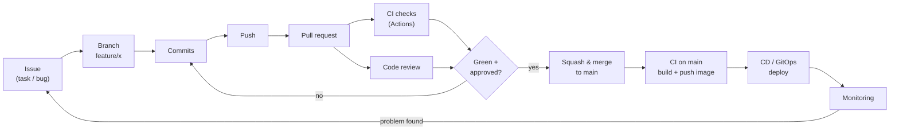
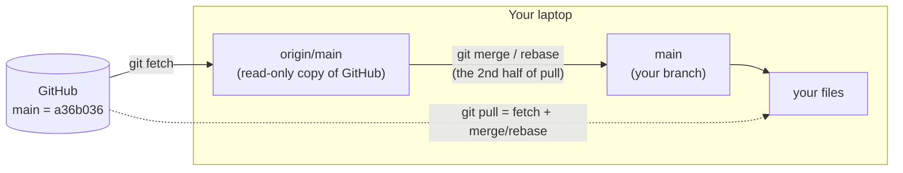
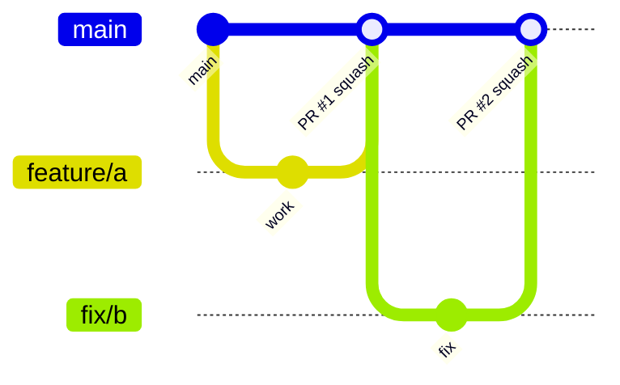
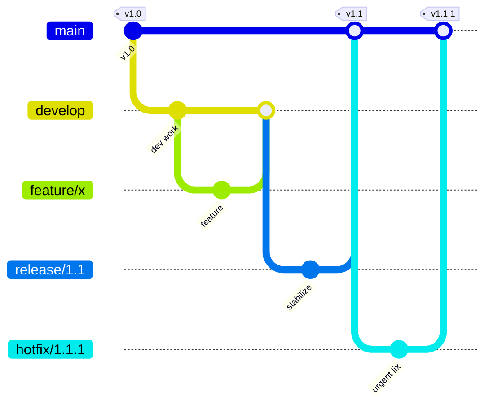
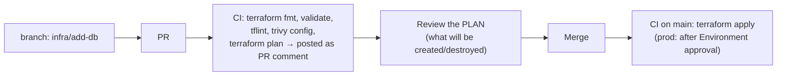

# GitHub Handbook: Git & GitHub for Programmers and DevOps

> 🎯 **Objective:** one place that explains **every Git/GitHub thing you'll use at work**: commands with
> **real outputs**, flow diagrams, every GitHub feature, and **real-life cases** from both the
> programmer side and the DevOps side.
>
> Prerequisite: [git-github-basics.md](git-github-basics.md) (the concepts). Words: [glossary](glossary.md).

**Try every example yourself, safely:**

```bash
bash scripts/git-playground.sh        # all scenarios
bash scripts/git-playground.sh 2      # only scenario 2 (fetch vs pull)
```

The script builds `/tmp/git-playground` with a fake GitHub (`github.git`) and two laptops: **you** and
teammate **alice**. Nothing in this project or on GitHub is touched. Outputs below come from that script
(commit hashes will differ on your run, because they include the time).

---

## Part 1: The big picture



| Stage | Mostly the programmer | Mostly DevOps |
|---|---|---|
| Issue, branch, commits, PR, review | ✅ writes code, opens PR | reviews Dockerfile/CI/infra changes |
| CI checks | fixes failing tests/lint | **builds and maintains the pipeline** |
| Merge rules | follows them | **defines them** (rulesets, CODEOWNERS) |
| Build image, deploy, monitor | watches their feature go live | **owns it** |

---

## Part 2: Git commands with real outputs

### 2.1 The basic cycle: edit → status → diff → add → commit → push

```
you $ git status --short
 M app.txt                         ← M in the 2nd column = modified, NOT staged yet
you $ git diff
@@ -1,2 +1,3 @@
 version=1
 color=blue
+size=large                        ← + added line, - removed line
you $ git add app.txt && git status --short
M  app.txt                         ← M in the 1st column = staged (in the basket)
you $ git commit -q -m "Add size setting" && git log --oneline
771d593 Add size setting
132bf30 Initial commit
you $ git status -sb
## main...origin/main [ahead 1]    ← you have 1 commit GitHub doesn't have
you $ git push -q origin main && git status -sb
## main...origin/main              ← in sync
alice $ git pull -q --ff-only && git log --oneline
771d593 Add size setting           ← alice now has your commit
132bf30 Initial commit
```

---

### 2.2 FETCH vs PULL: the difference, with real output

**The situation:** alice changed `color=blue` → `color=green` and pushed. You haven't done anything yet.

**Step 0: before fetch, your laptop doesn't know anything happened**

```
you $ git status -sb
## main...origin/main              ← says "in sync", but that's only what your laptop LAST knew
you $ cat app.txt
color=blue
```

> ⚠️ `git status` **doesn't ask GitHub**. It compares with the last downloaded copy (`origin/main`).

**Step 1: `git fetch` downloads the news, and changes NOTHING in your files**

```
you $ git fetch origin
From /tmp/git-playground/github
   771d593..a36b036  main       -> origin/main     ← origin/main moved forward
you $ git status -sb
## main...origin/main [behind 1]                    ← NOW it knows: you're 1 commit behind
you $ git log --oneline --graph --all
* a36b036 Change color to green                     ← origin/main is here
* 771d593 Add size setting                          ← your main is still here
* 132bf30 Initial commit
you $ cat app.txt
color=blue                                          ← your file is UNCHANGED
you $ git diff main origin/main                     ← preview what you WOULD get
-color=blue
+color=green
```

**Step 2: `git pull` = fetch + update your branch and your files**

```
you $ git pull --ff-only
Updating 771d593..a36b036
Fast-forward
 app.txt | 2 +-
 1 file changed, 1 insertion(+), 1 deletion(-)
you $ git status -sb
## main...origin/main                               ← in sync for real
you $ cat app.txt
color=green                                         ← file CHANGED
```



| | `git fetch` | `git pull` |
|---|---|---|
| Talks to GitHub? | yes | yes |
| Updates `origin/main`? | yes | yes |
| Changes **your branch**? | **no** | **yes** |
| Changes **your files**? | **no** | **yes** |
| Can cause conflicts? | **never** | yes |
| Use it when | you want to **look first** ("what did others do?") | you're ready to **take** the changes |

**Rule of thumb:** `fetch` = "check the mailbox and read the letters". `pull` = "check the mailbox and immediately do what they say".
Safe habit: `git fetch` → `git status` / `git diff main origin/main` → `git pull --ff-only`.

---

### 2.3 Both of you pushed: push rejected → `pull --ff-only` fails → `pull --rebase`

alice pushed `Add docs`; meanwhile you committed `Add license` locally.

```
you $ git push origin main
 ! [rejected]        main -> main (fetch first)
error: failed to push some refs to '/tmp/git-playground/github.git'
hint: Updates were rejected because the remote contains work that you do
hint: not have locally. ...                              ← GitHub has a commit you don't
you $ git pull --ff-only
   a36b036..c7f9a05  main       -> origin/main
fatal: Not possible to fast-forward, aborting.           ← histories diverged; --ff-only refuses to guess
you $ git log --oneline --graph --all
* 3166ac1 Add license            ← yours
| * c7f9a05 Add docs             ← alice's
|/
* a36b036 Change color to green  ← common ancestor
you $ git pull --rebase
Successfully rebased and updated refs/heads/main.
you $ git log --oneline --graph --all
* 0225552 Add license            ← your commit replayed ON TOP of alice's (new hash!)
* c7f9a05 Add docs
* a36b036 Change color to green
you $ git push -q origin main && git status -sb
## main...origin/main            ← accepted
```

| Command | What it does when histories diverged | Result |
|---|---|---|
| `git pull --ff-only` | refuses | nothing changes; you decide |
| `git pull --rebase` | puts **your** commits on top of theirs | straight-line history ✅ (our choice) |
| `git pull` (merge, default) | creates a "Merge branch 'main' of …" commit | extra merge commits, messier history |

> 💡 Set your preference once: `git config --global pull.rebase true`

---

### 2.4 Merge conflict: both changed the same line

alice pushed `version=2`; you (without pulling) changed the same line to `version=1.5` and committed.
`git pull --rebase` stops with a conflict. What you'll see:

```
CONFLICT (content): Merge conflict in app.txt
error: could not apply ... Bump to version 1.5
hint: Resolve all conflicts manually, mark them as resolved with
hint: "git add/rm <conflicted_files>", then run "git rebase --continue".
```

```
$ git status --short
UU app.txt                       ← UU = both modified: conflict
$ cat app.txt
<<<<<<< HEAD
version=2                        ← what's already on main (alice)
=======
version=1.5                      ← your commit
>>>>>>> ... (Bump to version 1.5)
color=green
```

**Resolve:** edit the file to the correct final content (delete the `<<<<<<<`, `=======`, `>>>>>>>` lines), then:

```bash
git add app.txt
git rebase --continue      # (for a merge instead of a rebase: git commit)
git push
```

Gave up? `git rebase --abort` puts everything back as before the pull.
👉 Run `bash scripts/git-playground.sh 4` to see this with real output on your machine.

**On GitHub** a PR with a conflict shows *"This branch has conflicts that must be resolved"*: fix it locally
on the PR's branch (`git switch feature/x && git pull --rebase origin main`, resolve, `git push --force-with-lease`)
or with GitHub's **Resolve conflicts** button for simple cases.

---

### 2.5 Merge commit vs squash vs rebase (same feature branch, 3 results)

Feature branch `feature/search` with two commits: `WIP search`, `fix typo`.

```
(a) MERGE COMMIT                     (b) SQUASH (our choice)          (c) REBASE
*   331cca2 Merge feature/search     * cca2260 Add search (#5)        * 131b56d fix typo
|\                                   * f6d1410 Bump to version 2      * 291df6a WIP search
| * 131b56d fix typo                 * 0225552 Add license            * f6d1410 Bump to version 2
| * 291df6a WIP search                                                * 0225552 Add license
|/
* f6d1410 Bump to version 2
```

| | Merge commit | Squash | Rebase |
|---|---|---|---|
| `main` gets | all commits + a merge commit | **one** commit | all commits, in a line |
| "WIP"/"fix typo" on main? | yes | **no** | yes |
| Easy to revert the whole feature? | yes (revert the merge) | **yes (one commit)** | harder (several commits) |
| Typical for | big long-lived branches | feature PRs ✅ | small clean commit series |

---

### 2.6 Undoing things: restore vs reset vs revert

```
# (a) throw away an UNCOMMITTED change
you $ echo 'oops' >> app.txt && git status --short
 M app.txt
you $ git restore app.txt && git status --short
(clean)

# (b) undo a LOCAL commit that was NOT pushed yet
you $ git log --oneline -2
75a1fa3 Bad local commit
f6d1410 Bump to version 2
you $ git reset --soft HEAD~1 && git log --oneline -1 && git status --short
f6d1410 Bump to version 2          ← the commit is gone...
A  temp.txt                        ← ...but its changes are kept (staged), so you can fix and recommit

# (c) undo a commit that WAS pushed: revert
you $ git log --oneline -2
8b04728 Enable debug               ← already pushed, others may have it
you $ git revert --no-edit HEAD
you $ git log --oneline -3
6d37426 Revert "Enable debug"      ← a NEW commit that does the opposite
8b04728 Enable debug               ← history stays honest
f6d1410 Bump to version 2
```

| Situation | Use | Why |
|---|---|---|
| Uncommitted change in a file | `git restore <file>` | simply discard |
| Staged by mistake | `git restore --staged <file>` | unstage, keep the change |
| Last commit **not pushed**, want to redo it | `git reset --soft HEAD~1` | removes commit, keeps changes |
| Last commit **not pushed**, throw it all away | `git reset --hard HEAD~1` ⚠️ | changes are lost |
| Commit **already pushed / on main** | `git revert <sha>` ✅ | never rewrite shared history |
| Typo in the last commit message (not pushed) | `git commit --amend` | rewrites the last commit |

> 🚫 Never `reset --hard` + `push --force` on a shared branch. Our ruleset blocks force pushes to `main` for this reason.

---

### 2.7 Stash: park unfinished work

```
you $ git status --short
 M app.txt                                         ← half-done work
you $ git stash push -m "half-done feature"
Saved working directory and index state On main: half-done feature
you $ git status --short
(clean: work is parked)                            ← now you can switch branches / fix a bug
you $ git stash list
stash@{0}: On main: half-done feature
you $ git stash pop -q && git status --short
 M app.txt                                         ← work is back
```

---

### 2.8 Tags: marking releases

```
you $ git tag -a v1.0.0 -m "First release" && git push -q origin v1.0.0 && git tag -n
v1.0.0          First release
alice $ git fetch -q --tags && git show --no-patch --format="%h %s" v1.0.0
tag v1.0.0
Tagger: You <you@example.com>
First release
6d37426 Revert "Enable debug"                       ← the commit the tag points to
```

DevOps use: a tag `v1.0.0` triggers a **release pipeline** that publishes `taskapi:1.0.0` + a GitHub Release.

---

### 2.9 Investigating history: who changed what, and when?

```
you $ git log --oneline -- app.txt                 ← every commit that touched this file
6d37426 Revert "Enable debug"
8b04728 Enable debug
f6d1410 Bump to version 2
a36b036 Change color to green
771d593 Add size setting
you $ git blame app.txt                            ← who last changed each LINE
f6d14105 (Alice 2026-11-23 00:45:49 +0100 1) version=2
a36b0364 (Alice 2026-11-23 00:45:49 +0100 2) color=green
771d5937 (You   2026-11-23 00:45:48 +0100 3) size=large
you $ git show --stat --format="%h %an: %s" HEAD~1 ← what a commit changed
8b04728 You: Enable debug
 app.txt | 1 +
```

**`git bisect`** (no demo, but good to know): when "it worked last week, now it's broken", bisect does a
binary search through commits. You mark `good`/`bad`, and Git finds the exact commit that broke it.
`git bisect start` → `git bisect bad` → `git bisect good <old-sha>` → test → repeat → `git bisect reset`.

---

## Part 3: Every GitHub feature, and who uses it

| Feature | What it is | Programmer uses it for | DevOps uses it for | In this project |
|---|---|---|---|---|
| **Repository** | the project's home | code | code + infra + pipelines | ✅ `devops-project` |
| **Branches** | parallel work | features, fixes | infra changes, release branches | ✅ |
| **Pull requests** | propose + review + merge | delivering every change | reviewing Dockerfile/CI/infra changes; GitOps deploys | ✅ PR #2–#4 |
| **Code review** (Approve / Request changes / suggestions) | teammates comment on lines | review each other | require reviews on sensitive files | later (solo now) |
| **Draft PR** | "not ready yet" PR | early feedback, CI runs | same | optional |
| **Issues** | tasks, bugs, ideas | what to work on | incidents, infra tasks, postmortems | optional |
| **Projects** | kanban board over issues/PRs | planning | planning | optional |
| **Labels / Milestones** | categorize, group by release | triage | `dependencies`, `security`, `infra` | Dependabot adds labels |
| **Actions** | CI/CD automation | sees ✅/❌ on PRs | **builds and owns pipelines** | ✅ `ci.yml`, `codeql.yml` |
| **Actions secrets & variables** | encrypted values for workflows | — | registry/cloud credentials, config | Phase 4/8 (Azure creds) |
| **Environments** (dev/prod + required reviewers + wait timers) | gated deployments | — | **manual approval before prod** | Phase 6/8 |
| **Packages (GHCR)** | image/package registry | pulls images | **publishes images** | ✅ `ghcr.io/valinfernanda/taskapi` |
| **Releases** | versioned downloads + notes, on a tag | release notes | release pipeline, changelog | Phase 3+ (`v1.0.0`) |
| **Rulesets / branch protection** | merge rules | follows them | **defines them** | ✅ `protect-main` |
| **CODEOWNERS** | auto-request reviewers per folder | gets review requests | protect `/infra`, `.github/` | later |
| **Dependabot** (alerts + version updates) | dependency bot | merges update PRs | owns update policy | ✅ `dependabot.yml` |
| **Code scanning** (CodeQL, SARIF) | security findings | fixes them | owns tools + policy | ✅ CodeQL + Trivy |
| **Secret scanning + push protection** | blocks pushes containing secrets | protected from mistakes | incident response | enable in Settings → Code security |
| **Webhooks / Apps** | notify other systems on events | — | trigger ArgoCD, Slack, etc. | Phase 6 (polling locally) |
| **Insights** (contributors, traffic, dependency graph) | repo statistics | — | dependency graph, SBOM export | built in |
| **Wiki / Discussions / Pages** | docs, Q&A, static website | docs | runbooks | not used (docs live in `docs/`) |
| **Codespaces** | cloud dev environment | coding in the browser | consistent dev setup | not used |
| **gh CLI** | GitHub from the terminal | `gh pr create`, `gh pr checkout` | `gh run watch`, `gh api` | optional |
| **Templates** (`.github/pull_request_template.md`, issue forms) | pre-filled PR/issue text | consistent PRs | checklists ("did you update docs?") | later |

---

## Part 4: Branching strategies (team workflows)

### GitHub Flow: what we use ✅



One long-lived branch (`main`, always deployable) + short-lived branches + PRs. Simple; ideal with CI/CD.

### Trunk-based development
Like GitHub Flow, but branches live **hours, not days**, and unfinished features hide behind **feature flags**.
Used by teams that deploy many times a day.

### Git Flow (older, heavier)



Branches: `main` (released), `develop` (integration), `feature/*`, `release/*`, `hotfix/*`.
Used for scheduled releases (mobile apps, packaged software). Too heavy for continuous deployment.

| | GitHub Flow ✅ | Trunk-based | Git Flow |
|---|---|---|---|
| Long-lived branches | `main` | `main` | `main` + `develop` |
| Branch lifetime | days | hours | days–weeks |
| Fits | web apps, CI/CD | very frequent deploys | versioned releases |

---

## Part 5: Programmer cases

### P1. New feature, from start to finish
```bash
git switch main && git pull --ff-only
git switch -c feature/task-priority
# code + tests
bash scripts/ci-local.sh
git add -A && git commit -m "Add task priority"
git push -u origin feature/task-priority
```
→ open PR (link from the push output) → CI green → review → **Squash and merge** (edit the title!) → **Delete branch** →
`git switch main && git pull --ff-only && git branch -D feature/task-priority`.

### P2. The reviewer asked for changes
Don't open a new PR. Change the code **on the same branch**, commit, push: the PR updates and CI re-runs.
Reply to each comment ("Fixed in abc123") and click **Resolve conversation**.

### P3. `main` moved while you were working ("This branch is out-of-date")
Our ruleset requires branches to be up to date. Either click **Update branch** on the PR, or locally:
```bash
git switch feature/x
git pull --rebase origin main     # replay your commits on the newest main
git push --force-with-lease       # needed after a rebase; safe: refuses if someone else pushed meanwhile
```

### P4. The PR has a conflict
→ Part 2.4 locally on the feature branch, then `git push --force-with-lease`.

### P5. I committed on `main` locally by accident (not pushed)
```bash
git switch -c feature/oops        # the commit comes along on a new branch
git switch main
git reset --hard origin/main      # main back to GitHub's state
git switch feature/oops           # continue here; push it and open a PR
```
(If you try to push to `main`, our ruleset rejects it anyway: `GH013`.)

### P6. Undo my last commit
- Not pushed → `git reset --soft HEAD~1` (keep changes) or `--hard` (discard).
- Pushed / merged → `git revert <sha>` in a new PR.

### P7. Urgent bug while mid-feature
```bash
git stash push -m "wip feature"
git switch main && git pull --ff-only && git switch -c fix/urgent-bug
# fix, commit, push, PR, merge
git switch feature/x && git stash pop
```

### P8. "Who wrote this line, and why?" / "What broke this?"
`git blame <file>` → `git show <sha>` → open the PR mentioned in the commit title `(#N)` to read the discussion.
For "it broke somewhere in the last 50 commits": `git bisect`.

### P9. I committed a password / API key
**Stop and tell DevOps/security immediately**: case D6. Deleting it in a new commit is **not enough**.

### P10. My PR is huge and reviewers are slow
Split it: one PR per logical change (e.g. "add DB column" → "add API field" → "add UI"). Small PRs merge faster and conflict less.

---

## Part 6: DevOps cases

### D1. CI is red on `main`
Main should always be green. → Actions tab → failing run → annotations/logs (02-ci.md Step 2.14) →
if a recent merge caused it: **revert that PR** (button *Revert* on the merged PR) to restore green fast, then fix properly.

### D2. A flaky test (fails sometimes, passes on re-run)
**Re-run failed jobs** once to unblock, but open an issue: flaky tests teach people to ignore red CI.
Fix the cause (timing, shared state, network).

### D3. Dependabot opened PRs
Read the PR (changelog, version jump) → CI green? → patch/minor bumps of libraries: merge (or enable auto-merge) →
major versions / base image changes: test deliberately, sometimes decline with `@dependabot ignore this major version`
(we did this kind of judgment with Python 3.15 in 02-ci.md Step 2.10).

### D4. Release a version
```bash
git switch main && git pull --ff-only
git tag -a v1.0.0 -m "First stable release"
git push origin v1.0.0
```
→ a release workflow (trigger `on: push: tags: ["v*"]`) builds and pushes `taskapi:1.0.0`, creates a **GitHub Release**
with notes. Deployments pin `1.0.0` or `sha-…`, never `latest`. *(Built in a later phase.)*

### D5. Bad deploy: roll back
With GitOps (Phase 6) the cluster follows Git, so rollback = **revert the commit** that changed the image tag:
PR → merge → ArgoCD syncs the previous version. No manual `kubectl`. Fast, auditable, and the history shows what happened.

### D6. A secret was pushed (incident)
1. **Rotate/revoke the secret first** (it's compromised the moment it was pushed; bots scan GitHub within minutes).
2. Remove it from the code; move it to a secret store (Actions secrets, Key Vault, Kubernetes Secret).
3. If needed, purge it from history (`git filter-repo`) and contact GitHub support for cached views. History rewriting is disruptive, so step 1 is what really protects you.
4. Prevent: `.gitignore`, gitleaks in CI (ours ✅), **push protection** (Settings → Code security).

### D7. Infrastructure change via PR (Terraform, Phase 4/8)

Reviewers review the **plan** ("+ 1 to add, 0 to destroy"), not just the code.

### D8. Protect sensitive folders: CODEOWNERS
`.github/CODEOWNERS`:
```
/.github/   @devops-team
/infra/     @devops-team
/app/       @backend-team
```
With the ruleset option *"Require review from Code Owners"*, a change to `/infra/` can't merge without DevOps approval.

### D9. Manual approval before production: Environments
Settings → **Environments** → `production` → *Required reviewers*, *Wait timer*, *Deployment branches: main only*.
A workflow job with `environment: production` **pauses** until a reviewer clicks **Approve**. Environment-specific secrets
(e.g. prod cloud credentials) are only released to approved jobs.

### D10. Credentials for pipelines
Settings → **Secrets and variables → Actions**. Use `${{ secrets.NAME }}`; GitHub masks them as `***` in logs.
Prefer **OIDC** (short-lived tokens, no stored passwords) for cloud logins: `azure/login` with federated
credentials (Phase 8). Our GHCR push needs none of this: it uses the automatic `GITHUB_TOKEN`.

### D11. Hotfix in production
GitHub Flow: `fix/...` branch from `main` → PR → CI → merge → normal pipeline deploys it. No special branch needed
because `main` is always deployable. (Git Flow teams use `hotfix/*` → merged to `main` and `develop`.)

### D12. Emergency: CI is down but production is broken
Rulesets can list **bypass actors** (e.g. an admin team) for true emergencies. Every bypass is logged.
Use it rarely, and write down why. We kept the bypass list **empty** on purpose.

### D13. Promote dev → prod with GitOps (Phase 6)
The image tag is changed in `values-dev.yaml` automatically by CI → ArgoCD deploys dev →
a PR changes the same tag in `values-prod.yaml` → approval + merge → ArgoCD deploys prod.
**The PR is the deployment approval.**

---

## Part 7: Cheat sheet

```bash
# look before you leap
git fetch && git status -sb && git log --oneline --graph --all -10
git diff main origin/main

# daily
git switch main && git pull --ff-only
git switch -c feature/x
git add -A && git commit -m "what + why"
git push -u origin feature/x

# keep a branch up to date / fix a conflict
git pull --rebase origin main      # resolve → git add → git rebase --continue
git push --force-with-lease        # only on YOUR feature branch, never on main

# undo
git restore <file>                 # discard uncommitted change
git restore --staged <file>        # unstage
git reset --soft HEAD~1            # undo last local commit, keep changes
git revert <sha>                   # undo a pushed commit safely

# park work
git stash push -m "wip" ; git stash list ; git stash pop

# history
git log --oneline -- <file> ; git blame <file> ; git show <sha>

# releases
git tag -a v1.0.0 -m "msg" && git push origin v1.0.0
```
